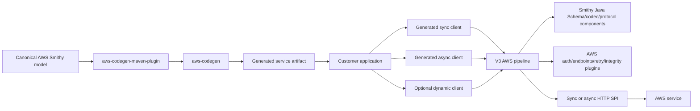
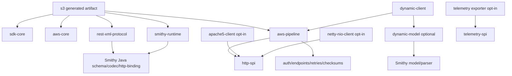
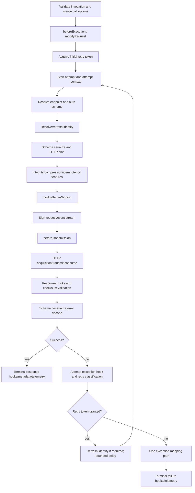
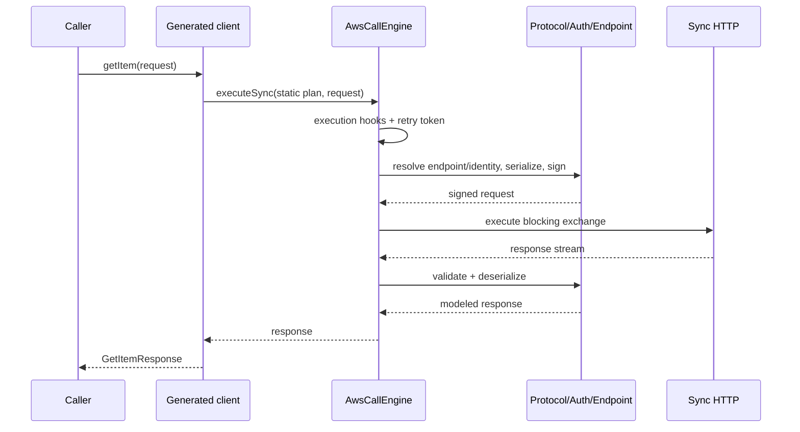
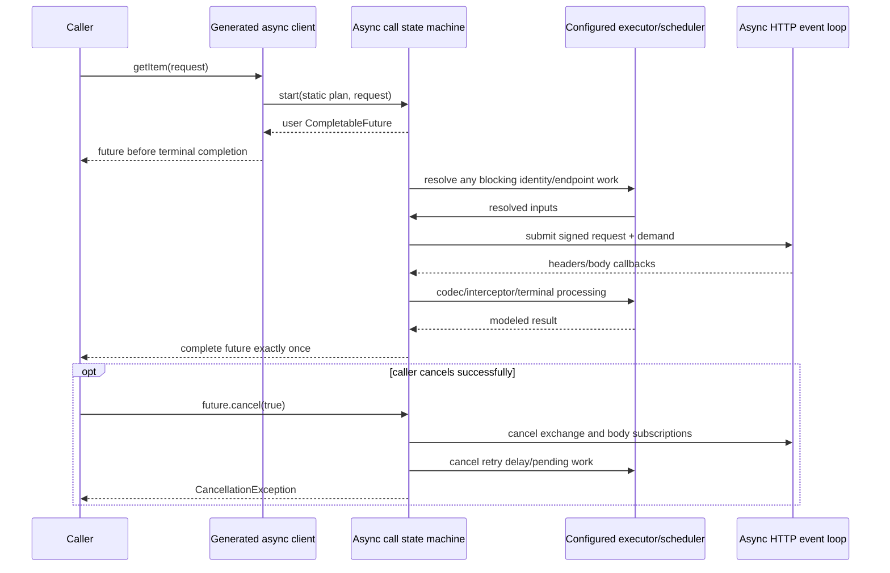
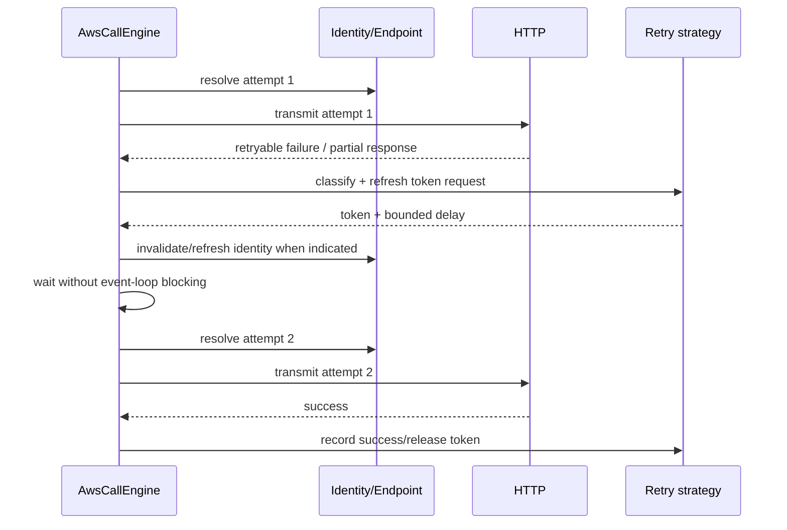
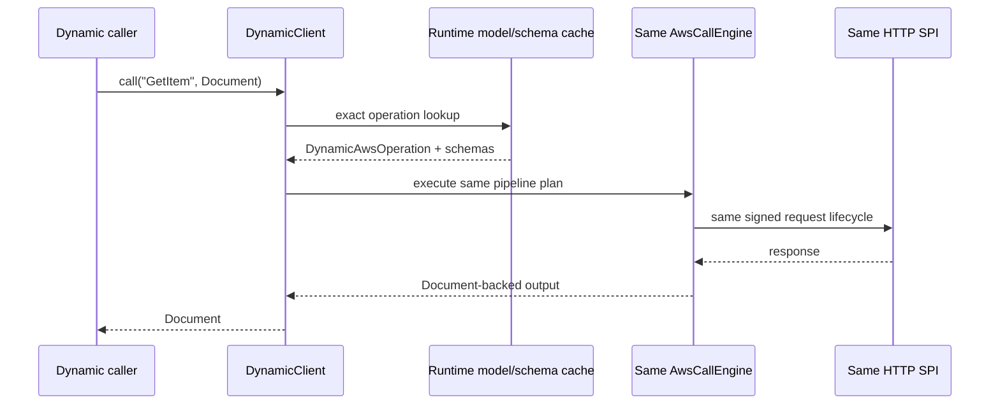
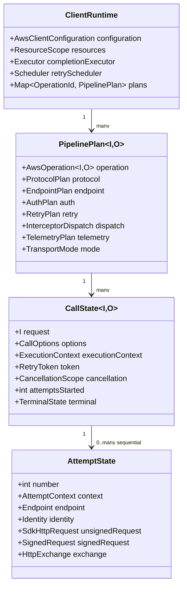

# AWS SDK for Java V3 Design

**Status:** Design for review  
**Workflow:** Requirements first  
**Target:** JDK 21+, Maven, AWS SDK for Java V3  
**Normative input:** [`requirements.md`](./requirements.md)

## Overview

V3 is a new major release whose generated clients retain the familiar AWS SDK for Java programming model while replacing V2's C2J/JavaPoet/intermediate-model/runtime stack with a Smithy-native architecture. Canonical Smithy models are the only semantic input. One AWS-focused code generator emits immutable Java types, Smithy Java `Schema` graphs, `SerializableStruct` implementations, static operation descriptors, typed clients, paginators, waiters, presigners, utilities, and a service `TypeRegistry`. Generated, trimmed, and dynamic calls enter one V3-owned AWS pipeline and share protocol, auth, endpoint, retry, HTTP, interception, telemetry, and error behavior.

The primary public-API decision is **same customer-facing Java package names and service artifact IDs, new 3.x Maven versions, no V2/V3 co-residency guarantee**. For example, V3 S3 remains `software.amazon.awssdk:s3:3.x` and `software.amazon.awssdk.services.s3.S3Client`. This maximizes source migration and allows selected binary-compatible surfaces, but Maven resolves only one major version of an artifact in a dependency graph. Applications that must run V2 and V3 simultaneously use process/class-loader isolation or complete migration; V3 does not relocate its entire API merely to permit side-by-side use.

“Preserved” therefore has three distinct meanings that the Parity Manifest records independently:

1. **Source-preserved:** the same source call compiles after moving dependencies to 3.x and JDK 21.
2. **Descriptor/binary-preserved:** already-compiled caller bytecode links because owner, name, JVM descriptor, and required hierarchy remain compatible.
3. **Behavior-preserved:** observable documented behavior is equivalent.

A surface is marked `PRESERVED` only for the dimensions actually verified. A fully qualified name alone does not establish binary compatibility. Interfaces that conflict with V3 correctness—legacy `Signer`, legacy retry policies, or semantics that cannot be represented safely—are `EXCLUDED` or `ADAPTED` with migration diagnostics. This resolves the tension between Requirements 17.1–17.3 and a true major-version redesign without promising impossible whole-SDK binary compatibility.

### Goals

- Emit concrete, ergonomic generated APIs that are recognizably V2 but natively implement Smithy Java runtime contracts.
- Preserve canonical model semantics in generated schemas without C2J, sidecars, trait reconstruction, or an SDK-specific whole-service model.
- Execute generated sync, generated async, and dynamic requests through one lifecycle and one retry owner.
- Make the default generated hot path reflection-free, runtime-model-free, allocation-conscious, and free of inactive-extension work.
- Launch with verified service, HTTP implementation, high-level-library, configuration, and behavioral parity as classified by the Parity Manifest.
- Make every compatibility compromise explicit, diagnosable, and testable.

### Non-goals

- Loading V2 and V3 service artifacts in the same ordinary class loader.
- Preserving deprecated pre-SRA signer/retry contracts.
- Retaining V2 generated marshaller/unmarshaller classes, V2's `IntermediateModel`, C2J sidecars, or a fallback V2 pipeline.
- Making Java records the default generated structure representation. Records make builder, inheritance, optional-member, unknown-enum, and source-compatibility behavior harder without enough runtime benefit. Generated structures remain final immutable classes.
- Exposing virtual threads in public async signatures. V3 may use virtual threads in an HTTP implementation where measured, but async service methods remain `CompletableFuture` based.

### Research findings that determine the design

The design was checked against the requested sources. The findings below are architectural inputs rather than general background.

| Evidence | Finding | Design consequence |
|---|---|---|
| Current V2 `pom.xml`, generated S3 clients, `SdkClientConfiguration`, HTTP SPIs, and `ExecutionInterceptor` | V2 is a large Maven reactor targeting Java 8; users program against separate sync/async interfaces, immutable model builders, request consumer overloads, separate HTTP SPIs, request overrides, and a rich interceptor lifecycle. | Preserve common service/model/builder/client call shapes and separate sync/async HTTP provider contracts; replace internals rather than customer ergonomics. |
| `feature/poc/racecar:pipeline_benchmark2/project_racecar_summary.md` | Straight-line stage execution, direct schema-like SERDE, immutable collection adoption, compact headers/context, client-constant caching, prefiltered interceptors, and disabled metrics paths materially reduce CPU/allocation. Per-call graph construction and inactive extension dispatch are measurable. | Build one precomputed `PipelinePlan` per client/operation; use direct generated `serializeMembers`/builder switches; compact state; no stage object graph or inactive hook/timer/counter allocation per call. |
| `feature/poc/racecar:pipeline_benchmark2/async_execution_model.md` | V2 async creates roughly 41 futures and 25 completion nodes for a small call, can unmarshal and run interceptors on an event loop, and pays transport/header adaptation costs. | Async uses one call state machine and one user future, bounded transport callbacks, an explicit completion executor, and no user/interceptor/codec work on HTTP event loops. |
| `smithy-java-bridge-alexwoo-full:alexwoo-smithy-java-runtime.md` and `compatability_issues.md` | Reconstructing schemas from C2J produced silent REST-XML wire defects; the bridge missed configuration, metadata, timeouts, checksums, hooks, async, and utilities. Smithy Java's observed retry placement did not retry transport failures. Runtime model classes also hurt construction time. | Generate directly from canonical Smithy; run differential wire tests; put the entire attempt—including transport and response consumption—inside V3's retry owner; keep Smithy model/parser modules off generated runtime paths. |
| `smithy-java-spi-bridge-poc` spec/current-state report | SPI fallback created coexisting pipeline paths, reflection-based operation lookup, sync-only behavior, and repeated request conversion; the full interceptor bridge dominated overhead. | No runtime pipeline selection or fallback. Generated methods hold static descriptor references. Compatibility conversion is tooling/source migration, not per-hook/per-call object translation. |
| Smithy Java `SerializableStruct`, `Schema`, `ApiOperation`, `Document`, `TypeRegistry`, codegen directed contexts, and dynamic client | Smithy Java already provides schema graphs, generated direct member access, codec contracts, documents (including blob/timestamp/streams), registries, model-to-schema conversion, and runtime protocol building blocks. | Reuse these types directly where their API/performance/conformance meets V3 gates; do not fork equivalent schema/document/codec abstractions. |
| AWS models repository (`dynamodb/smithy/model.json`, `s3/smithy/model.json`, immutable source revision) | Canonical JSON AST models contain Smithy shapes/traits and are versioned independently of V2's generated resources. | Codegen input is a resolved Smithy `Model`; provenance embeds exact model revision and service shape ID. Legacy sidecar discovery is a hard error. |
| Serialization/schema-decoupling reference | Every exported generated type needs a schema; schema SERDE must be protocol-neutral, reflection-free, and runtime-selectable. | Models emit one schema and direct `ShapeSerializer`/`ShapeDeserializer` paths; protocols are runtime libraries, not generated per-operation transforms. |
| Document/type-registry reference | Documents cover the full finite Smithy data model, retain discriminator/context, and package registries compose by shape ID. | Reuse Smithy Java `Document`; emit one primary service registry with exact generated type/schema/builder entries. |
| Dynamic-client reference | Generated, trimmed, and dynamic clients are projections over the same schema-driven pipeline; runtime traits must remain extensible and unknown traits preserved. | Dynamic descriptors implement the same internal operation contract as generated descriptors; parser/model dependencies live only in optional dynamic artifacts. |

## Architecture

### System context



### Architectural decisions

1. **One semantic source:** Codegen receives a validated Smithy `Model`. Local symbols, indexes, and immutable generator views are allowed; a duplicate whole-service graph or serialized downstream IR is forbidden.
2. **One AWS codegen artifact:** `software.amazon.awssdk:aws-codegen` contains directed generation, AWS naming, docs, customizations, service emitters, and manifest/provenance generation. `aws-codegen-maven-plugin` is only the Maven goal wrapper and does not contain a second generator.
3. **One AWS pipeline:** `AwsCallEngine` is the sole production invocation engine. Sync/async are two drivers over shared plans and stage functions, not separate semantic pipelines.
4. **Static generated descriptors:** Every generated method references an `OperationDescriptor` constant. Generated hot paths never resolve classes/names reflectively and never parse/load a Smithy model.
5. **Smithy Java reuse behind conformance gates:** V3 directly reuses `Schema`, `SerializableStruct`, `ShapeBuilder`, `Document`, `TypeRegistry`, serializers/deserializers, codecs, and selected protocol/auth/endpoint primitives. V3 owns AWS lifecycle, configuration resolution, HTTP SPIs, retry orchestration, observability, compatibility surfaces, and release evidence.
6. **Separate sync/async HTTP SPIs:** They have different control-flow, body, cancellation, and resource contracts. A nominal unified `execute` interface would force either blocking types into async or futures/publishers into sync and would repeat V2 bridge costs. Shared immutable message/header/TLS/proxy/config value types prevent duplication.
7. **Compatibility without hot-path adaptation:** Preserved APIs are generated natively. Adapted APIs are transformed by migration tooling or implemented at construction boundaries. V2 request/HTTP objects are not rebuilt at every interceptor hook.
8. **Build-time generated metadata, runtime-derived caches:** Exact model facts are generated. Expensive derived protocol/auth/endpoint/interceptor plans are computed once per client/operation and cached in immutable plans.
9. **No silent drops:** Unsupported configuration, traits required by AWS behavior, incompatible HTTP options, duplicate integrations, and parity gaps fail with typed diagnostics.

### Maven module and dependency architecture

All published V3 release artifacts share an exact version managed by `software.amazon.awssdk:bom:3.x`. The table names logical artifacts; splitting a module further requires dependency-size evidence and may not cross the stated ownership boundary.

| Artifact | Owns | Required dependencies | Forbidden dependencies |
|---|---|---|---|
| `annotations` | Public stability/thread-safety annotations | none | runtime/codegen |
| `sdk-core` | Base exceptions, request/response metadata, builders, typed config keys, request overrides, close aggregation, sync/async body transformers | small Smithy Java core/schema/io set | model parser, codegen, HTTP implementations |
| `smithy-runtime` | Curated re-export/compatibility boundary for Smithy Java `Schema`, `SerializableStruct`, `Document`, codecs and protocol interfaces; version handshake | pinned Smithy Java runtime modules | Smithy model/codegen |
| `aws-core` | `AwsClient`, `AwsClientConfiguration`, region/partition/config providers, identity APIs, AWS metadata | `sdk-core`, `smithy-runtime` | concrete HTTP engines |
| `aws-pipeline` | `AwsCallEngine`, `PipelinePlan`, stages, context, interceptor/plugin dispatch, cancellation, timeout, exception mapping | `aws-core`, protocol/auth/endpoint/retry/checksum modules, `http-spi` | service artifacts, model parser, V2 |
| `protocol-core` | Protocol selection and HTTP binding contracts | Smithy Java schema/serde/http-binding modules | generated service types |
| `aws-json-protocol`, `rest-json-protocol`, `rest-xml-protocol`, `aws-query-protocol`, `ec2-query-protocol`, `rpcv2-cbor-protocol` | Schema-driven protocol implementations | Smithy Java codecs/protocol primitives plus `protocol-core` | per-service generated marshallers |
| `auth-api`, `auth-aws`, `identity-spi`, `identity-providers`, `regions`, `endpoints`, `retries`, `checksums`, `eventstream` | AWS behavior and feature plugins | minimal core/runtime APIs | generated service artifacts except explicit optional service integrations |
| `http-spi` | Immutable HTTP messages, separate sync/async SPIs, streaming, cancellation, config capabilities | `sdk-core`, Reactive Streams API if retained by parity | any engine |
| `apache-client`, `apache5-client`, `url-connection-client` | Native sync implementations | `http-spi`, respective engine | async core |
| `netty-nio-client` | Native async Netty implementation | `http-spi`, Netty | sync engine |
| `aws-crt-client` | Native sync/async CRT implementations when supported | `http-spi`, CRT | generated services |
| `telemetry-spi`, exporter artifacts | Optional telemetry contract/exporters | core only / exporter libraries | exporters in service dependency trees |
| `dynamic-client` | V3 dynamic facade and dynamic operation descriptors | `aws-pipeline`, `dynamic-model` | service artifacts |
| `dynamic-model` | Smithy JSON AST parser/model assembler and model-to-schema conversion | Smithy model/dynamic-schemas | generated service dependency trees |
| `aws-codegen` | The only AWS generator | Smithy model/codegen/directed-codegen, writer library | runtime HTTP implementations |
| `aws-codegen-maven-plugin` | Maven lifecycle integration | `aws-codegen` | duplicate emitters |
| `<service>` (for example `s3`) | Generated types/clients/descriptors/registry plus small service-specific plugin descriptors | required V3 runtimes/protocol for that service | V2, Smithy model/parser, codegen, concrete HTTP, telemetry exporter |
| `dynamodb-enhanced`, `s3-transfer-manager`, `iam-policy-builder`, `s3-event-notifications`, `sns-message-manager` | High-level libraries | public V3 service/core APIs | V2/bridge internals |
| `v2-migration` | OpenRewrite-style recipes, diagnostics, manifest reader | parser/tooling dependencies at build time | production service runtime |
| `parity-manifest`, `release-evidence`, `performance-harness`, conformance test modules | Release gates and evidence | test/tooling only | production dependency trees |



A Maven Enforcer/architecture test fails if a service runtime tree contains V2, codegen, Smithy model/parser, generated protocol-marshaller, concrete HTTP, or exporter artifacts. V3 modules publish a generated runtime-version resource; `ClientConfiguration` checks participating module versions once at construction.

### Code-generation architecture

`aws-codegen` is a Smithy `DirectedCodegen` implementation. Its execution data is:

```text
CodegenContext = Model + ServiceShape + SymbolProvider + Settings
               + FileManifest + ordered AwsCodegenIntegration list
```

Allowed indexes include Smithy `TopDownIndex`, `OperationIndex`, `EventStreamIndex`, auth/endpoint/pagination/waiter indexes, symbol tables, and small immutable per-shape render plans. No allowed object can become an alternate semantic authority: every shape/trait query traces to `Model`, every plan is scoped to one emitted file or one generation invocation, and nothing serializes a whole-service semantic graph for another generator.

Generation phases are deterministic and ordered:

1. validate model provenance, service closure, protocol availability, required AWS semantics, and absence of C2J/sidecars;
2. run ordered integrations and detect setting/output conflicts by integration ID and shape ID;
3. compute public closure and symbols;
4. emit shared/recursive schema holders;
5. emit models/builders/errors and direct SERDE methods;
6. emit service metadata and operation descriptors;
7. emit sync/async client interfaces, builders, and package-private implementations;
8. emit paginators, waiters, presigners, utilities, registry, endpoint/auth/service plugins, examples/docs;
9. emit provenance, dependency metadata, parity hooks, and generation manifest;
10. atomically publish the generated tree only after all phases succeed.

Writers sort shapes by absolute shape ID, members by modeled order, integrations by `(order, identifier)`, and generated maps/sets explicitly. Output timestamps and absolute paths are forbidden. Integration conflicts fail before artifact packaging.

## Components and Interfaces

### Generated service source and package layout

For S3, `software.amazon.awssdk:s3:3.x` contains:

```text
software.amazon.awssdk.services.s3
├── S3Client.java                       public sync interface
├── S3AsyncClient.java                  public async interface
├── S3ClientBuilder.java
├── S3AsyncClientBuilder.java
├── S3ClientConfiguration.java          immutable resolved service config view
├── S3ServiceMetadata.java              public advanced schema/registry metadata
├── S3Utilities.java                    preserved/adapted utilities
├── DefaultS3Client.java                package-private final implementation
├── DefaultS3AsyncClient.java           package-private final implementation
├── model/
│   ├── GetObjectRequest.java           immutable SerializableStruct
│   ├── GetObjectResponse.java
│   ├── NoSuchKeyException.java
│   ├── ...
│   └── internal/S3Schemas.java         non-exported recursive/shared schemas
├── internal/operation/
│   ├── S3Operations.java               static operation table
│   ├── GetObjectOperation.java         static descriptor
│   └── ...
├── paginators/
│   ├── ListObjectsV2Iterable.java
│   └── ListObjectsV2Publisher.java
├── waiters/
│   ├── S3Waiter.java
│   └── S3AsyncWaiter.java
├── presigner/
│   └── S3Presigner.java
├── transform/                          only public body transformers/utilities;
│                                       never protocol marshaller classes
└── internal/plugin/                    generated declarative service plugin metadata
META-INF/aws-sdk-java-v3/
├── service.json                        service ID, protocol IDs, artifact/version
├── model-provenance.json               full revision + exact service shape ID
├── registry.index                      optional lazy registry partition index
└── runtime-modules.properties          version handshake
```

Operation descriptor classes may be package-private behind `S3Operations` unless an advanced public use case requires them. Generated client methods always use direct static references. `S3ServiceMetadata.operation(ShapeId)` provides supported reflective tooling without Java reflection.

### Generated model, schema, and builder

Representative output (abridged but signature-accurate as a design contract):

```java
package software.amazon.awssdk.services.dynamodb.model;

public final class GetItemRequest extends DynamoDbRequest
        implements software.amazon.smithy.java.core.schema.SerializableStruct,
                   ToCopyableBuilder<GetItemRequest.Builder, GetItemRequest> {

    public static final ShapeId ID = ShapeId.from("com.amazonaws.dynamodb#GetItemInput");
    public static final Schema SCHEMA = DynamoDbSchemas.GET_ITEM_INPUT;

    public String tableName();
    public Map<String, AttributeValue> key();
    public Boolean consistentRead();
    public boolean hasKey();
    public Builder toBuilder();
    public static Builder builder();

    @Override public Schema schema();
    @Override public void serializeMembers(ShapeSerializer serializer);
    @Override public <T> T getMemberValue(Schema member);

    public interface Builder extends DynamoDbRequest.Builder,
            CopyableBuilder<Builder, GetItemRequest>,
            ShapeBuilder<GetItemRequest> {
        Builder tableName(String tableName);
        Builder key(Map<String, AttributeValue> key);
        Builder consistentRead(Boolean consistentRead);
        Builder overrideConfiguration(AwsRequestOverrideConfiguration override);
        GetItemRequest build();
        Builder deserialize(ShapeDeserializer deserializer);
    }
}
```

Generated implementation rules:

- Fields are final. Exposed collections and all nested generated collection values are deeply immutable; the builder snapshots mutable inputs at `build()`.
- `serializeMembers` writes directly to the supplied Smithy Java `ShapeSerializer`; `getMemberValue` and builder deserialization switch on private schema member indexes. No reflection, DOM, `SdkField` adapter, or protocol-specific generated transform is used.
- `SCHEMA` is the single exported schema for the type. Recursive graphs use lazily resolved references in `internal/*Schemas`; the public constant resolves to the same object identity.
- Required reference members are validated in one pass. One `MissingRequiredMembersException` includes all missing absolute/member IDs. Primitive defaults follow canonical Smithy semantics; the generator does not invent V2 defaults.
- Sensitive members are redacted by Smithy traits in `toString`; equality/hash behavior follows the Parity Manifest for `PRESERVED` types.
- Unknown enum values preserve V2's forward-compatible string access pattern where classified. Native enum APIs may be added, but do not replace preserved string accessors without `ADAPTED` classification.
- Request override configuration is non-modeled state excluded from `SCHEMA`, equality, hash, document conversion, and wire serialization. It is retained only for source compatibility. New explicit operation overloads accept an override separately, preventing framework callers from rebuilding requests.
- V2 `SdkPojo` compatibility, where public and classified `PRESERVED`, is a cold compatibility view derived once from `SCHEMA`; the AWS pipeline never calls `sdkFields()`.

### Service metadata, operation descriptors, and registry

The V3-owned descriptor extends Smithy Java's `ApiOperation` rather than replacing its schema contract:

```java
public interface AwsOperation<I extends SerializableStruct, O extends SerializableStruct>
        extends ApiOperation<I, O> {
    ShapeId id();
    AwsService serviceMetadata();
    Supplier<? extends ShapeBuilder<I>> inputBuilderSupplier();
    Supplier<? extends ShapeBuilder<O>> outputBuilderSupplier();
    TypeRegistry serviceTypeRegistry();
    StreamingMetadata streaming();
    PaginationMetadata pagination();
    WaiterMetadata waiters();
    AwsOperationFeatures features();
}

final class GetItemOperation {
    static final AwsOperation<GetItemRequest, GetItemResponse> INSTANCE =
        AwsOperationDescriptor.<GetItemRequest, GetItemResponse>builder()
            .schema(DynamoDbSchemas.GET_ITEM_OPERATION)
            .input(GetItemRequest.SCHEMA, GetItemRequest::builder)
            .output(GetItemResponse.SCHEMA, GetItemResponse::builder)
            .errors(DynamoDbTypeRegistry.errorsFor(GET_ITEM_ERROR_IDS))
            .service(DynamoDbServiceMetadata.SERVICE)
            .build();
}
```

`S3ServiceMetadata` exposes immutable advanced metadata without exposing the runtime model parser:

```java
public final class S3ServiceMetadata {
    public static ShapeId serviceId();
    public static Schema serviceSchema();
    public static Collection<? extends AwsOperation<?, ?>> operations();
    public static Optional<? extends AwsOperation<?, ?>> operation(ShapeId id);
    public static TypeRegistry typeRegistry();
    public static ModelProvenance provenance();
}
```

The primary registry is generated once and can be lazily partitioned to limit class initialization:

```java
TypeRegistry registry = S3ServiceMetadata.typeRegistry();
GetObjectRequest typed = (GetObjectRequest) registry.deserialize(document);

TypeRegistry combined = TypeRegistry.compose(
    S3ServiceMetadata.typeRegistry(),
    S3EventNotificationMetadata.typeRegistry());
```

Every public structure, union, request, response, and modeled error has exactly one entry mapping exact `ShapeId` to schema, Java class, and builder supplier. Composition stores references to child registries; it does not copy entries. Conflicts compare shape ID, schema identity/equivalence, Java type, and builder factory and fail deterministically.

### Generated sync client

```java
public interface DynamoDbClient extends AwsClient {
    static DynamoDbClient create();
    static DynamoDbClientBuilder builder();

    GetItemResponse getItem(GetItemRequest request);
    default GetItemResponse getItem(Consumer<GetItemRequest.Builder> request);

    // New advanced overload; avoids embedding framework overrides in modeled data.
    GetItemResponse getItem(GetItemRequest request, AwsRequestOverrideConfiguration override);

    QueryIterable queryPaginator(QueryRequest request);
    default QueryIterable queryPaginator(Consumer<QueryRequest.Builder> request);

    DynamoDbWaiter waiter();
    DynamoDbUtilities utilities();
    DynamoDbClientConfiguration serviceClientConfiguration();
    String serviceName();
    @Override void close();
}
```

For streaming S3:

```java
public interface S3Client extends AwsClient {
    <T> T getObject(GetObjectRequest request,
                    ResponseTransformer<GetObjectResponse, T> transformer);
    ResponseInputStream<GetObjectResponse> getObject(GetObjectRequest request);
    GetObjectResponse getObject(GetObjectRequest request, Path destination);

    PutObjectResponse putObject(PutObjectRequest request, RequestBody body);

    S3Waiter waiter();
    S3Utilities utilities();
}
```

Sync streaming bodies expose blocking `InputStream`/channel-based contracts and explicit abort/close. They do not route through async publishers internally. A response transformer owns consumption policy; returning a live `ResponseInputStream` transfers body-close responsibility to the caller.

The generated `DefaultDynamoDbClient.getItem` is intentionally small:

```java
@Override
public GetItemResponse getItem(GetItemRequest request,
                               AwsRequestOverrideConfiguration override) {
    return engine.executeSync(operations.getItemPlan(), request, override, NoStreamingInput.INSTANCE);
}
```

The `operations.getItemPlan()` reference is a final client field created from the static descriptor plus resolved immutable client configuration. There is no `supportsOperation`, reflection, provider discovery, or fallback.

### Generated async client

```java
public interface DynamoDbAsyncClient extends AwsClient {
    static DynamoDbAsyncClient create();
    static DynamoDbAsyncClientBuilder builder();

    CompletableFuture<GetItemResponse> getItem(GetItemRequest request);
    default CompletableFuture<GetItemResponse> getItem(Consumer<GetItemRequest.Builder> request);
    CompletableFuture<GetItemResponse> getItem(
            GetItemRequest request, AwsRequestOverrideConfiguration override);

    QueryPublisher queryPaginator(QueryRequest request);
    DynamoDbAsyncWaiter waiter();
    DynamoDbClientConfiguration serviceClientConfiguration();
}
```

```java
public interface S3AsyncClient extends AwsClient {
    <T> CompletableFuture<T> getObject(
        GetObjectRequest request,
        AsyncResponseTransformer<GetObjectResponse, T> transformer);

    CompletableFuture<PutObjectResponse> putObject(
        PutObjectRequest request,
        AsyncRequestBody body);
}
```

`CompletableFuture` is retained because it is the V2 composition contract and has broad ecosystem support. V3 does not return `CompletionStage` only, does not expose `StructuredTaskScope`, and does not silently schedule on the common pool. Every SDK-owned continuation is either inline when bounded/non-blocking or scheduled on the configured `asyncCompletionExecutor`. Codec, interceptor, credential, endpoint, and blocking body work never run on HTTP event loops.

Async body APIs preserve Reactive Streams compatibility at launch. `AsyncRequestBody` and async response subscribers enforce demand exactly; native HTTP implementations may use optimized single-buffer/file paths without constructing a generic publisher graph. Event Stream publishers use the same demand and cancellation contract.

### Paginators, waiters, presigners, and utilities

Paginator names and common entry points remain source-preserved:

```java
public final class ListObjectsV2Iterable
        implements SdkIterable<ListObjectsV2Response> {
    public Iterator<ListObjectsV2Response> iterator();
    public Stream<ListObjectsV2Response> stream();
    public SdkIterable<S3Object> contents();
}

public final class ListObjectsV2Publisher
        implements SdkPublisher<ListObjectsV2Response> {
    @Override public void subscribe(Subscriber<? super ListObjectsV2Response> subscriber);
}
```

Sync pagination pulls one page at a time. Async pagination requests no page until downstream demand is positive, decrements demand exactly once per emitted page, and propagates cancellation to an in-flight call. Tokens and stop conditions come from canonical pagination traits, never sidecars.

Waiters retain familiar entry points and share the exact client configuration/resource graph:

```java
public interface S3Waiter extends AutoCloseable {
    WaiterResponse<HeadBucketResponse> waitUntilBucketExists(HeadBucketRequest request);
    WaiterResponse<HeadBucketResponse> waitUntilBucketExists(
        HeadBucketRequest request, WaiterOverrideConfiguration override);
}

public interface S3AsyncWaiter extends AutoCloseable {
    CompletableFuture<WaiterResponse<HeadBucketResponse>>
        waitUntilBucketExists(HeadBucketRequest request);
}
```

A waiter obtained from `client.waiter()` borrows the client and does not close it. A standalone waiter built with its own client owns that client. Async delays use the configured scheduler; no caller or event-loop thread sleeps.

`S3Presigner` is a first-class Modern Auth client, not a legacy signer adapter. It uses the same endpoint/auth-scheme/configuration resolution but terminates after signing rather than HTTP transmission. Existing named request/result methods are preserved where the manifest permits. Legacy `Signer`/generic `Presigner` injection is excluded.

Service utilities are generated or hand-owned in the service artifact according to a declared customization integration. They accept public V3 model/config types and cannot call pipeline internals. Customization behavior must have canonical Smithy representation or an explicit AWS codegen integration keyed by shape/service ID; opaque V2 sidecar customizations are rejected.

### Client construction and resolved configuration

Common V2 builder names are preserved, while configuration storage becomes a typed immutable record-like object:

```java
try (S3Client client = S3Client.builder()
    .region(Region.US_WEST_2)
    .credentialsProvider(DefaultCredentialsProvider.create())
    .endpointOverride(URI.create("https://example.test"))
    .retryStrategy(StandardRetryStrategy.builder().maxAttempts(4).build())
    .httpClient(Apache5HttpClient.builder()
        .maxConnections(100)
        .connectionTimeout(Duration.ofSeconds(2))
        .build())
    .overrideConfiguration(c -> c
        .apiCallTimeout(Duration.ofSeconds(30))
        .apiCallAttemptTimeout(Duration.ofSeconds(10))
        .addExecutionInterceptor(new AuditInterceptor()))
    .build()) {
    // use client
}
```

Resolved public view:

```java
public interface AwsClientConfiguration {
    Region region();
    URI clientEndpoint();
    IdentityProvider<? extends AwsCredentialsIdentity> credentialsProvider();
    RetryStrategy retryStrategy();
    TimeoutConfiguration timeouts();
    HttpClientConfiguration http();
    List<ExecutionInterceptor> interceptors();
    TelemetryConfiguration telemetry();
    ShapeId protocolId();
    ResourceOwnership resources();
    <T> Optional<T> get(ClientOption<T> option);
}
```

`S3ClientConfiguration` extends this with typed service options (path style, ARN region, acceleration, checksum policy, account-ID endpoint mode, and modeled client context parameters). It is immutable, safe to publish, and is the exact object read by calls and waiters—not a reconstructed summary.

Configuration resolution occurs once at build for client-constant values. For each key, the resolver records both value and provenance and applies:

```text
request override > explicit builder > JVM property > environment > profile > SDK default
```

The identity provider itself may refresh per call/attempt; “resolved once” means the provider chain and static parameters are resolved once, not that expiring credentials are frozen. Configuration source reads that can block are performed at construction or on the configured blocking executor, never on an event loop.

Resource setters distinguish ownership:

- passing a built HTTP client/provider/executor means caller-owned;
- passing its builder/factory means SDK-created and SDK-owned;
- defaults are SDK-owned;
- close is idempotent, attempts every owned resource once, and throws one `SdkCloseException` with all failures suppressed after attempts complete.

### Request overrides

V3 preserves request-builder overrides where classified and adds an explicit overload for frameworks:

```java
GetItemRequest request = GetItemRequest.builder()
    .tableName("T")
    .overrideConfiguration(o -> o
        .putHeader("x-example", "value")
        .apiCallAttemptTimeout(Duration.ofSeconds(2)))
    .build();
client.getItem(request);

// Preferred for reusable modeled values:
client.getItem(request, AwsRequestOverrideConfiguration.builder()
    .credentialsProvider(oneCallProvider)
    .retryStrategy(StandardRetryStrategy.builder().maxAttempts(2).build())
    .addExecutionInterceptor(interceptor)
    .putExecutionAttribute(KEY, value)
    .build());
```

The override is validated and merged into lightweight `CallOptions`; it never clones the full `ClientConfiguration`. Header/query overrides are represented as immutable deltas. A supplied legacy signer is rejected; Modern Auth scheme/identity overrides are typed. Plugins can add behavior only within documented override scope.

### HTTP SPI

The SPI uses shared immutable message types but separate execution interfaces.

```java
public interface SdkSyncHttpClient extends AutoCloseable {
    SyncHttpExchange prepare(SdkHttpRequest request,
                             Optional<ContentStreamProvider> body,
                             HttpExecutionOptions options);
    HttpClientCapabilities capabilities();
    String clientName();
}

public interface SyncHttpExchange extends AutoCloseable {
    SdkHttpResponse execute();
    void abort();
}

public interface SdkAsyncHttpClient extends AutoCloseable {
    AsyncHttpExchange execute(SdkHttpRequest request,
                              AsyncRequestBody body,
                              AsyncHttpResponseHandler handler,
                              HttpExecutionOptions options);
    HttpClientCapabilities capabilities();
    String clientName();
}

public interface AsyncHttpExchange {
    CompletableFuture<Void> completion();
    boolean cancel(CancellationReason reason);
}
```

`SdkHttpRequest` preserves method, scheme, authority, raw path, ordered raw query entries, and an immutable insertion-ordered multimap of headers without eagerly creating `URI`. Protocol-significant repeated values are never collapsed. The signer and transports iterate a compact header representation directly.

Sync response bodies are closeable streams. Async request/response bodies are demand-driven publishers/subscribers of read-only `ByteBuffer` chunks. Contracts require:

- no `onNext` without positive demand;
- no more elements than cumulative demand;
- bounded implementation buffering, documented in bytes/chunks;
- serial terminal signal exactly once;
- cancellation of pending acquisition, write, read, and subscriptions;
- no callback into user code from an I/O event loop unless the user explicitly selects a direct executor;
- transport failures mapped to stable categories: acquisition, connect, TLS, proxy, timeout, cancellation, transmit, consume, protocol.

Implementation strategy:

| Artifact | Mode | Strategy |
|---|---|---|
| `apache-client` | sync | Native V3 adapter over Apache HTTP Client 4; preserve supported V2 options, compact header/body path. |
| `apache5-client` | sync (and async only if parity baseline requires and benchmarks pass) | Native V3 implementation over Apache 5; preferred sync candidate subject to release measurements. |
| `url-connection-client` | sync | Small JDK implementation; explicitly reports unsupported pool/HTTP2 options. |
| `netty-nio-client` | async | Native event-loop implementation with direct `ByteBuf`/`ByteBuffer` handoff, bounded flow control, and no pool-decorator wake-up stack. |
| `aws-crt-client` | sync/async according to parity manifest | Native JNI-aware implementation; avoid per-call URI and repeated header conversion where CRT APIs permit. |

Default discovery uses service provider metadata with an explicit numeric priority and mode/capability set. Explicit client/builder always wins. If two available defaults tie at the highest priority, construction fails and names both; V2's silent classpath winner behavior is not retained. Unsupported options fail before client return, and acquired SDK-owned resources are closed.

### Interceptors and plugins

V3 preserves the name `ExecutionInterceptor` where source migration is valuable, but changes contexts to typed V3 values and makes execution/attempt scope explicit. Hooks are default methods so a dispatcher can precompute exactly which hooks each class overrides.

```java
public interface ExecutionInterceptor {
    default void beforeExecution(ExecutionBefore context) {}
    default SerializableStruct modifyRequest(ModifyRequest context) { return context.request(); }
    default void beforeAttempt(AttemptBefore context) {}
    default void afterSerialization(SerializedRequest context) {}
    default SdkHttpRequest modifyBeforeSigning(ModifyHttpRequest context) {
        return context.httpRequest();
    }
    default SignedRequest modifyAfterSigning(SignedRequestContext context) {
        return context.signedRequest();
    }
    default void beforeTransmission(TransmissionBefore context) {}
    default void afterTransmission(TransmissionAfter context) {}
    default SdkHttpResponse modifyHttpResponse(ModifyHttpResponse context) {
        return context.response();
    }
    default AsyncResponseBody modifyResponseBody(ModifyResponseBody context) {
        return context.body();
    }
    default void beforeDeserialization(DeserializationBefore context) {}
    default SerializableStruct modifyResponse(ModifyResponse context) {
        return context.response();
    }
    default Throwable modifyAttemptException(ModifyAttemptException context) {
        return context.failure();
    }
    default void afterAttempt(AttemptAfter context) {}
    default Throwable modifyException(ModifyExecutionException context) {
        return context.failure();
    }
    default void afterExecution(ExecutionAfter context) {}
}
```

Every context exposes `AwsOperation`, modeled/transport value appropriate to the hook, read-only resolved configuration, and typed context. Mutation is replacement, not hidden in-place mutation. The pipeline validates replacement schema/message compatibility and names the interceptor and hook on failure.

| Hook | Scope/frequency | Endpoint visible | Identity visible | May replace | Retry behavior |
|---|---|---:|---:|---|---|
| `beforeExecution` | once/call | no | no | nothing | never repeated |
| `modifyRequest` | once/call | no | no | modeled request of input schema | replacement reused by attempts |
| `beforeAttempt` | once/attempt | no | no | nothing | repeated |
| endpoint/auth/identity internal stages | once/attempt (cached where valid) | stage output | stage output | internal | inside retry owner |
| `afterSerialization` | once/attempt unless safe serialized template reused; hook still fires per attempt with current view | yes | yes | nothing | repeated |
| `modifyBeforeSigning` | once/attempt | exact transmitted endpoint | yes | unsigned transport request/body | repeated; output signed |
| `modifyAfterSigning` | once/attempt | yes | yes | signed request under restricted validation | repeated |
| `beforeTransmission` | once/attempt | yes | yes | nothing | repeated |
| `afterTransmission` | once/attempt with headers/status or failure | yes | yes | nothing | repeated |
| `modifyHttpResponse/body` | once/received attempt response | yes | yes | response/body | repeated |
| `beforeDeserialization` | once/response attempt | yes | yes | nothing | repeated |
| `modifyResponse` | once on terminal success | final attempt | final identity metadata | modeled output of output schema | not repeated |
| `modifyAttemptException` | once/failed attempt before classification | current attempt | current attempt | throwable | classifier sees replacement |
| `afterAttempt` | once/attempt | current attempt | current attempt | nothing | repeated |
| `modifyException` | once on terminal execution failure | final known | final known | throwable | after retries |
| `afterExecution` | once terminal | final known | metadata only | nothing | exactly once |

Execution-scoped typed values survive attempts. Attempt-scoped values are created fresh and become inaccessible after that attempt. Registration order is stable. The per-client dispatch plan contains arrays only for implemented hooks; if no interceptor implements a hook, no context object or dispatch/timing work exists for it.

An `AwsFeaturePlugin` is lower-level and schema-driven:

```java
public interface AwsFeaturePlugin {
    ShapeId id();
    boolean appliesTo(AwsOperation<?, ?> operation);
    void configure(PipelinePlan.Builder plan, SchemaView schemas);
}
```

Plugins may contribute predeclared stages or derived metadata at client-plan construction. They cannot introduce an alternate pipeline or refer to generated service classes. Generated service customizations contribute declarative plugins keyed by schemas/traits.

V2 interceptor migration is source conversion, not a runtime bridge. Recipes map contexts and flag semantic differences, especially endpoint visibility, body replacement, execution-vs-attempt frequency, and renamed HTTP types.

### V3-owned AWS pipeline

#### Plan and drivers

Each client has an immutable `ClientRuntime`; each operation has an immutable `PipelinePlan<I,O>`. A plan contains direct function references, prefiltered hooks/plugins, resolved protocol/binding/codec strategy, auth/endpoint metadata, static user-agent fragments, error registry, retry classifier, and transport mode. It is built once and shared across calls.

`AwsCallEngine` has two drivers over shared stage methods:

```java
<I extends SerializableStruct, O extends SerializableStruct>
O executeSync(PipelinePlan<I, O> plan, I input,
              AwsRequestOverrideConfiguration override, SyncBody inputBody);

<I extends SerializableStruct, O extends SerializableStruct>
CompletableFuture<O> executeAsync(PipelinePlan<I, O> plan, I input,
              AwsRequestOverrideConfiguration override, AsyncRequestBody inputBody);
```

The sync driver loops directly and blocks only in sync transport/body/delay stages. The async driver is a compact state machine with one user future, one active transport exchange, one scheduled retry handle, and body subscriptions. It does not model each stage as a `CompletableFuture`.

#### Stage order and retry ownership



The retry owner encloses endpoint/identity resolution, serialization of attempt-sensitive bindings, signing, HTTP acquisition, request transmission, response consumption, checksum validation, deserialization, and per-attempt hooks. Therefore connection reset, partial body, TLS, timeout, endpoint, identity, signing, protocol, and modeled-service failures all reach one classifier with attempt metadata. One granted token permits exactly one later attempt. No token means no transmission.

Idempotency token injection occurs once per execution before attempts and is preserved across retries. Replayable finite serialized bodies may be cached in `CallState`; non-replayable streams require a replay contract before retry. A consumed non-replayable body produces a non-retryable `NonReplayableRequestException`, never a partial replay.

#### Sequence: sync call



#### Sequence: async call and cancellation



#### Sequence: retry



#### Performance mechanics

- generated direct member switches and schema constants;
- no generated protocol transform classes;
- compact immutable headers and typed context slots assigned at plan build;
- no per-call URI construction unless a public API requests it;
- request body buffer ownership transferred rather than copied when safe;
- serializer output sizing learned/capped per operation without retaining customer data;
- constant user-agent/auth/endpoint/interceptor data cached by client;
- signer scratch buffers pooled with strict clearing; signing keys cached within credential/date/region/service validity;
- direct operation references and monomorphic stage call sites;
- no timers/counters/hook contexts when telemetry/interceptors are absent;
- sync has no futures; async targets one public future and O(1) internal continuation objects per attempt;
- dynamic derived schema plans cached by runtime schema identity, while generated schemas start with precomputed plans;
- all optimizations retain byte/conformance or differential oracles and are benchmark-gated.

### Dynamic client

The dynamic client is an optional facade over the same engine. `dynamic-model` parses a Smithy JSON AST and converts model shapes/unknown traits into runtime schemas. `dynamic-client` selects a service, creates `DynamicAwsOperation` descriptors implementing the same internal contract as generated descriptors, and builds ordinary `PipelinePlan`s.

```java
try (DynamicClient client = DynamicClient.builder()
    .model(Path.of("service.json"))
    .serviceId(ShapeId.from("com.example#ExampleService"))
    .region(Region.US_WEST_2)
    .build()) {

    Document output = client.call("GetThing", inputDocument);
    CompletableFuture<Document> async =
        client.callAsync("GetThing", inputDocument, override);
}
```

Finite inputs/outputs are Smithy Java `Document`. Streaming blob/Event Stream values use the same V3 async/sync stream abstractions and are never buffered into finite documents. A generated value interoperates without wire or JSON conversion:

```java
Document dynamicInput = Document.of(GetItemRequest.builder()
    .tableName("T")
    .key(key)
    .build());
Document dynamicOutput = dynamic.call("GetItem", dynamicInput);
GetItemResponse typed = dynamicOutput.asShape(GetItemResponse.builder());
```



Generated artifacts have no dependency edge to `dynamic-model`; loading a generated client does not load Smithy model classes. Dynamic operation-name maps are immutable and lexical diagnostics list valid names. Unknown traits remain runtime objects keyed by exact trait shape ID/value.

### High-level libraries and launch parity

High-level libraries sit above generated clients and use only public service/model/config/stream APIs. They do not get privileged alternate transport or pipeline paths.

- **DynamoDB Enhanced:** mapper/schema logic converts to native V3 DynamoDB models; sync/async clients share one table/index/expression model. Documents use the common Smithy Java `Document` where compatible, with explicit enhanced-document adapters measured outside the core hot path.
- **S3 Transfer Manager:** uses `S3AsyncClient`, replayable split-body factories, paginator APIs, and cancellation scopes. Multipart concurrency is explicit and independent of executor pool size. Cancelling a transfer cancels active parts and cleanup according to policy.
- **IAM policy builder, S3 event notifications, SNS message manager:** retain separate artifacts and public behavior classifications; event notification types publish schemas and registries where modeled.
- **Presigners/utilities:** service artifact or tightly coupled service utility artifact; same endpoint/auth configuration and parity evidence.

The Parity Manifest generator inventories the frozen V2 baseline and binds every entry to owning V3 artifact, classification, replacement, migration recipe/diagnostic, and test evidence. General availability is blocked unless every non-deprecated entry is shipped as `PRESERVED`/`ADAPTED` with candidate-specific evidence.

### Migration API comparison

| Concern | V2 call site | V3 decision | Classification intent |
|---|---|---|---|
| Model builder/accessor | `GetItemRequest.builder().tableName("T").build()` | Same package/name/signature; additionally implements `SerializableStruct` | `PRESERVED` |
| Sync client | `DynamoDbClient.create().getItem(r)` | Same common call shape and FQCN under 3.x artifact | `PRESERVED` source/behavior; binary only when manifest proves descriptors/hierarchy |
| Consumer overload | `client.getItem(b -> b.tableName("T"))` | Same | `PRESERVED` |
| Async client | `client.getItem(r).thenApply(...)` | Same `CompletableFuture` composition | `PRESERVED` |
| Sync streaming | `s3.getObject(r, ResponseTransformer.toFile(p))` | Same public pattern, native V3 stream internals | `PRESERVED` where exact transformer contract passes |
| Async streaming | `s3.putObject(r, AsyncRequestBody.fromFile(p))` | Same public pattern, stricter demand/cancellation | `PRESERVED` or `ADAPTED` for corrected edge behavior |
| Paginator | `client.listObjectsV2Paginator(r)` | Same method/type names where practical | `PRESERVED` |
| Waiter | `client.waiter().waitUntilBucketExists(r)` | Same; exact resolved config and ownership documented | `PRESERVED` |
| Region/credentials | `.region(Region.US_EAST_1).credentialsProvider(p)` | Same names/types; identity provider is native core | `PRESERVED` |
| Endpoint | `.endpointOverride(uri)` | Same; exact endpoint visible before signing | `PRESERVED` |
| Retry | `.overrideConfiguration(c -> c.retryStrategy(...))` | Modern strategy accepted directly; legacy retry policy rejected with recipe | Modern `PRESERVED`; legacy `EXCLUDED` |
| Timeouts | `.apiCallTimeout(d).apiCallAttemptTimeout(d)` | Same semantics, owned by pipeline/cancellation state | `PRESERVED` |
| HTTP client | `.httpClient(ApacheHttpClient.builder()...)` | Same artifacts/builders where manifest permits; underlying SPI is V3 native | `PRESERVED`/`ADAPTED` per option |
| Request override | `request.overrideConfiguration(...)` | Preserved plus explicit operation overload | `PRESERVED` with additive API |
| Interceptor | `ExecutionInterceptor.modifyHttpRequest(...)` | Recipe maps to typed `modifyBeforeSigning`; endpoint/body/attempt semantics explicit | `ADAPTED` unless exact hook semantics verified |
| Legacy signer | `.signer(v2Signer)` | No legacy extension contract; use auth scheme/identity/presigner | `EXCLUDED` |
| Legacy retry policy | `RetryPolicy`/legacy strategy | No legacy path; Modern Retry replacement | `EXCLUDED` |
| V2/V3 coexistence | Different dependency trees occasionally coexist transitively | Same package/artifact identity means one selected major per classloader | Explicit limitation, not binary promise |

Example interceptor conversion:

```java
// V2
final class TenantHeader implements ExecutionInterceptor {
    @Override
    public SdkHttpRequest modifyHttpRequest(Context.ModifyHttpRequest c,
                                             ExecutionAttributes a) {
        return c.httpRequest().toBuilder().putHeader("x-tenant", tenant).build();
    }
}

// V3
final class TenantHeader implements ExecutionInterceptor {
    @Override
    public SdkHttpRequest modifyBeforeSigning(ModifyHttpRequest c) {
        // c.endpoint() is the exact current-attempt endpoint; replacement is signed.
        return c.httpRequest().toBuilder().putHeader("x-tenant", tenant).build();
    }
}
```

Migration tooling reports when a V2 hook changed frequency (execution vs attempt), when an attribute lacks a V3 key, when a body replacement must use the new body type, or when an API is excluded. It never rewrites an uncertain construct silently.

## Data Models

### Core runtime objects



### `PipelinePlan`

A plan is immutable and client/operation-specific. It stores no request/customer data. Plan equality is not public. Plans may share immutable subplans (protocol, endpoint bytecode, auth scheme tables) by identity. Construction verifies protocol/transport message compatibility and required feature capability before client return.

### `CallState`

One call owns:

- normalized immutable modeled request;
- merged call options as deltas over client configuration;
- execution-scoped typed context slots;
- initial/current retry token and deterministic attempt counter;
- idempotency token values generated once;
- replayable serialized body template only when semantically safe;
- one cancellation scope containing transport, body, delay, and child task handles;
- terminal compare-and-set state (`RUNNING`, `SUCCEEDED`, `FAILED`, `CANCELLED`).

No `CallState` is shared between calls. Terminal transition is one-way and occurs exactly once.

### `AttemptState`

A fresh attempt owns attempt-scoped context, endpoint, identity, unsigned/signed requests, transport exchange, response/body handle, timing only when active telemetry requires it, and failure classification. It cannot be reused after completion. Values become visible only after their producing stage and only to later hooks in that attempt.

### Typed contexts

`ContextKey<T>` instances are assigned dense integer slots when a plan is built. Execution and attempt contexts are separate compact arrays with immutable key/type metadata. User-defined keys use an overflow map only when present. Reads enforce declared type. Attempt context can read execution context but not mutate it except through an explicit execution-scope API.

### Documents and protocol context

V3 uses Smithy Java `Document` directly. Finite document nodes retain:

- exact Smithy value kind;
- insertion order for maps/lists where meaningful;
- optional normalized absolute discriminator;
- optional protocol representation context used for coercion;
- immutable blob/timestamp values.

Streams are represented by Smithy Java stream-capable document/runtime values only at dynamic boundaries and are not finite document nodes. Generated-to-document conversion uses `SerializableStruct.serializeMembers`; document-to-generated conversion uses the registered `ShapeBuilder`.

### Configuration values and provenance

Each resolved option is logically:

```java
record ResolvedOption<T>(ClientOption<T> key,
                         T value,
                         ConfigurationSource source,
                         ResourceOwnership ownership) {}
```

The public API exposes value and, through diagnostics, provenance without exposing mutable maps. Secrets are never included in provenance/log rendering. Request overrides are immutable sparse deltas.

### HTTP messages and bodies

`SdkHttpRequest`/`SdkHttpResponse` are immutable value objects with raw protocol components. Header storage preserves case-insensitive lookup plus original/insertion order needed for transmission/signing. Builders use copy-on-write. Body ownership is explicit:

- `SyncBody`: absent, replayable provider, one-shot stream, or file/channel;
- `AsyncBody`: demand publisher plus optional known length and replay factory;
- response body: close/cancel handle owned by pipeline until transferred to a transformer/caller.

### Resource and cancellation state

`ResourceScope` contains identity-deduplicated close entries `(resource, ownership, closeState)`. Closing uses atomic state to guarantee one attempt per SDK-owned resource while collecting all failures.

`CancellationScope` is hierarchical. Successful user cancellation atomically marks the call, cancels retry delay, active HTTP exchange, input/output subscriptions, endpoint/identity child work, and queued completion tasks. Late callbacks observe terminal state and release data without scheduling new attempts or invoking terminal hooks twice.

### State invariants

1. One generated type maps to one exported schema object; one registry entry maps an exact shape ID to that schema/type/builder.
2. One client invocation creates one `CallState`; attempts are sequentially numbered from one and never overlap unless a future modeled hedging feature explicitly changes the contract.
3. A call has one terminal outcome and one exception-mapping path.
4. A granted retry token authorizes at most one subsequent attempt.
5. Attempt-scoped endpoint/identity/context values never leak to another attempt or call.
6. Execution-scoped values and idempotency tokens remain stable across attempts.
7. No HTTP transmission occurs before model/config/protocol/auth/integrity validation succeeds.
8. A non-replayable consumed request body is never retransmitted.
9. Async demand and delivered element counts never become negative and delivery never exceeds cumulative demand.
10. SDK-owned resources receive exactly one close attempt; caller-owned resources receive none.
11. Generated hot paths perform no runtime model parsing, operation class lookup, reflective member access, or per-call pipeline construction.
12. Inactive interceptor/telemetry paths allocate and dispatch nothing solely for the inactive feature.

## Correctness Properties

*A property is a characteristic or behavior that should hold true across all valid executions of a system—essentially, a formal statement about what the system should do. Properties serve as the bridge between human-readable specifications and machine-verifiable correctness guarantees.*

The properties below reflect and consolidate overlapping acceptance criteria. Build matrices, external-service behavior, binary linkage, full conformance suites, and performance measurements remain example/integration/benchmark tests as described in Testing Strategy.

### Property 1: Canonical model-to-schema bijection and fidelity

For every generated service model and every exported model shape, exactly one exported generated type and one exported `Schema` exist, and the schema graph has the same absolute identity, shape type, ordered member graph, targets, requiredness, defaults, constraints, recursive links, and runtime-relevant traits as the canonical shape.

**Validates: Requirements 2.1, 2.2, 4.1, 4.5, 4.6, 4.7, 4.12, 19.3**

### Property 2: Unknown trait preservation

For any unknown trait identifier, target, and Smithy node value present in a canonical or runtime model, generation or dynamic loading preserves that identifier, target, and value exactly in the corresponding runtime schema.

**Validates: Requirements 2.11, 14.1, 14.17**

The runtime schema representation must address unknown traits by exact trait shape ID, including on enum/intEnum members and with several unknown traits per shape, because Smithy Java 1.6.1's class-keyed `TraitMap` and `SchemaConverter` do not.

### Property 3: Legacy input rejection is atomic

For any generation request containing C2J or a V2 paginator, waiter, endpoint, example, or customization sidecar, generation reports the service and legacy format and publishes no affected service artifact.

**Validates: Requirements 2.3, 2.4, 2.5, 2.6, 2.7, 2.8, 2.9**

### Property 4: Provenance is exact

For any immutable model revision and service shape ID, generated provenance contains both values without truncation or normalization loss.

**Validates: Requirements 2.12, 22.2**

### Property 5: Generation is deterministic

For any valid model, generator configuration, generator version, JDK, and equivalent output roots, repeated generation produces the same relative paths and byte-identical contents.

**Validates: Requirements 3.6**

### Property 6: Integration conflicts are complete diagnostics

For any two codegen integrations that claim conflicting output or settings, generation fails and identifies both integration IDs and the affected shape ID.

**Validates: Requirements 3.7**

### Property 7: Generated surface matches modeled and parity closures

For any client-supported service, generated model, operation, sync-client, async-client, overload, paginator, waiter, presigner, and utility surfaces equal the canonical model closure plus entries required as `PRESERVED` or `ADAPTED` by the Parity Manifest, with every generated operation method holding a static descriptor reference.

**Validates: Requirements 3.8, 7.1, 7.4, 7.5, 7.6, 8.1, 8.3, 16.5**

### Property 8: Generated values expose complete modeled state

For any valid generated value, direct schema serialization and schema-member access expose every present modeled member exactly once with the modeled value, and builder deserialization reconstructs an equal value.

**Validates: Requirements 4.2, 4.3, 4.4, 4.8, 4.9**

### Property 9: Generated collection state is deeply immutable

For any generated value containing arbitrarily nested modeled collections, no mutation through any collection reachable from a public accessor changes the value or succeeds.

**Validates: Requirements 4.10**

### Property 10: Missing required members are aggregated

For any generated builder and any nonempty subset of omitted required members, `build()` raises one validation error whose missing-member set equals that subset exactly.

**Validates: Requirements 4.11**

### Property 11: Protocol selection is singular and valid

For any canonical set of declared protocols, installed protocol set, and explicit selection, client construction chooses exactly one declared supported protocol or rejects construction before returning a client and identifies the invalid selection.

**Validates: Requirements 5.6, 5.12**

### Property 12: Schema SERDE round trip

For any valid generated value and identical supported codec settings, serialization followed by deserialization preserves member presence and values, significant order, blob bytes, timestamp values, union selection, and event content.

**Validates: Requirements 5.1, 5.2, 5.8**

### Property 13: Invalid wire input is atomic and located

For any protocol or schema violation introduced at a member path, deserialization returns no partial modeled value and reports the operation ID, shape ID, and failing member path.

**Validates: Requirements 5.9, 5.10**

### Property 14: Demand and buffering bounds

For any valid sequence of stream chunks, page results, downstream demand changes, and cancellation, an async body, Event Stream, or paginator delivers no more elements than cumulative positive demand, requests no later element when demand is zero, preserves element order, and keeps buffered data within the implementation bound.

**Validates: Requirements 5.11, 8.4, 8.5, 8.6, 12.5**

### Property 15: Complete Document round trip

For any finite Smithy data-model value—including blob, timestamp, nested collection, structure, union, enum, and document—conversion to a `Document` and back through its matching schema preserves kind, value, discriminator, protocol context, and significant order.

**Validates: Requirements 6.1, 6.2, 6.3, 6.4**

### Property 16: Registry completeness and exact lookup

For any generated service artifact, its one primary registry contains every eligible public aggregate/error generated type, and each shape ID resolves to that type's exact schema, Java class, and functioning builder factory.

**Validates: Requirements 6.5, 6.6, 6.7, 6.9**

### Property 17: Registry composition preserves identity

For any pair of nonconflicting registries, their composition resolves the union of IDs while preserving each original registry entry's schema, type, and factory object identity.

**Validates: Requirements 6.8**

### Property 18: Registry and coercion failures are deterministic

For any incompatible document kind/schema, absent discriminator, unknown discriminator, conflicting registry entries, or discriminator/schema mismatch, the same input produces the same typed error containing every required source kind, ID, and conflicting type.

**Validates: Requirements 6.10, 6.11, 6.12, 6.13, 6.14**

### Property 19: Paginator termination follows modeled tokens

For any finite modeled page/token sequence, a generated sync or async paginator emits each page at most once in order and stops exactly when the modeled continuation condition is false.

**Validates: Requirements 7.8, 8.6**

### Property 20: Derived clients share exact configuration

For any resolved client configuration, a waiter, paginator call, presigner, or utility documented as sharing that client observes the same immutable configuration values and ownership decisions.

**Validates: Requirements 7.9, 7.11**

### Property 21: Async calls return before terminal completion

For any async generated or dynamic invocation whose controlled transport has not terminated, the invocation has already returned an incomplete `CompletableFuture` to the caller.

**Validates: Requirements 8.2, 14.9**

### Property 22: Async causal failures remain reachable

For any child asynchronous stage failure, the returned future completes exceptionally and the original causal SDK exception is reachable without replacement by wrapper-only failures.

**Validates: Requirements 8.11**

### Property 23: Cancellation is terminal and comprehensive

For any successful cancellation point and any racing callbacks, the call reaches `CANCELLED` exactly once, cancels every active transport/body/delay handle, schedules no later attempt or body work, and emits no second terminal result.

**Validates: Requirements 8.9, 8.10, 10.15, 14.10, 14.13**

### Property 24: Configuration precedence is total

For any subset of request override, builder, JVM property, environment, profile, and default values for one key, resolution chooses the value from the highest-priority present source.

**Validates: Requirements 9.3**

### Property 25: Overrides are isolated and scoped

For any calls sharing one client and carrying arbitrary distinct request overrides, each call observes only its own sparse deltas plus base configuration, and all non-overridden calls observe the unchanged base configuration.

**Validates: Requirements 9.4, 9.11, 9.12**

### Property 26: Client-constant resolution is once per client

For any positive number of calls through one client, every client-constant derived value, stage graph, interceptor plan, auth/endpoint metadata object, and static user-agent fragment is resolved no more than once for that client/operation plan.

**Validates: Requirements 9.5, 10.11**

### Property 27: Resource ownership and close aggregation

For any mixture of SDK-owned and caller-owned resources, any number of client closes, and any subset of close failures, every SDK-owned resource receives exactly one close attempt, no caller-owned resource is closed, all SDK-owned resources are attempted, and the reported failure set equals the failures thrown.

**Validates: Requirements 9.6, 9.7, 9.8, 9.13, 9.14, 12.14**

### Property 28: Unsupported options never disappear silently

For any supplied option whose Parity Manifest disposition has no V3 behavior, client construction rejects it by name and migration tooling reports its exact source location and disposition.

**Validates: Requirements 9.9, 9.10**

### Property 29: Pipeline lifecycle partial order

For any success, failure, retry, or cancellation trace, executed stages and hooks respect the documented lifecycle partial order, and no dependent later stage executes after its prerequisite fails.

**Validates: Requirements 10.2, 10.14**

### Property 30: Client projections have equivalent lifecycle

For any equivalent generated sync, generated async, and dynamic finite call, normalized lifecycle traces contain the same semantic stages and ordering except documented transport mechanics.

**Validates: Requirements 10.4, 14.14**

### Property 31: Retry tokens and attempts correspond one-to-one

For any sequence of retry decisions, attempts are numbered `1..N`, every granted retry token authorizes exactly one subsequent attempt, and no subsequent attempt occurs without a token.

**Validates: Requirements 10.6, 10.7, 10.8, 13.11**

### Property 32: Attempt data visibility is forward-only and isolated

For any number of attempts, endpoint, identity, and attempt-context values are unavailable before their stage, visible to later stages in the same attempt, and invisible in every other attempt and call.

**Validates: Requirements 10.9, 11.7**

### Property 33: Inactive extensions cost no extension work

For any call with no applicable interceptor or telemetry publisher, extension callback counts, extension-only timers/counters, and allocations whose sole purpose is extension dispatch are zero.

**Validates: Requirements 10.10, 20.21, 21.5**

### Property 34: Protocol/transport capability validation is fail-fast

For any protocol and HTTP implementation with incompatible message/capability types, construction fails before returning a client and identifies both component IDs.

**Validates: Requirements 10.13**

### Property 35: Interceptor contexts are exact

For any applicable hook, the interceptor receives the exact operation schema, scope-correct typed context, and endpoint/identity values produced for that execution or attempt.

**Validates: Requirements 11.1, 11.5**

### Property 36: Interceptor invocation counts and order

For any ordered interceptor list and any N-attempt call, each applicable per-execution hook runs once, each applicable per-attempt hook runs N times, and interceptors run in registration order at each hook.

**Validates: Requirements 11.3, 11.9, 11.10**

### Property 37: Interceptor mutation composes into the next stage

For any compatible modeled request, transport request, request body, response, or response-body replacement, the exact replacement becomes the next stage input; in particular, pre-sign transport changes are included in the signature.

**Validates: Requirements 11.4, 11.8**

### Property 38: Execution context survives and attempt context does not

For any typed value written in execution scope, all later execution hooks and attempts can read it; for any value written in attempt scope, only later hooks of that attempt can read it.

**Validates: Requirements 11.6, 11.7**

### Property 39: Interceptor failures identify source and preserve cause

For any incompatible interceptor return or thrown exception at any hook, the call fails naming the interceptor class and hook, and a thrown original exception remains the cause.

**Validates: Requirements 11.13, 11.14**

### Property 40: HTTP representation preserves protocol-significant data

For any valid HTTP/1.1 or HTTP/2 request representable by the SPI, converting through builders and implementation adapters preserves method/pseudo-headers, target, ordered repeated headers, body bytes, stream semantics, and required connection behavior.

**Validates: Requirements 12.2, 12.3, 12.4**

### Property 41: Transport failure categories are stable

For any underlying failure in acquisition, connect, TLS, proxy, timeout, cancellation, transmission, response consumption, or protocol handling, every HTTP implementation maps it to the same corresponding V3 category.

**Validates: Requirements 12.7**

### Property 42: Default HTTP selection is deterministic

For any installed provider set and classpath enumeration order, selection yields the unique highest-priority compatible implementation, or rejects a top-priority tie and lists every tied implementation.

**Validates: Requirements 12.11, 12.12**

### Property 43: HTTP options are capability checked

For any implementation and option it cannot support, construction fails naming both before returning a client.

**Validates: Requirements 12.13**

### Property 44: Auth and identity precedence follows model and manifest

For any modeled service/operation auth traits and eligible default identity-source subset, V3 selects only an effective modeled auth scheme and evaluates identity sources in the exact manifest precedence.

**Validates: Requirements 13.1, 13.3**

### Property 45: Endpoint dimensions follow canonical rules

For any valid region, partition, FIPS, dual-stack, account, host-prefix, discovery, and auth endpoint parameters, endpoint resolution equals the canonical modeled rules result.

**Validates: Requirements 13.5**

### Property 46: Integrity and compression transformations are exact

For any modeled request/response and payload bytes, configured checksum and compression processing covers the exact modeled scope/algorithm/threshold, accepts correct integrity data, and never returns a response with invalid required integrity data.

**Validates: Requirements 13.6, 13.7, 13.8**

### Property 47: Idempotency values are stable across retries

For any request requiring an idempotency token, an existing token remains unchanged; an omitted token receives exactly one generated value that is reused by every attempt.

**Validates: Requirements 13.9**

### Property 48: Event Stream signatures form the modeled chain

For any modeled Event Stream frame sequence, every frame requiring signing is signed in order under the selected auth scheme and verifies against the prior signature state.

**Validates: Requirements 13.10**

### Property 49: Retry hints and classification are bounded

For any response metadata and modeled retry traits, a valid in-bound retry hint is used, an above-bound hint is capped, an invalid hint is ignored, and retryability reflects both schema traits and response metadata.

**Validates: Requirements 13.12, 13.13, 13.14, 13.15**

### Property 50: Identity refresh changes subsequent signing identity

For any rejected/expired refreshable identity followed by successful refresh, V3 requests refresh before an allowed later attempt/call and signs it with the refreshed identity; if refresh fails, no later transmission occurs and the refresh failure remains the cause.

**Validates: Requirements 13.16, 13.17, 13.19**

### Property 51: Model conflicts block transmission

For any endpoint, auth, checksum, compression, or content-encoding setting conflicting with the operation model, transport invocation count remains zero and the error identifies the operation and setting.

**Validates: Requirements 13.18**

### Property 52: Dynamic service and operation selection is exact

For any runtime model, singleton service selection chooses its only service; explicit selection chooses the exact member of a multi-service set; ambiguity lists service IDs lexically; and unknown operation diagnostics identify the selected service and lexically list available operations.

**Validates: Requirements 14.2, 14.3, 14.4, 14.5, 14.6, 14.7**

### Property 53: Dynamic finite input validates before transport

For any selected dynamic operation and finite `Document`, conforming input reaches the shared pipeline and nonconforming input produces an element-specific error with zero HTTP transmissions.

**Validates: Requirements 14.11, 14.19**

### Property 54: Generated and dynamic calls are wire equivalent

For any equivalent input, configuration, protocol, and normalized nondeterministic metadata, generated and dynamic calls produce equivalent modeled results and Wire Equivalent method, URI, ordered headers, body, event frames, and status interpretation.

**Validates: Requirements 14.16, 19.6**

### Property 55: BOM and runtime versions are coherent

For any release artifact inventory, the BOM maps every artifact to the exact release version; for any runtime module-version set containing conflicts, validation reports every conflicting module/version before client return.

**Validates: Requirements 15.1, 15.11**

### Property 56: Manifest classifications form a complete partition

For any inventoried baseline entry, exactly one of `PRESERVED`, `ADAPTED`, or `EXCLUDED` is assigned; every adapted/excluded entry contains its required differences, rationale, replacement/action, diagnostics, and verification evidence.

**Validates: Requirements 16.2, 16.3, 16.11, 16.13**

### Property 57: Adapted replacements exist in the candidate

For any `ADAPTED` Parity Manifest entry, the named replacement resolves in the release candidate artifact/API inventory.

**Validates: Requirements 16.12**

### Property 58: Preserved API descriptors match their declared dimension

For any API entry declared source- or binary-preserved, the generated owner/FQCN, name, JVM parameter and return descriptors, overload set, builder shape, and required exception hierarchy equal the recorded baseline values for that compatibility dimension.

**Validates: Requirements 17.1, 17.2**

### Property 59: Migration dispositions are total and exclusive

For any encountered migration item, tooling assigns exactly one disposition—preserved, transformed, or unresolved—and every represented dependency/config/interceptor/HTTP/retry/signer/streaming/high-level item receives one.

**Validates: Requirements 17.4, 17.10, 17.11**

### Property 60: Unsafe migration is non-destructive

For any construct that cannot be safely transformed, tooling leaves the construct unchanged and emits a source-located unresolved or blocking diagnostic with affected construct, classification rationale, and replacement/documentation when available.

**Validates: Requirements 17.9, 18.9**

### Property 61: Excluded facilities receive modern diagnostics

For any encountered excluded signer or retry API with a replacement, migration tooling names the corresponding Modern Auth or Modern Retry replacement.

**Validates: Requirements 18.7, 18.8**

### Property 62: Intentional wire differences are classified

For any wire-differential expectation that intentionally differs from V2, test metadata references an existing `ADAPTED` or `EXCLUDED` manifest entry.

**Validates: Requirements 19.5**

### Property 63: Fault outcomes follow pipeline state

For any deterministic injected fault and retry strategy state, the observed terminal outcome, attempt count, delay, cancellation propagation, and resource release equal the model-predicted result.

**Validates: Requirements 19.7, 19.8**

### Property 64: Performance harness partitions and schedules cells correctly

For any benchmark scenario and release-gate plan, payload-size ranges are non-overlapping, every scenario belongs to exactly one range, each compared arm has five through ten interleaved repetitions, and every measured cell has a matching same-artifact null experiment.

**Validates: Requirements 20.2, 20.6, 20.8**

### Property 65: Performance statistics are computed and gated correctly

For any valid positive measurement set, equal-weight geometric means, stability decisions, 95% confidence intervals, relative half-widths, null ratios, repetition validity, and cell validity equal an independent statistics oracle; any invalid required cell or missed boundary yields a blocked release decision.

**Validates: Requirements 20.9, 20.11, 20.23, 20.24, 20.25, 20.26, 20.27, 20.28, 20.29**

### Property 66: Response metadata preserves supplied presence

For any subset of request IDs, extended IDs, status, service code, attempt count, and transport metadata supplied by a response, the modeled response or exception exposes exactly supplied values and uses documented absent representations for the rest without dereference failure.

**Validates: Requirements 21.1, 21.13**

### Property 67: Telemetry records correspond to lifecycle

For any call with N attempts and configured telemetry, exactly one terminal call record and N terminal attempt records are emitted, each containing all required call/attempt dimensions.

**Validates: Requirements 21.2, 21.3, 21.4**

### Property 68: User-agent contribution is exact

For any set of components that contribute to a call, the user agent contains every required base dimension and exactly the contributing optional feature IDs, with no noncontributor ID.

**Validates: Requirements 21.6, 21.7**

### Property 69: Sensitive data is absent from diagnostics

For any nested modeled value, headers, credentials, tokens, cookies, log event, exception, telemetry record, or diagnostic, values designated sensitive by key or Smithy trait do not occur in rendered output.

**Validates: Requirements 21.10**

### Property 70: Logging does not duplicate caller-visible failures

For any failure returned to the caller, runtime logging emits zero WARN/ERROR events for that failure; for any repeated benign warning key within a suppression scope, at most one equivalent warning is emitted.

**Validates: Requirements 21.11, 21.12**

### Property 71: Telemetry failures are isolated

For any telemetry callback failure and any underlying success or causal SDK failure, the call's terminal result remains the underlying result while the telemetry failure appears in the telemetry-failure channel.

**Validates: Requirements 21.14, 21.15**

### Property 72: Release evidence is uniquely associated and complete

For any release candidate, exactly one candidate Parity Manifest and all required evidence-category summaries are associated with it, and every summary has consistent required identity, scope, date, count, omission, and outcome fields.

**Validates: Requirements 22.1, 22.3, 22.4**

### Property 73: Adapted/excluded documentation is complete

For any adapted or excluded entry, published documentation contains the required rationale, replacement when present, behavioral differences when adapted, and migration action.

**Validates: Requirements 22.6, 22.7**

### Property 74: Model API deltas are fully classified

For any canonical model update that changes generated public API, the delta report contains every affected shape ID and API delta with exactly one compatibility classification.

**Validates: Requirements 22.8**

### Property 75: General-availability decisions fail closed

For any candidate with a nondeprecated parity gap, unapproved silent configuration drop, Wire Equivalent failure, missing/failed/unapproved-skipped evidence, invalid performance collection, or missed performance boundary, the release decision is blocked.

**Validates: Requirements 16.15, 19.15, 20.25, 20.26, 20.27, 20.28, 20.29, 22.9, 22.10, 22.11**

## Error Handling

### Error taxonomy

| Layer | Public error family | Required context | Retry ownership |
|---|---|---|---|
| Codegen/model | `CodegenException` with structured diagnostics | service/operation/shape, source URI, integration ID, missing/conflicting semantic | never runtime |
| Client construction/config | `SdkClientConfigurationException` | option, source/provenance, component IDs, capability/version conflict | no call exists |
| Request/model validation | `SdkRequestValidationException` / `MissingRequiredMembersException` | operation, shape, all missing/invalid paths | nonretryable |
| Protocol/SERDE | `SdkProtocolException` | protocol, operation, shape, member path, safe wire location | nonretryable unless failure is transport truncation classified separately |
| Endpoint/identity/auth | typed resolution/signing exceptions | operation, scheme/provider, safe endpoint dimensions; cause | strategy decides only where contract permits |
| Integrity | `SdkIntegrityException` | operation, algorithm/scope, expected/actual only when safe | strategy/model decides; invalid successful response never returned |
| Transport | `SdkTransportException` plus stable category | implementation, attempt, phase; cause | Modern Retry classifier |
| Modeled service | generated service exception hierarchy | modeled members, status, IDs, code, attempt metadata, raw safe metadata | model/response classifier |
| Unmodeled service | service base exception | status, parsed code/message where safe, IDs, attempt metadata | response classifier |
| Timeout/cancellation | `SdkTimeoutException` / `CancellationException` | API-call vs attempt timeout, attempt number | call timeout terminal; attempt timeout strategy-classified |
| Close | `SdkCloseException` | all close failures as suppressed causes | never retry |
| Telemetry | telemetry failure channel | callback/exporter and cause, redacted | never replaces call result |

### Failure rules

1. **Typed sync/async symmetry:** sync calls throw the mapped SDK exception directly. Async calls complete exceptionally with the same causal SDK exception; framework wrappers do not hide it.
2. **Single mapping boundary:** per-attempt failures stay typed through retry classification. Only a terminal failure passes through execution `modifyException` and one final exception mapper.
3. **No partial success:** malformed/integrity-failed responses never publish modeled output. Streaming transformers may expose bytes already demanded before a later transport failure, but terminal failure and partial-consumption semantics are explicit.
4. **Atomic generation/construction:** generated output is staged then moved into place after success. Client construction releases acquired SDK-owned resources on any failure.
5. **Cancellation wins only when successful:** `future.cancel` returning true establishes terminal cancellation. If terminal success/failure already won, cancellation returns false and does not alter it.
6. **Suppression rather than loss:** cleanup/close errors are suppressed onto the primary failure or aggregated after all cleanup; they never replace a more relevant call failure.
7. **Safe diagnostics:** request/response body values, credentials, auth headers, cookies, tokens, and `@sensitive` members are redacted before any renderer receives them.
8. **No runtime INFO:** runtime modules log no INFO. Caller-visible failures are returned, not WARN/ERROR logged. Debug/trace logging is lazy and redacted.
9. **Unknown modeled errors:** exact known service error IDs use the service registry (not only operation-local errors, avoiding the bridge's concrete-error loss). Unknown codes produce the service base exception with all safe metadata.
10. **Retry safety:** transport exceptions carry whether transmission/body consumption may have occurred; the retry strategy combines category, modeled idempotency, body replayability, quota, and hints. Retry never occurs merely because an adapter guessed safety.

## Testing Strategy

### Property-based testing

PBT is applicable because major V3 behaviors are pure or modelable transformations/state machines with large input spaces: Smithy graph projection, schemas/SERDE/documents, registry composition, configuration precedence, retry accounting, interceptor ordering, demand/cancellation, migration disposition, redaction, and release/statistical policies.

Use **jqwik** for Java property tests, pinned to one exact version in V3 test dependency management. Each property runs at least 100 tries; state-machine/concurrency properties use reproducible seeds and bounded generated traces. Each correctness property has exactly one primary property test, although helper generators/oracles are shared. Every test includes a comment/tag:

```java
// Feature: aws-sdk-java-v3, Property 12: Schema SERDE round trip
@Property(tries = 1_000)
void schemaSerdeRoundTrip(@ForAll("validGeneratedValues") SerializableStruct value) { ... }
```

Failures record jqwik seed and minimized counterexample in test reports. Generated-model properties run against synthetic models plus a rotating canonical-service sample; fleet-wide deterministic/fidelity checks run as integration gates rather than 100 random full-service generations.

### Layered verification

| Layer | Primary tests | Purpose |
|---|---|---|
| Unit | builders, option resolvers, classifiers, error mappers, close aggregation, redaction, small codec cases | Specific examples, edge cases, readable failures |
| Property | 75 properties above | Universal invariants and generated input space |
| Compile/golden generation | synthetic Smithy models and checked generated trees | API shape, deterministic formatting, recursive schemas, errors, streams |
| Schema fidelity | every source shape against generated/runtime schema graph | Prevent trait/identity/member loss |
| Protocol conformance | all applicable pinned Smithy cases for seven launch protocols | Standards correctness |
| Endpoint conformance | all canonical endpoint rule/test cases | Routing dimensions and auth properties |
| Wire differential | V2 baseline, canonical expectations, generated vs dynamic | Detect silent binding/trait/signing differences; normalize only documented nondeterminism |
| Fault injection | required transport/protocol/service/identity/endpoint/cancel catalogue | Retry placement, terminal outcome, cleanup, metadata |
| HTTP SPI TCK | each sync/async implementation and capability mode | Headers, streaming, demand, cancellation, TLS/proxy/timeouts, ownership |
| Concurrency | barrier-controlled clients/providers/interceptors/retries/paginators/waiters/libraries | State isolation and bounded completion |
| Streaming | payload larger than heap, fragmented/random chunks, early close/cancel | Bounded memory, exact bytes/order, replay semantics |
| Compatibility | source compile, `japicmp`/Revapi-like API checks, compiled V2 bytecode execution | Distinguish source, descriptor, and behavior claims |
| Migration | recipe golden tests, transform/compile/behavior corpus | No silent source loss; diagnostics located |
| Dependency/module | Maven dependency trees, JPMS/native-image smoke, forbidden edges | Small runtime and optionality |
| High-level library | DynamoDB Enhanced, Transfer Manager, policy/events/messages parity suites | Launch parity |
| Release evidence | schema/join/immutability/fail-closed mutation tests | Candidate traceability |

### Protocol and wire coverage

The protocol matrix covers request serialization, successful response, modeled/unmodeled error, document, timestamp/blob, sparse/dense collections, unions/enums, payload/header/query/label/prefix-header bindings, flattened/wrapped XML, event streams, checksums, compression, and protocol-specific edge cases. The bridge evidence showed that broad unit tests did not catch five silent trait-reconstruction errors; therefore byte-level wire differential is a release gate, not optional confidence testing.

### Async and concurrency testing

- Test futures are returned while a controllable transport remains blocked.
- Block-detection instruments event-loop threads; credential/profile/file/body/codec/interceptor work on those threads fails tests.
- Cancellation is injected before acquisition, during request demand, during response demand, during delay, during identity refresh, and in races with terminal callbacks.
- Concurrency tests use at least two simultaneous calls, more total operations than simultaneous calls, a barrier proving overlap, and a bounded timeout.
- Reactive Streams TCK is run where the public compatibility API remains Reactive Streams; V3-specific TCK additionally covers whole-call cancellation and HTTP bounds.

### Performance validation

The Performance Harness is a forked-process benchmark system, not a unit-test microbenchmark masquerading as end-to-end evidence. It implements Requirement 20 exactly:

- separate pinned client/mock-service processes and recorded host/JDK/JVM/power/background policy;
- small/medium/large finite success/retry/error cells, streams/Event Streams, sync/async/dynamic, all applicable protocols, concurrency 1/8/32;
- 5–10 interleaved repetitions, at least 30 seconds after JIT stability, same-artifact null experiment per cell;
- application CPU, allocation, p50/p99, throughput, construction/first call, classes, artifacts, streaming heap and full metadata;
- equal-weight geometric means and 95% confidence intervals; invalidation and GA thresholds from the requirements.

Microbenchmarks remain useful to attribute serializer, signer, header, context, future, and transport changes, but only harness results satisfy release boundaries. Every claimed optimization carries a byte/conformance oracle and a same-artifact null result. Racecar's harness bug and transport auto-selection ambiguity are explicitly prevented: progress output is outside timed regions, selected transport is explicit and recorded, warmup stability is measured, and failed operations invalidate repetitions.

## Migration and Compatibility Strategy

### Coordinates, packages, and coexistence

V3 keeps `software.amazon.awssdk` group/artifact IDs and `software.amazon.awssdk.*` Java packages for service and common APIs where preservation is valuable. Consumers upgrade BOM/dependency versions to 3.x and JDK to 21. This supports source preservation and selected binary preservation, but ordinary Maven/class-loader resolution cannot host V2 and V3 definitions with the same FQCN simultaneously. The migration guide states this limitation prominently.

If measured customer evidence shows side-by-side execution is a hard launch requirement, the approved escape is a separate, explicitly limited **process/class-loader bridge**, not relocating the V3 product or adding V2 adapters to generated hot paths. This choice requires product validation before feature freeze but does not change the core architecture.

### Parity Manifest schema

Each entry records:

```text
baseline artifact + FQCN/member/behavior ID
compatibility classification: PRESERVED | ADAPTED | EXCLUDED
compatibility dimensions: source | JVM descriptor | behavior | configuration
rationale and freeze evidence
V3 owner/replacement
migration recipe or located diagnostic
candidate verification test/evidence ID
```

The manifest is generated from baseline API/docs/config inventories then reviewed for behavioral classifications. Candidate evidence joins by stable entry ID.

### Migration tooling flow

1. Resolve the project's effective V2 dependency/BOM graph and selected baseline.
2. Inventory imports, method invocations, builders, configuration, HTTP clients, interceptors, retry/signing, streaming, and high-level libraries.
3. Assign exactly one manifest-backed disposition to every encountered item.
4. Apply only deterministic recipes: JDK/Maven settings, versions, imports when needed, renamed types/methods, interceptor context conversions, Modern Auth/Retry replacements, HTTP option changes.
5. Leave uncertain/excluded-without-safe-replacement AST unchanged and emit blocking, source-located diagnostics.
6. Compile under JDK 21, run configured tests, and produce a machine-readable migration report.

Representative POM migration remains intentionally small:

```xml
<dependencyManagement>
  <dependencies>
    <dependency>
      <groupId>software.amazon.awssdk</groupId>
      <artifactId>bom</artifactId>
      <version>3.x.y</version>
      <type>pom</type>
      <scope>import</scope>
    </dependency>
  </dependencies>
</dependencyManagement>
```

Most model/client call sites should not change. Adaptation concentrates in extension points, deprecated facilities, corrected streaming/cancellation semantics, and options whose backing implementation changed.

### Interceptor migration rules

- `beforeExecution`/`afterExecution`: preserve when semantic frequency matches.
- `modifyRequest`: convert V2 `SdkRequest` to typed `SerializableStruct`; report unsafe casts.
- `modifyHttpRequest`: map to `modifyBeforeSigning`; V3 guarantees resolved endpoint visibility and per-attempt frequency, so tooling flags interceptors with append/non-idempotent mutations.
- body mutation: convert to `SyncBody`/`AsyncBody`; no silent ignored return.
- execution attributes: map known keys to typed `ContextKey`; unknown keys get explicit compatibility storage or diagnostic.
- `modifyException`: remains terminal execution scope; per-attempt exception mutation has a separate hook.

### Binary compatibility policy

Binary compatibility is claimed entry-by-entry only after compiled V2 caller bytecode runs against V3 without V2 jars. Adding `SerializableStruct` to generated classes is generally linkage-safe; changing method descriptors, return covariance, interface defaults, exception superclass chains, or removing referenced fields is not assumed safe. Services may achieve high binary coverage without making whole-product binary compatibility a GA criterion beyond manifest declarations.

## Compatibility Risks and Mitigations

| Risk | Why it matters | Mitigation/gate |
|---|---|---|
| Same FQCN prevents ordinary V2/V3 coexistence | Dependency migrations may be incremental across large apps | Explicit support policy; migration corpus; product validation of class-loader/process bridge need before freeze |
| Requirements overstate whole-SDK binary feasibility | New major internals and excluded APIs conflict with exact linkage | Separate source/descriptor/behavior dimensions; claim only tested entries |
| Current Smithy Java `Schema` uses model `ShapeId`/trait classes | Bridge measured 114 model classes loaded and service runtime must exclude full parser/model artifacts | Upstream/runtime split prerequisite: lightweight shape-ID/runtime-trait artifact separate from parser/assembler; dependency/class-load gate |
| Reusing Smithy Java pipeline unchanged repeats retry defect | Prototype showed transport failure outside effective retry ownership | V3 owns call engine/retry loop; fault injection for connection reset/partial bodies |
| Generic schema SERDE misses wire details | C2J trait reconstruction produced silent XML/header defects | Canonical models only; schema fidelity + protocol conformance + byte differential |
| Preserving request override inside models leaks nonmodeled state | Equality/serialization/caching ambiguity | Explicit exclusion from schema/equality/wire plus preferred operation override overload |
| Async compatibility preserves expensive abstractions | Futures/publishers and adapters can dominate small calls | State-machine engine, specialized bodies, no per-stage futures, transport benchmark gates |
| Interceptor semantic changes break extensions | Hook placement/frequency/endpoint/body behavior is observable | Explicit lifecycle matrix, migration recipes/diagnostics, adapted parity tests |
| Default HTTP selection changes by classpath | V2 can silently choose an unintended client | Deterministic priorities, tie failure, selected implementation in diagnostics/telemetry |
| Registry initialization hurts cold start | Hundreds of types can trigger class loading | Lazy partitioned immutable registry; cold-start benchmark and exact lookup tests |
| Unknown traits increase size/load | Open trait set can pull parser objects into runtime | Compact runtime trait representation in Smithy Java split; lazy materialization; size/class gates |
| High-level libraries bypass common behavior | Transfer/Enhanced clients can create parity/cancellation gaps | Public-client-only integration; no private pipeline; dedicated parity/fault suites |
| Performance goals conflict with compatibility hooks | Adapters/metrics can hide cost | Native preserved implementations; prefiltered plans; explicit enabled-feature benchmark cells |

## Alternatives Considered and Rejected

### Keep optimizing V2 (“Racecar”) instead of V3

Racecar proves many tactics and may benefit V2, but it does not remove C2J, the intermediate model, fragmented runtime ownership, Java 8 constraints, or enable a clean dynamic/schema-native architecture. V3 incorporates its proven tactics rather than treating incremental optimization as the target architecture.

### Put the V2 surface on Smithy Java through a runtime bridge

Rejected for V3. The full bridge demonstrated useful performance but also repeated adaptation, incomplete hooks/options/metadata, model classes on runtime paths, error hierarchy shims, and trait-reconstruction wire defects. V3 generates native types/contracts so no veneer conversion is required.

### Discover a Smithy pipeline through SPI with V2 fallback

Rejected. The SPI POC retained two paths, reflection-based operation lookup, sync-only coverage, and ambiguous behavior. Requirement 10 deliberately demands one production path. Static descriptors and one engine replace discovery/fallback.

### Reuse Smithy Java `ClientPipeline` unchanged

Rejected while preserving reusable components. Its current sync-oriented shape and observed transport-failure retry placement do not satisfy V3 async, timeout, compatibility-hook, cancellation, metadata, and retry requirements. V3 reuses schemas/codecs/protocol/auth/endpoint primitives after gates but owns orchestration.

### Generate protocol-specific marshallers for speed

Rejected as the default architecture. It multiplies code by shape/protocol, blocks runtime protocol selection/dynamic clients, and duplicates semantics. Generated `serializeMembers` and builder switches provide the direct typed fast path while runtime schema codecs own formats. A protocol-specific generated optimization would require proof that it remains schema-derived, dynamic-equivalent, and does not become a second semantic implementation; it is not planned for launch.

### Load canonical models in every generated client

Rejected. It increases startup, artifact size, class loading, and parser dependencies. Generated descriptors/schemas contain only runtime-required facts; only dynamic clients load models.

### One unified sync/async HTTP interface

Rejected. Blocking streams and abortable calls differ fundamentally from demand-driven publishers and asynchronous cancellation. Shared message/config/capability types provide commonality without forcing adapters or futures onto sync.

### Replace Reactive Streams with `java.util.concurrent.Flow` at launch

Rejected for the preserved surface. Flow is available on JDK 21 but changing subscriber types would increase migration friction and force ecosystem adapters. Internal implementations can share demand logic; a future additive Flow facade needs measured demand and zero-copy adapter evidence.

### Generate records/sealed hierarchies everywhere

Rejected as a blanket policy. Sealed interfaces can improve generated union exhaustiveness where they do not break parity, but records conflict with builders, optionality, inheritance, unknown values, and binary/source preservation. Use Java 21 language/runtime features internally and selectively in additive APIs.

### Relocate all V3 Java packages for side-by-side use

Rejected as the default because it maximizes migration edits and makes preservation requirements unattainable. Same-package 3.x is the chosen tradeoff; coexistence is explicitly not guaranteed.

## Phased Architectural Milestones

These are architectural proof gates, not an implementation task list.

1. **Foundation gate:** freeze the V2 baseline; publish manifest schema; establish Maven/JDK 21 reactor; obtain a Smithy Java runtime dependency split that excludes parser/assembler from generated clients; pin canonical model provenance.
2. **Schema/codegen vertical slice:** one AWS codegen package emits types, recursive schemas, builders, service/operation descriptors, registry, and deterministic provenance for synthetic models plus DynamoDB/S3. Fidelity and direct SERDE properties pass.
3. **Sync pipeline vertical slice:** one sync generated client supports AWS JSON and REST XML through V3 pipeline, auth, endpoints, retries including transport faults, metadata, interceptors, timeouts, and one native sync HTTP client. No fallback path exists.
4. **Async/streaming vertical slice:** compact async state machine, bounded streams/Event Streams, cancellation, async paginator/waiter, Netty/CRT TCK, and event-loop blocking gates pass.
5. **Protocol and dynamic completeness:** all seven protocols pass conformance; dynamic models create the same descriptors/plans; generated/dynamic wire differential passes; parser remains optional.
6. **Compatibility and libraries:** source/binary migration corpus, recipes/diagnostics, all HTTP artifacts, DynamoDB Enhanced, S3 Transfer Manager, presigners/utilities, and remaining high-level libraries meet manifest parity.
7. **Fleet and release gate:** all canonical services generate; endpoint/schema/wire/fault/concurrency/native/module tests pass; statistically valid performance boundaries and immutable candidate evidence pass before GA.

A milestone cannot advance by adding a temporary second pipeline, C2J input, generated protocol transform, or runtime bridge to production artifacts. Experimental branches may use scaffolding only if it cannot enter the release dependency graph and results are differential against the target architecture.

## Unresolved Decisions Requiring Validation

The following are intentionally not vague implementation choices; each needs evidence before feature freeze.

1. **Smithy Java runtime/model split (blocking):** current inspected `Schema` APIs reference Smithy model `ShapeId` and trait types, and bridge evidence showed model classes loaded at runtime. Validate an upstream lightweight runtime identity/trait module (or equivalent official Smithy Java refactor) that preserves direct `Schema` use while keeping parser/assembler out of generated service trees. Forking a second V3 schema system is not an acceptable fallback.
2. **Default HTTP priorities:** choose Apache 5 versus Apache 4 sync and Netty versus CRT async only after V3 TCK, cold-start, throughput, CPU, allocation, TLS, proxy, and operational evidence. The selection algorithm is decided; numeric priorities are evidence-dependent.
3. **Apache 5 async launch mode:** Requirement 12 follows the nondeprecated V2 baseline by artifact/mode. Confirm whether Apache 5 async is a required public implementation or whether the artifact remains sync-only; document separately in the manifest.
4. **Public `SCHEMA` constant naming:** `SCHEMA` is designed above. Validate source-conflict risk across generated fleet and Smithy Java conventions before freezing; object identity/one-schema semantics are nonnegotiable.
5. **Service registry initialization granularity:** prototype eager, generated lazy partitions, and class-data measurements must determine partition size without weakening exact lookup or composition identity.
6. **Per-attempt endpoint/identity cache policy:** lifecycle semantics require attempt-local resolved values and refresh correctness. Measure safe reuse for retry-free/static cases and prove no stale endpoint/auth/identity use before enabling shortcuts.
7. **Reactive Streams additive Flow facade:** retain Reactive Streams for launch compatibility; prototype an additive Flow view only if it avoids duplicated subscriptions, buffers, and cancellation ambiguity.
8. **Side-by-side migration demand:** validate customer corpus need for V2/V3 in one classloader. If material, scope a separate isolation tool; do not relocate V3 or insert runtime adapters without a requirements revision.
9. **Schema SERDE performance headroom:** compare pure generic schema dispatch plus generated `serializeMembers` against Racecar direct SERDE across all protocols/payloads. Optimizations may specialize cached schema plans but cannot generate protocol-specific semantic paths or break dynamic equivalence.
10. **Corrected behavior classification:** stricter cancellation, backpressure, missing-required aggregation, default HTTP tie failure, and endpoint-visible interceptor semantics are likely improvements but may be behaviorally different from V2. The Parity Manifest must classify each as `PRESERVED` or `ADAPTED` from corpus evidence rather than assuming compatibility.

If validation exposes a gap in canonical semantics or customer-facing requirements, return to requirements clarification before weakening these invariants.

## Requirements Traceability

| Requirement | Design components | Correctness properties | Additional release validation |
|---|---|---|---|
| 1. JDK/Maven | Maven architecture, generation phases, milestones | — | JDK matrix, clean reactor, old-JDK/no-class checks, no-Gradle audit |
| 2. Canonical models | Codegen architecture, provenance, atomic generation | 1–4 | full AWS model fleet generation |
| 3. One direct codegen | Codegen context/phases, static descriptors | 5–7 | architecture scans, no-IR/no-reflection instrumentation |
| 4. Types/schemas | Generated model/builder/schema, registry | 1, 7–10 | compile/golden and reflection instrumentation |
| 5. Schema SERDE | Protocol modules, direct SERDE, streaming | 11–14 | seven protocol conformance suites |
| 6. Documents/registries | Smithy Java Document and generated TypeRegistry | 15–18 | class-init/cold-start tests |
| 7. Sync client | Sync APIs, streaming, paginator/waiter/config | 7, 19–20 | source corpus and sync concurrency |
| 8. Async client | Async APIs/state machine/demand/cancel | 14, 19, 21–23 | event-loop, common-pool, TCK, concurrency tests |
| 9. Configuration/resources | Resolved config, override delta, ownership | 24–28 | API inventory and configuration corpus |
| 10. AWS pipeline | plan/engine/stage order/retry | 26, 29–34 | one-path architecture and reflection probes |
| 11. Interceptors/plugins | interfaces, lifecycle matrix, dispatch plan | 35–39 | adapted V2 interceptor corpus |
| 12. HTTP | separate SPIs, messages, capabilities, implementations | 14, 27, 40–43 | implementation TCK/cancellation timeout |
| 13. AWS correctness | auth/endpoints/retry/integrity plugins | 31, 44–51 | identity/provider integration and canonical endpoint suites |
| 14. Dynamic client | optional model layer, dynamic descriptors, same plan | 2, 21, 23, 30, 52–54 | dynamic feature matrix/parser isolation |
| 15. Dependencies | module graph, BOM, version handshake | 55 | Maven trees, API scans, module/native smoke |
| 16. Launch parity | high-level architecture, manifest | 7, 56–57, 75 | full baseline inventory and library suites |
| 17. Migration | compatibility dimensions/tooling flow | 28, 58–60 | source compile, V2 bytecode, transformed behavior |
| 18. Exclusions | Modern Auth/Retry replacements | 60–61 | public API exclusion scans |
| 19. Verification | layered test strategy | 1, 54, 62–63, 75 | conformance/wire/fault/concurrency/heap/module/native gates |
| 20. Performance | plan tactics, async mechanics, harness | 33, 64–65, 75 | all measured boundaries/cells |
| 21. Observability | metadata, telemetry plan, redaction/logging | 33, 66–71 | logging-facade and no-binding integration |
| 22. Release evidence | manifest/evidence architecture and fail-closed policy | 4, 56–57, 72–75 | artifact publication, license inventory, immutability/retrieval |
