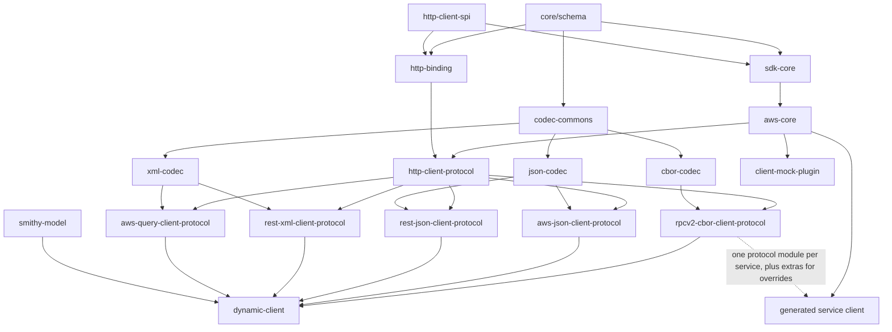
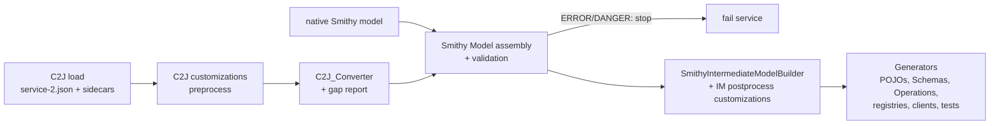
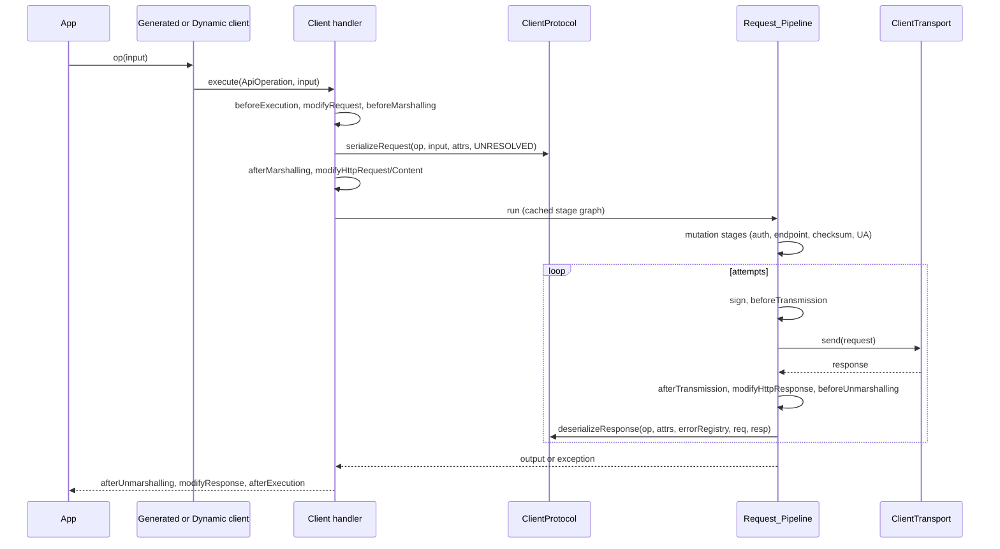

# Design Document: Schema Decoupling and Schema-Based Serde (SDK v2, Smithy migration phase 3)

## Overview

_Requirements: 1, 17, 33, 42_

This design brings schema-based serialization, the enhanced Document type with Type Registries, and the Dynamic Client to the AWS SDK for Java v2. It ports smithy-java's runtime designs as close to 1:1 as Java 8 allows, and it moves codegen to a Smithy-only IntermediateModel.

The design has four parts, in dependency order (Requirement 42.1). The Overview and Architecture sections are front matter. They define every module, shared runtime type family, and Codegen component before any part references them (Requirement 42.5).

- **Part A: Schema decoupling and schema-based serde** (Requirements 1–17). Runtime `Schema`, traits, schema extensions, `SerializableStruct`/`ShapeBuilder`, serializers and deserializers, codecs, HTTP binding serde, client protocols and transports, streaming, the Smithy-only IntermediateModel, the C2J-to-Smithy converter, and the Schema_Generator.
- **Part B: Document types and Type Registries** (Requirements 18–24).
- **Part C: Dynamic Client** (Requirements 25–31).
- **Part D: Cross-cutting concerns** (Requirements 32–42). Protocol test generation, the prototype service set, performance, response generation and mocking, artifact size, the pipeline rewrite informed by racecar, library integration, serde outside operations, observability, correctness properties, error handling, testing strategy (D.10–D.12, now the top-level Correctness Properties, Error Handling and Testing Strategy sections), the phased implementation order, the Porting_Map, open decisions, and traceability.

### Key decisions at a glance

| # | Decision | Rationale | Section |
|---|---|---|---|
| K1 | New Runtime_Schema_Module `core/schema` holds SDK-native `ShapeId`, `ShapeType`, runtime traits, `Schema`, serde, documents and type registries. It has no `smithy-model` dependency. | smithy-java's schema uses `smithy-model` `ShapeId` and `Trait` at runtime, which Requirement 1.6 forbids for generated clients. | A.1–A.5 |
| K2 | Generated POJOs implement `SerializableStruct`. The interface method is `sdkSchema()`, not `schema()`. | CloudWatch `InsightRule` (a prototype service) already has a public `schema()` getter, and Java cannot overload on return type. Requirement 16.1 takes precedence. Flagged as **OD-1**. | A.6 |
| K3 | `SdkPojo.sdkFields()` is kept but derived lazily from the `Schema`. Generated `SdkField` constants are removed. | Keeps source compatibility (Requirement 16.1) and removes the largest per-member generated code. | A.6, D.5 |
| K4 | One generated `<Svc>Operations` class per service holds every `ApiOperation` and the Error_Registry. Sync and async clients share it. | Removes duplicated per-operation exception mapping (40–56% of JSON client bytes today). | A.12, D.5 |
| K5 | JSON codec is a Java 8 port of smithy-java's hand-written `SmithyJsonSerializer`/`SmithyJsonDeserializer`. The Jackson provider is not ported. | Racecar measured hand-written byte-level JSON at −65…−77% time against Jackson. No databind (Requirement 8.4). | A.8 |
| K6 | New `ApiOperation`-driven request pipeline implemented on this branch as its own path for schema-based operations (from Phase 2), applying racecar's refactoring concepts: straight-line stage composition, stage graph built once per client configuration, flattened mutation stages, fewer per-call allocations, shared sync/async stages. Racecar code is not merged. | Gives generated and dynamic clients one pipeline (Requirement 37.3) without bolting seams onto the legacy stage graph; legacy pipeline stays for non-schema clients. | D.6 |
| K7 | Codegen pipeline: C2J → C2J customizations → ported and extended C2J_Converter → validated Smithy `Model` → Smithy-only IntermediateModel → generated code. | Requirement 17. The fork's converter emits ~28 `com.amazonaws.c2j` marker traits and lacks several standard traits. We extend it so the IntermediateModel reads no marker trait. | A.13–A.14 |
| K8 | Protocol tests are fully generated from the Smithy `httpRequestTests`/`httpResponseTests` traits, like endpoint tests. | Requirement 32. Wire correctness is verified against cross-SDK fixtures. | D.1 |
| K9 | Dynamic client = SDK client builder plus a ported `SchemaConverter`. It is the only runtime module that depends on `smithy-model`. | Requirement 1.7, Part C. | C |
| K10 | Runtime bytecode generation of codecs (`RuntimeCodegenMode`) is **deferred**. | It relies on `Lookup.defineHiddenClass` (JDK 15+) and a JDK 25 class-file path. Its Java 8 replacement needs measurement first. | D.3 |

### Scope

In scope: the runtime modules and Codegen changes below, the Prototype_Service_Set (Requirement 33), generated protocol tests, benchmarks, and the size report. Out of scope: server frameworks, `ServerProtocol`, Sparrowhawk, and generating the whole fleet (phase 6 of the implementation order is listed but is not delivered by the prototype).

---

## Architecture

_Requirements: 1, 11, 13, 17, 37, 42.5_

### Module layout

All runtime modules compile with `--release 8` through the existing root `pom.xml` settings (`jre.version=1.8`, and the `jdk-11-plus` profile sets `maven.compiler.release=8`). Every new module inherits them (Requirement 1.3).

**New runtime modules**

| Module path | artifactId | Root package | Ports (smithy-java module) | Depends on |
|---|---|---|---|---|
| `core/schema` (**Runtime_Schema_Module**) | `schema` | `software.amazon.awssdk.schema` | `core` (schema, serde, document, event), `io` (subset) | `annotations`, `utils`, `reactive-streams` |
| `core/codecs/codec-commons` | `codec-commons` | `software.amazon.awssdk.codecs.commons` | `codecs/codec-commons` (minus runtime codegen) | `schema` |
| `core/codecs/json-codec` | `json-codec` | `software.amazon.awssdk.codecs.json` | `codecs/json-codec` (smithy provider only) | `schema`, `codec-commons` |
| `core/codecs/cbor-codec` | `cbor-codec` | `software.amazon.awssdk.codecs.cbor` | `codecs/cbor-codec` | `schema`, `codec-commons` |
| `core/codecs/xml-codec` | `xml-codec` | `software.amazon.awssdk.codecs.xml` | `codecs/xml-codec` | `schema`, `codec-commons` |
| `core/http-binding` (**Http_Binding_Serde**) | `http-binding` | `software.amazon.awssdk.httpbinding` | `http/http-binding` | `schema`, `http-client-spi` |
| `core/protocols/http-client-protocol` | `http-client-protocol` | `software.amazon.awssdk.protocols.client.http` | `client/client-http` (protocol parts), `client/client-http-binding`, `aws/aws-event-streams` | `sdk-core`, `aws-core`, `http-binding`, `eventstream` |
| `core/protocols/rpcv2-cbor-client-protocol` | `rpcv2-cbor-client-protocol` | `software.amazon.awssdk.protocols.client.rpcv2` | `client/client-rpcv2`, `client/client-rpcv2-cbor` | `http-client-protocol`, `cbor-codec` |
| `core/protocols/aws-json-client-protocol` | `aws-json-client-protocol` | `software.amazon.awssdk.protocols.client.awsjson` | `aws/client/aws-client-awsjson` | `http-client-protocol`, `json-codec` |
| `core/protocols/rest-json-client-protocol` | `rest-json-client-protocol` | `software.amazon.awssdk.protocols.client.restjson` | `aws/client/aws-client-restjson` | `http-client-protocol`, `json-codec` |
| `core/protocols/rest-xml-client-protocol` | `rest-xml-client-protocol` | `software.amazon.awssdk.protocols.client.restxml` | `aws/client/aws-client-restxml` | `http-client-protocol`, `xml-codec` |
| `core/protocols/aws-query-client-protocol` | `aws-query-client-protocol` | `software.amazon.awssdk.protocols.client.awsquery` | `aws/client/aws-client-awsquery` | `http-client-protocol`, `xml-codec` |
| `core/dynamic-client` (**Dynamic_Client module**) | `dynamic-client` | `software.amazon.awssdk.dynamicclient` | `client/dynamic-client`, `dynamic-schemas` | `aws-core`, all six protocol modules, `smithy-model`, `smithy-rules-engine` |
| `test/client-mock-plugin` (**Mock_Plugin**, **Response_Generator**) | `client-mock-plugin` | `software.amazon.awssdk.testutils.mock` | `client/client-mock-plugin` | `sdk-core`, `aws-core`, protocol modules (optional) |
| `services-custom/message-payloads` | `message-payloads` | `software.amazon.awssdk.messaging.payload` | none (new; Requirement 38.3) | `schema` |

**Changed runtime modules**

- `core/sdk-core` gains a dependency on `schema` and adds:
  - `software.amazon.awssdk.core.client.protocol`: the `ClientProtocol`, `ClientProtocolFactory`, `ClientTransport`, `AsyncClientTransport`, `MessageExchange`, `ProtocolSettings` and `HttpMessageExchange` SPI.
  - `software.amazon.awssdk.core.document.DocumentConverter`: Legacy_Document ↔ Document.
  - Internals: `SdkFieldsFromSchema`, `SdkHttpClientTransport`, `SdkAsyncHttpClientTransport`, the new pipeline stages, and `SchemaSerdeSupport` (SdkBytes and Legacy_Document adapters used by generated code).
- `core/aws-core` gains `AwsSchemaClientHandler` support for `ApiOperation`-driven calls, and `AwsServiceException` population helpers for protocols.
- `core/protocols/aws-json-protocol`, `aws-cbor-protocol`, `aws-xml-protocol`, `aws-query-protocol`, `protocol-core` and `smithy-rpcv2-protocol` are **unchanged**. Already-published clients still use them. Schema-generated clients do not depend on them.

**Codegen modules**

| Module | Change |
|---|---|
| `codegen-c2j-to-smithy` (**C2J_Converter**, new) | A Java 8 port of `C2jToSmithyConverter` from `mtdowling/aws-sdk-java-v2@smithy-java-bridge`, extended to emit standard traits (A.13). `SmithyToServiceModel`, the parity runners, and the smithy-java `codegen-plugin` dependency are not ported. |
| `codegen` | Smithy-only IntermediateModel (A.14), `SchemaGenerator`, `TraitInitializer` SPI, POJO, `<Svc>Operations` and registry generators, and `ProtocolTestGenerator` (D.1). The `transform` marshaller generators, `ProtocolSpec` exception-mapper code, and C2J model builders are deleted. |
| `codegen-maven-plugin` | `GenerationMojo` runs the Codegen_Pipeline (A.13). It gains dependencies on `codegen-c2j-to-smithy`, `smithy-protocol-test-traits` and `smithy-aws-protocol-tests`. |

**Test modules**

| Module | Purpose |
|---|---|
| `test/smithy-protocol-tests` | Generated JUnit 5 protocol tests for the Protocol_Test_Services. Replaces `test/protocol-tests` (D.1). |
| `test/smithy-protocol-tests-core` | Runtime support for the generated tests: capturing transport, fixed-response transport, and body comparators. Replaces `test/protocol-tests-core`. |
| `test/sdk-standard-benchmarks` | Adds schema-serde JMH benchmarks (D.3). |
| `test/standalone-e2e-benchmarks` | Ported from racecar's harness as benchmark tooling only (racecar runtime changes are not merged) (D.3). |

### Dependency graph



A generated client depends on `aws-core` plus the protocol module for each protocol it declares. CloudWatch declares three protocols, so it depends on `rpcv2-cbor-client-protocol`, `aws-json-client-protocol` and `aws-query-client-protocol` (Requirement 12.6). No generated client depends on `smithy-model` (Requirement 1.6).

### Codegen pipeline



Each stage finishes before the next starts (Requirement 17.1). A native Smithy model bypasses stages A–C (Requirement 17.4).

### Runtime call path



### Porting conventions

_Requirements: 1.1–1.5, 1.8_

These conventions apply to every ported type. The Porting_Map (D.14) records each deviation.

| smithy-java construct | SDK form |
|---|---|
| `record` | `final class` with private final fields, accessors of the same names, `equals`/`hashCode`/`toString` |
| `sealed ... permits` | Non-sealed type with package-private constructors, so only same-package subclasses exist |
| Pattern `switch` / `instanceof` patterns / switch expressions | `if`/`instanceof` chains or classic `switch` on `memberIndex()` / `ShapeType` |
| `var`, text blocks | Explicit types and string concatenation |
| `List.of`, `Map.of`, `Set.of`, `Optional.isEmpty`, `String.isBlank`, `Objects.requireNonNullElse`, `Stream.toList`, `LinkedHashMap.newLinkedHashMap`, `List.getFirst`, `ByteArrayOutputStream.toString(Charset)` | `Collections.unmodifiable*`/`Arrays.asList`, `!isPresent()`, `trim().isEmpty()`, explicit null checks, `collect(Collectors.toList())`, `new LinkedHashMap<>(capacity)`, `get(0)`, `new String(bytes, UTF_8)` |
| `java.util.concurrent.Flow.*` | `org.reactivestreams.*` (Requirement 1.5) |
| `VarHandle` byte-array views (`NumberCodec`, `CborReadUtil`, `CborSerializer`, `JsonReadUtils`, `Zmij`) | Explicit shift-and-mask loops in `codec-commons` `ByteArrays` |
| `CompactStringAccess` (`sun.misc.Unsafe`, `String.value`) | Not ported. String encoding uses `charAt` loops with a 4-characters-per-iteration ASCII fast path, re-implemented here (racecar E6) |
| `java.net.http`, virtual threads | Not ported. The transport is the SDK `SdkHttpClient`/`SdkAsyncHttpClient` (Requirement 13) |
| `software.amazon.smithy.model.shapes.ShapeId`, `ShapeType`, `traits.Trait` | SDK-native `software.amazon.awssdk.schema.ShapeId`, `ShapeType`, `traits.Trait` (A.1, A.2) |
| `software.amazon.smithy.java.context.Context` | `software.amazon.awssdk.core.interceptor.ExecutionAttributes` |
| `SmithyUri` | `java.net.URI` |
| `software.amazon.smithy.java.http.api.HttpRequest`/`HttpResponse` | `SdkHttpFullRequest` / `SdkHttpFullResponse` |
| `ModeledException` / `CallException` | `SdkServiceException` / `AwsServiceException` / `SdkClientException` |
| `public` (no annotation) / `@SmithyUnstableApi` / `@SmithyInternalApi` | `@SdkPublicApi` / `@SdkProtectedApi` / `@SdkInternalApi` (Requirement 1.8) |

A build-time check, `Java8ApiGuardTest`, runs in each ported module. It scans compiled classes with the JDK 8 `ct.sym` signature set (the `animal-sniffer-maven-plugin` with the `java18` signature) and fails on any JDK 9+ API reference (Requirement 1.4). A CI job runs the ported modules' unit tests on a JDK 8 runtime (Requirement 1.9).

---

## Components and Interfaces

This is the runtime type and Codegen component index. Detailed design for each entry is in the referenced Part section.

_Requirements: 42.5_

Every runtime type and Codegen component used in this design is defined here. Detailed design follows in the listed section.

| Name | Module / package | Definition | Detail |
|---|---|---|---|
| `ShapeId`, `ShapeType` | `schema` / `software.amazon.awssdk.schema` | Runtime shape identifier and Smithy shape type enum | A.1 |
| `Trait`, `GenericTrait`, `TraitFactory` | `schema` / `.schema.traits` | Runtime trait objects and their discovery | A.2 |
| `TraitKey` | `schema` / `.schema` | Dense integer key for trait lookup | A.3 |
| `Schema`, `SchemaBuilder`, `PreludeSchemas`, `SchemaIndex` | `schema` / `.schema` | Runtime shape description, builder, prelude constants, per-service index | A.4, A.17 |
| `SchemaExtensionKey`, `SchemaExtensionProvider` | `schema` / `.schema` | Cached per-Schema derived data | A.5 |
| `SerializableShape`, `SerializableStruct`, `ShapeBuilder`, `SmithyEnum`, `SmithyIntEnum` | `schema` / `.schema` | Shape write/read contracts that generated classes implement | A.6 |
| `ShapeSerializer`, `ShapeDeserializer`, `MapSerializer`, `SpecificShapeSerializer`, `SpecificShapeDeserializer`, `InterceptingSerializer`, `ListSerializer`, `NullSerializer`, `ToStringSerializer`, `TimestampFormatter`, `ShapeTranscoder`, `SerializationException` | `schema` / `.schema.serde` | Format-agnostic serde | A.7 |
| `Codec` | `schema` / `.schema.serde` | Factory for a serializer/deserializer pair over bytes | A.8 |
| `TypeRegistry`, `ErrorRegistry` | `schema` / `.schema.serde` | ShapeId → shape class and builder | A.7 (interface), B.5 |
| `Document`, `Documents`, `DocumentParser`, `DocumentDeserializer`, `DiscriminatorException` | `schema` / `.schema.serde.document` | Full-Smithy-data-model document | B.1–B.3 |
| `DataStream`, `ByteBufferOutputStream` | `schema` / `.schema.io` | Streaming blob abstraction over reactive streams, and a growable output buffer | A.13 |
| `EventStream`, `EventEncoder`, `EventDecoder`, `Frame`, … | `schema` / `.schema.serde.event` | Event stream abstractions | A.13 |
| `ApiOperation`, `ApiService`, `SimpleApiOperation` | `schema` / `.schema` | Operation and service metadata | A.18 |
| `JsonCodec`/`JsonSettings`, `Rpcv2CborCodec`/`CborSettings`, `XmlCodec`/`XmlSettings` | codec modules | Codecs and Codec_Settings | A.8 |
| `HttpBinding`, `RequestSerializer`, `ResponseSerializer`, `RequestDeserializer`, `ResponseDeserializer` | `http-binding` | Http_Binding_Serde | A.9 |
| `ClientProtocol`, `ClientProtocolFactory`, `ProtocolSettings`, `MessageExchange`, `HttpMessageExchange` | `sdk-core` / `.core.client.protocol` | Protocol SPI | A.10 |
| `ClientTransport`, `AsyncClientTransport`, `SdkHttpClientTransport`, `SdkAsyncHttpClientTransport` | `sdk-core` | Transport SPI and SDK HTTP adapters | A.12 |
| `RpcV2CborProtocol`, `AwsJson1Protocol`, `AwsJson11Protocol`, `RestJsonClientProtocol`, `RestXmlClientProtocol`, `AwsQueryClientProtocol`, `Ec2QueryClientProtocol` | protocol modules | The seven Client_Protocols | A.10 |
| `DocumentConverter` | `sdk-core` / `.core.document` | Legacy_Document ↔ Document | B.4 |
| `SdkFieldsFromSchema` | `sdk-core` (internal) | Derives `List<SdkField<?>>` from a Schema | A.6 |
| `SchemaConverter`, `StructDocument`, `DynamicClient`, `DynamicOperation`, `DocumentException` | `dynamic-client` | Dynamic client | C |
| `ResponseGenerator`, `MockPlugin`, `MockQueue` | `client-mock-plugin` | Response generation and mocking | D.4 |
| `MessagePayloads` | `message-payloads` | Typed SQS/SNS payload helpers | D.7 |
| **C2J_Converter** (`C2jToSmithyConverter`, `ConversionGapReport`) | `codegen-c2j-to-smithy` | C2J → Smithy | A.14 |
| **Intermediate_Model** | `codegen` | Smithy-only codegen model | A.15 |
| **Trait_Inclusion_Policy** (`TraitInclusionPolicy`), **Trait_Initializer** (`TraitInitializer`) | `codegen` / `.codegen.schema` | Trait selection and rendering | A.16 |
| **Schema_Generator** (`SchemasGenerator`, `SchemaFieldOrder`, `SchemaIndexGenerator`) | `codegen` / `.codegen.poet.schema` | Emits Schemas | A.17 |
| `OperationsClassSpec`, `ErrorRegistrySpec`, `TypeRegistrySpec`, `SchemaModelSpec` | `codegen` / `.codegen.poet.schema` | Generated operations, registries, POJO serde methods | A.18 |
| **Protocol_Test_Generator** (`ProtocolTestGenerator`) | `codegen` / `.codegen.poet.protocoltest` | Generates JUnit 5 protocol tests | D.1 |
| **Request_Pipeline** (`SyncApiCallPipeline`, `AsyncApiCallPipeline`, `RequestMutationStages`) | `sdk-core` (internal) | Straight-line pipeline | D.6 |

---

## Data Models

_Requirements: 42.5_

The core data models of this design, summarized from the sections that define them.

| Data model | Description | Detail |
|---|---|---|
| Runtime Schema graph (`Schema`, `RootSchema`, `MemberSchema`, `DeferredRootSchema`, `DeferredMemberSchema`, `ResolvedRootSchema`) | Runtime shape description built with `SchemaBuilder`; prelude constants in `PreludeSchemas` and a per-service `SchemaIndex` | A.4 |
| `ShapeId`, `Trait`, `TraitKey` | SDK-native shape identifier, runtime trait objects (no `smithy-model` dependency), and dense integer keys for trait lookup | A.1, A.2, A.3 |
| Generated POJO and builder | Generated_Model_Classes implement `SerializableStruct` (`sdkSchema()`), with a `ShapeBuilder`; `sdkFields()` is derived lazily from the `Schema` | A.6 |
| `ApiOperation`, `ApiService` | Operation and service metadata (input/output schemas, error registry, effective auth schemes), held in one generated `<Svc>Operations` class per service | A.18 |
| Smithy-only IntermediateModel | Codegen input that drops every C2J concept and keeps a reference to the validated Smithy `Model` | A.15 |
| Document hierarchy (`Document`, `Documents`, `DocumentParser`, `DocumentDeserializer`) | Full-Smithy-data-model document; each implementation holds its `Schema` | B.1, B.2 |
| `TypeRegistry`, `ErrorRegistry` | ShapeId → shape class and builder; one Error_Registry per service, with an `awsQueryError` code index | B.5 |
| Codec_Settings (`JsonSettings`, `CborSettings`, `XmlSettings`) | Per-codec settings and presets | A.8 |
| `ExecutionAttributes` context | Replaces smithy-java `Context`, so interceptors, protocols and transports share one context | A.10 |

---

## Part A: Schema Decoupling and Schema-Based Serde

_Requirements: 1–17_

### A.1 ShapeId and ShapeType

_Requirements: 2.1–2.3, 2.8_

`ShapeId` is a Java 8 port of the subset of `software.amazon.smithy.model.shapes.ShapeId` that smithy-java's runtime uses.

```java
package software.amazon.awssdk.schema;

@SdkPublicApi
public final class ShapeId implements Comparable<ShapeId>, Serializable {
    public static ShapeId from(String absoluteShapeId);                     // throws ShapeIdSyntaxException
    public static ShapeId fromParts(String namespace, String name);
    public static ShapeId fromParts(String namespace, String name, String member);
    public String getNamespace();
    public String getName();
    public Optional<String> getMember();
    public boolean hasMember();
    public ShapeId withMember(String member);
    public ShapeId withoutMember();
    @Override public String toString();                                     // "ns#Name" or "ns#Name$member", cached
    @Override public boolean equals(Object o);
    @Override public int hashCode();                                        // cached
    @Override public int compareTo(ShapeId o);
}

@SdkPublicApi
public final class ShapeIdSyntaxException extends IllegalArgumentException { /* message contains the input */ }

@SdkPublicApi
public enum ShapeType {
    BLOB, BOOLEAN, STRING, ENUM, TIMESTAMP, BYTE, SHORT, INTEGER, INT_ENUM, LONG, FLOAT, DOUBLE,
    BIG_INTEGER, BIG_DECIMAL, DOCUMENT, LIST, MAP, STRUCTURE, UNION, MEMBER, OPERATION, RESOURCE, SERVICE;
    public Category getCategory();          // SIMPLE, AGGREGATE, MEMBER, SERVICE
    public String toString();               // Smithy IDL name, for example "bigInteger"
}
```

- The parser validates the Smithy identifier grammar (`[A-Za-z_][A-Za-z0-9_]*` for each segment). It rejects an empty input, a missing `#`, an empty namespace or name, more than one `$`, or an empty member name. Each case throws `ShapeIdSyntaxException` with the offending string (Requirement 2.8).
- Generated code calls `fromParts(NS, "Name")` with a per-package `NS` constant instead of `from(String)`. This skips parsing during class initialization (D.3).
- **Deviation:** smithy-model's `ShapeType.SET` is not ported. The Schema_Generator and Schema_Converter emit a `set` as `LIST` with `uniqueItems`, matching Smithy IDL 2.0 (Requirement 2.3).

### A.2 Runtime traits and the trait factory registry

_Requirements: 2.4–2.7, 2.9, 2.10, 9.7_

smithy-java stores `software.amazon.smithy.model.traits.Trait` objects in schemas. The SDK cannot, because generated clients must not depend on `smithy-model` (Requirement 1.6). It defines its own trait types instead.

```java
package software.amazon.awssdk.schema.traits;

@SdkPublicApi
public interface Trait {
    ShapeId traitId();                 // e.g. smithy.api#jsonName
    Document toDocument();             // the model value as a Document, used by Schema_Converter equality and tooling
}

@SdkPublicApi
public final class GenericTrait implements Trait {
    public GenericTrait(ShapeId traitId, Document value);
    public Document value();           // returns the constructor argument (Requirement 2.5)
}

@SdkPublicApi
public interface TraitFactory<T extends Trait> {    // discovered via java.util.ServiceLoader
    ShapeId traitId();
    Class<T> traitClass();
    T create(Document value);                       // throws SerializationException on a shape mismatch (Requirement 2.10)
}

@SdkProtectedApi
public final class TraitFactories {
    public static Trait create(ShapeId traitId, Document value);  // typed trait, or GenericTrait if no factory (Requirement 2.9)
    public static TraitFactory<?> factoryFor(ShapeId traitId);    // null if none
}
```

- `TraitFactories` loads factories once through `ServiceLoader.load(TraitFactory.class, TraitFactory.class.getClassLoader())`. Two factories for one `traitId` fail discovery with an `IllegalStateException` that names the ShapeId and both classes (Requirement 2.10). A third-party factory for an id the SDK does not cover is used normally (Requirement 2.7).
- Typed traits (one class each, with a factory) cover every trait the default Trait_Inclusion_Policy includes (A.16):
  - Prelude: `RequiredTrait`, `DefaultTrait` (value `Document`), `SensitiveTrait`, `SparseTrait`, `IdempotencyTokenTrait`, `ErrorTrait`, `HttpErrorTrait`, `RetryableTrait`, `StreamingTrait`, `RequiresLengthTrait`, `EventHeaderTrait`, `EventPayloadTrait`, `MediaTypeTrait`, `HostLabelTrait`, `EndpointTrait`, `HttpTrait`, `HttpChecksumRequiredTrait`, `RequestCompressionTrait`, `PaginatedTrait`, `XmlNameTrait`, `XmlNamespaceTrait`, `XmlAttributeTrait`, `XmlFlattenedTrait`, `JsonNameTrait`, `TimestampFormatTrait`, `HttpHeaderTrait`, `HttpLabelTrait`, `HttpQueryTrait`, `HttpQueryParamsTrait`, `HttpPrefixHeadersTrait`, `HttpPayloadTrait`, `HttpResponseCodeTrait`, `UnitTypeTrait`.
  - AWS: `HttpChecksumTrait`, `AwsQueryErrorTrait`, `AwsQueryCompatibleTrait`, `Ec2QueryNameTrait`.
  - Protocols and auth: `AwsJson1_0Trait`, `AwsJson1_1Trait`, `RestJson1Trait`, `RestXmlTrait`, `AwsQueryTrait`, `Ec2QueryTrait`, `Rpcv2CborTrait`, `SigV4Trait`, `AuthTrait`, `OptionalAuthTrait`, `UnsignedPayloadTrait`.
- Annotation traits are singletons (`RequiredTrait.INSTANCE`), so generated code allocates nothing for them.
- Each typed trait implements value `equals`/`hashCode`.

### A.3 Trait keys

_Requirements: 4.1–4.5, 4.7_

```java
package software.amazon.awssdk.schema;

@SdkPublicApi
public final class TraitKey<T extends Trait> {
    public static <T extends Trait> TraitKey<T> get(Class<T> traitClass);   // ClassValue-pooled; same instance per class
    public static TraitKey<GenericTrait> generic(ShapeId traitId);          // SDK addition, ConcurrentHashMap-pooled
    public Class<T> traitClass();
    public static final TraitKey<RequiredTrait> REQUIRED_TRAIT = get(RequiredTrait.class);
    public static final TraitKey<JsonNameTrait> JSON_NAME_TRAIT = get(JsonNameTrait.class);
    // ... one public static final constant for every trait class any SDK runtime module reads (Requirement 4.5)
    final int id;                                                           // dense, contiguous from 0
}
```

- `id` comes from a single `AtomicInteger`. `get` uses `ClassValue`, which is Java 7+. Concurrent calls for the same class return one instance (Requirement 4.2).
- **Deviation (DC-26):** smithy-java keys untyped traits by Java class (`DynamicTrait`), so two untyped traits on one shape collide. `TraitKey.generic(ShapeId)` gives each Generic_Trait id its own key, so each stays independently retrievable.
- `Schema` stores traits in a `Trait[]` indexed by `id` (a port of `TraitMap`). A lookup is a bounds check plus an array load. It does not hash and does not allocate (Requirements 4.3, 4.4).

### A.4 Schema hierarchy

_Requirements: 3.1–3.13, 4.6, 4.7_

`Schema` ports smithy-java `Schema` with its subtypes: `RootSchema`, `MemberSchema`, `DeferredRootSchema`, `DeferredMemberSchema` and `ResolvedRootSchema`.

```java
package software.amazon.awssdk.schema;

@SdkPublicApi
public abstract class Schema implements MemberLookup {          // package-private constructors only
    // factories (same names as smithy-java)
    public static Schema createBoolean(ShapeId id, Trait... traits);   // createByte ... createTimestamp, createDocument
    public static Schema createEnum(ShapeId id, Set<String> values, Trait... traits);
    public static Schema createEnum(ShapeId id, Set<String> values, Class<?> shapeClass, Trait... traits);
    public static Schema createIntEnum(ShapeId id, Set<Integer> values, Trait... traits);
    public static Schema createOperation(ShapeId id, Trait... traits);
    public static Schema createResource(ShapeId id, Trait... traits);
    public static Schema createService(ShapeId id, Trait... traits);
    public static SchemaBuilder structureBuilder(ShapeId id, Trait... traits);
    public static SchemaBuilder unionBuilder(ShapeId id, Trait... traits);
    public static SchemaBuilder listBuilder(ShapeId id, Trait... traits);
    public static SchemaBuilder mapBuilder(ShapeId id, Trait... traits);

    public final ShapeId id();
    public final ShapeType type();                     // a member reports its target's type, never MEMBER
    public final boolean isMember();
    public final String memberName();                  // null for root schemas
    @SdkInternalApi public final int memberIndex();    // 0..N-1 for members, -1 for root schemas
    public Schema memberTarget();

    public final <T extends Trait> T getTrait(TraitKey<T> key);       // member trait wins over the target's
    public final boolean hasTrait(TraitKey<? extends Trait> key);
    public final <T extends Trait> T expectTrait(TraitKey<T> key);
    public <T extends Trait> T getDirectTrait(TraitKey<T> key);       // member-declared only
    public final Collection<Trait> traits();                          // unmodifiable view, each trait once

    public final <T> T getExtension(SchemaExtensionKey<T> key);       // A.5

    public List<Schema> members();                                    // unmodifiable, model declaration order
    public Schema member(String memberName);
    @SdkInternalApi public Schema member(int memberIndex);
    public final Schema listMember();
    public final Schema mapKeyMember();
    public final Schema mapValueMember();
    public Set<String> stringEnumValues();                            // unmodifiable
    public Set<Integer> intEnumValues();                              // unmodifiable

    public final ShapeBuilder<? extends SerializableShape> shapeBuilder();   // new builder per call, or null
    public final Class<?> shapeClass();                               // null if no generated class
    @SdkInternalApi public final long requiredMemberMask();           // bit i set if member i is required with no default
    public Schema resolve();
}

@SdkPublicApi
public final class SchemaBuilder {
    public SchemaBuilder putMember(String name, Schema target, Trait... memberTraits);
    public SchemaBuilder putMember(String name, SchemaBuilder deferredTarget, Trait... memberTraits);
    public SchemaBuilder builderSupplier(Supplier<ShapeBuilder<?>> supplier);
    public SchemaBuilder shapeClass(Class<?> shapeClass);
    public Schema build();
}
```

**Deviations from smithy-java** (each recorded in D.14):

1. **Member order.** smithy-java's `SchemaBuilder.sortMembers` moves required-without-default members first, so `members()` is not in declaration order. Requirement 3.3 requires declaration order. SDK `members()` and `memberIndex()` follow declaration order. Presence validation uses `requiredMemberMask()`, a 64-bit mask over declaration indexes (with a `BitSet` fallback above 64 required members), instead of a contiguous required prefix.
2. **Root member index.** smithy-java returns `0`. The SDK returns `-1` (Requirement 3.2).
3. **Constraint validation fields** (`minLengthConstraint`, `stringPattern` and the rest) and `Validator`/`ValidationError`/`CustomConstraint` are not ported. The SDK does not validate constraint traits client-side today, and the Trait_Inclusion_Policy excludes them (Requirement 9.3).
4. **`traits()`** collection view is added (Requirement 4.6). There are no per-trait getters (Requirement 4.7).
5. **`sealed`** is removed; constructors are package-private.

Semantics carried over unchanged:

- A `MemberSchema` merges traits eagerly at build time: target traits first, then member traits overwrite. `getDirectTrait` reads the member's own `Trait[]` (Requirements 3.7, 3.8). Member queries for type, members, list/map members and enum values delegate to the target (Requirement 3.6).
- **Recursion.** A `SchemaBuilder` passed as a member target creates a `DeferredMemberSchema`. `build()` on a recursive builder returns a `DeferredRootSchema`, and `resolve()` returns the `ResolvedRootSchema`. Accessing a deferred target before its builder is built throws `IllegalStateException` naming the unresolved ShapeId (Requirements 3.9, 3.13).
- **Builder validation** fails with `IllegalArgumentException` naming the ShapeId and member for: a duplicate member name, a member on a non-aggregate type, a list with other than one `member`, or a map without exactly `key` and `value` (Requirement 3.12).
- `PreludeSchemas` holds the prelude simple types (`STRING`, `INTEGER`, `PRIMITIVE_INTEGER`, …, `DOCUMENT`, `UNIT`).
- A `Schema` holds no generic type parameters and no reference to a generated class type parameter (Requirement 3.4). It holds only `Class<?>` and a `Supplier` (Requirement 3.5).

### A.5 Schema extensions

_Requirements: 5.1–5.11_

```java
@SdkPublicApi
public final class SchemaExtensionKey<T> {
    public SchemaExtensionKey();               // id from a global counter
}

@SdkPublicApi
public interface SchemaExtensionProvider<T> {  // ServiceLoader-discovered
    SchemaExtensionKey<T> key();
    T provide(Schema schema);                  // returned objects must be safely publishable (final fields)
}
```

`Schema.getExtension(key)` keeps smithy-java's design: an `Object[]` per schema indexed by `key.id`, prefilled with `NOT_COMPUTED`, null cached as `NULL_SENTINEL`, and providers discovered once in a holder class.

**Deviations:**

- **Publish-once.** smithy-java uses a benign race in which two threads may each compute and overwrite a slot. That breaks the identity guarantee in Requirements 5.4 and 5.5. The SDK keeps the plain-read fast path. On a miss it computes the value outside any lock, then publishes it under `synchronized (extensions)`: if another thread already published a value, the slot keeps the first value and that value is returned. The fast path still costs one array load. The lock is taken at most once per (schema, key) in steady state.
- **Exceptions.** Not caching a throwing provider (Requirement 5.10) falls out of computing before publishing.
- **Duplicate providers.** smithy-java silently keeps the last provider for a key. The SDK fails discovery with an `IllegalStateException` naming the key's provider classes (Requirement 5.11).

Extensions defined by SDK modules (Requirement 5.7):

| Key | Module | Value | Used by |
|---|---|---|---|
| `JsonSchemaExtensions.KEY` | json-codec | Pre-encoded field-name bytes (with and without `jsonName`), a packed-long member lookup table, and resolved timestamp formatters | JSON serializer and deserializer |
| `CborSchemaExtensions.KEY` | cbor-codec | Pre-encoded CBOR text-string member keys and a member lookup | CBOR serde |
| `XmlSchemaExtensions.KEY` | xml-codec | Element/attribute names, namespace, flattening, member lookup | XML serde |
| `AwsQuerySchemaExtensions.KEY` | aws-query-client-protocol | Query key paths (`ec2QueryName`/`xmlName` resolution) | Query serializer |
| `HttpBindingSchemaExtensions.KEY` | http-binding | Request and response binding plans per struct; per-member binding location and wire name | Http_Binding_Serde |
| `OperationMembersExtension.KEY` | schema | The idempotency-token, input-stream and output-stream members of an operation input/output | `ApiOperation` defaults |
| `SdkFieldsExtension.KEY` | sdk-core | Lazily derived `List<SdkField<?>>` and name map | `SdkPojo.sdkFields()` |
| `ToStringPlanExtension.KEY` | schema | Sensitive-member flags | `ToStringSerializer` |


### A.6 Serializable shapes, builders and generated model classes

_Requirements: 6.1–6.12, 16.1, 16.3, 21.4, 40.1_

#### Interfaces

```java
package software.amazon.awssdk.schema;

@SdkPublicApi @FunctionalInterface
public interface SerializableShape {
    void serialize(ShapeSerializer serializer);
}

@SdkPublicApi
public interface SerializableStruct extends SerializableShape {
    Schema sdkSchema();                                   // smithy-java: schema()   (OD-1)
    @Override default void serialize(ShapeSerializer s) { s.writeStruct(sdkSchema(), this); }
    void serializeMembers(ShapeSerializer serializer);
    <T> T getMemberValue(Schema member);
}

@SdkPublicApi
public interface ShapeBuilder<T extends SerializableShape> {
    T build();
    ShapeBuilder<T> deserialize(ShapeDeserializer decoder);
    default ShapeBuilder<T> deserializeMember(ShapeDeserializer decoder, Schema member) { return deserialize(decoder); }
    default void setMemberValue(Schema member, Object value) { throw new IllegalArgumentException(/* ShapeId + member */); }
    default ShapeBuilder<T> errorCorrection() { return this; }
    Schema sdkSchema();                                   // smithy-java: schema()   (OD-1)
}

@SdkPublicApi public interface SmithyEnum    { String getValue(); Schema sdkSchema(); }
@SdkPublicApi public interface SmithyIntEnum { int getValue();    Schema sdkSchema(); }
```

**Deviation (OD-1):** `schema()` becomes `sdkSchema()` on `SerializableStruct`, `ShapeBuilder`, `SmithyEnum` and `SmithyIntEnum`. CloudWatch `InsightRule` has a member `Schema`, so the Baseline_Build already exposes a public `InsightRule.schema()` returning `String`. Many fleet services have a `Schema` member too. Keeping smithy-java's name would break Requirement 16.1. The naming strategy adds `sdkSchema`, `serializeMembers`, `getMemberValue` and `serialize` to the reserved structure method names for future members.

`SmithyEnum`/`SmithyIntEnum` gain `sdkSchema()` to satisfy Requirement 6.9 ("expose the enum's Schema"). That is additive relative to smithy-java.

#### Generated structure (SQS `GetQueueUrl` input)

Generated code uses classic `switch` statements on `memberIndex()` (Java 8). Member schema constants replace the per-member `SdkField` constants.

```java
@Generated("software.amazon.awssdk:codegen")
public final class GetQueueUrlRequest extends SqsRequest
        implements SerializableStruct, ToCopyableBuilder<GetQueueUrlRequest.Builder, GetQueueUrlRequest> {

    public static final Schema SCHEMA = SqsSchemas.GET_QUEUE_URL_REQUEST;          // Requirement 6.3
    private static final Schema M_QUEUE_NAME = SCHEMA.member("QueueName");
    private static final Schema M_QUEUE_OWNER_AWS_ACCOUNT_ID = SCHEMA.member("QueueOwnerAWSAccountId");

    private final String queueName;
    private final String queueOwnerAWSAccountId;

    private GetQueueUrlRequest(BuilderImpl builder) { super(builder); this.queueName = builder.queueName; /* ... */ }

    public final String queueName() { return queueName; }                         // unchanged public API
    public final String queueOwnerAWSAccountId() { return queueOwnerAWSAccountId; }

    @Override public Schema sdkSchema() { return SCHEMA; }

    @Override
    public void serializeMembers(ShapeSerializer s) {                             // ascending member index
        if (queueName != null) { s.writeString(M_QUEUE_NAME, queueName); }
        if (queueOwnerAWSAccountId != null) { s.writeString(M_QUEUE_OWNER_AWS_ACCOUNT_ID, queueOwnerAWSAccountId); }
    }

    @Override @SuppressWarnings("unchecked")
    public <T> T getMemberValue(Schema member) {
        switch (member.memberIndex()) {
            case 0: return (T) SchemaUtils.validateSameMember(M_QUEUE_NAME, member, queueName);
            case 1: return (T) SchemaUtils.validateSameMember(M_QUEUE_OWNER_AWS_ACCOUNT_ID, member, queueOwnerAWSAccountId);
            default: throw SchemaUtils.notAMember(SCHEMA, member);                 // Requirement 6.10
        }
    }

    @Override public final List<SdkField<?>> sdkFields() { return SdkFieldsFromSchema.fields(SCHEMA); }
    @Override public final Map<String, SdkField<?>> sdkFieldNameToField() { return SdkFieldsFromSchema.fieldsByName(SCHEMA); }
    @Override public final String toString() { return ToStringSerializer.serialize(this); }   // Requirement 40.1
    // equals, hashCode, toBuilder, builder(), serializableBuilderClass(): unchanged signatures

    static BuilderImpl newShapeBuilder() { return new BuilderImpl(); }           // package-private; used by SqsSchemas

    public interface Builder extends SqsRequest.Builder, SdkPojo, CopyableBuilder<Builder, GetQueueUrlRequest> {
        Builder queueName(String queueName);                                      // unchanged; no new abstract methods
        Builder queueOwnerAWSAccountId(String queueOwnerAWSAccountId);
        @Override Builder overrideConfiguration(AwsRequestOverrideConfiguration c);
        @Override Builder overrideConfiguration(Consumer<AwsRequestOverrideConfiguration.Builder> c);
    }

    static final class BuilderImpl extends SqsRequest.BuilderImpl implements Builder, ShapeBuilder<GetQueueUrlRequest> {
        private String queueName;
        private String queueOwnerAWSAccountId;
        // existing constructors, setters, bean getters ...

        @Override public Schema sdkSchema() { return SCHEMA; }

        @Override public BuilderImpl deserialize(ShapeDeserializer d) {
            d.readStruct(SCHEMA, this, InnerDeserializer.INSTANCE);               // static, non-capturing (Requirement 6.7)
            return this;
        }

        @Override public BuilderImpl deserializeMember(ShapeDeserializer d, Schema member) {
            d.readStruct(member.assertMemberTargetIs(SCHEMA), this, InnerDeserializer.INSTANCE);
            return this;
        }

        @Override public void setMemberValue(Schema member, Object value) {
            switch (member.memberIndex()) {
                case 0: queueName((String) SchemaUtils.validateSameMember(M_QUEUE_NAME, member, value)); break;
                case 1: queueOwnerAWSAccountId((String) SchemaUtils.validateSameMember(M_QUEUE_OWNER_AWS_ACCOUNT_ID, member, value)); break;
                default: ShapeBuilder.super.setMemberValue(member, value);
            }
        }

        @Override public GetQueueUrlRequest build() { return new GetQueueUrlRequest(this); }

        private static final class InnerDeserializer implements ShapeDeserializer.StructMemberConsumer<BuilderImpl> {
            static final InnerDeserializer INSTANCE = new InnerDeserializer();
            @Override public void accept(BuilderImpl b, Schema member, ShapeDeserializer d) {
                switch (member.memberIndex()) {                                     // no name comparison
                    case 0: b.queueName = d.readString(member); break;
                    case 1: b.queueOwnerAWSAccountId = d.readString(member); break;
                    default: break;                                                // unknown members never reach here
                }
            }
        }
    }
}
```

Generation rules:

- **Unset vs. empty collections (Requirement 6.5).** The guard for a list or map member is `if (x != null && !(x instanceof SdkAutoConstructList))` (or `SdkAutoConstructMap`). A never-set collection is not written. An explicitly empty one is written.
- **Collection deserialization.** List and map members read through static consumers in a per-package `<Svc>SharedSerde` class: one consumer per collection shape, ported from smithy-java's `SharedSerde`. The consumer pre-sizes from `containerSize()` capped at `containerPreAllocationLimit()`. `InnerDeserializer` assigns the built, unmodifiable collection directly to the field. It does not run the setter's defensive copier. This re-implements, on the deserialization side, the allocation saving racecar measured in E4.
- **String enums** are stored as strings, as today. `serializeMembers` and `getMemberValue` use the wire string, including unknown values (Requirements 6.5, 6.6). Enum classes implement `SmithyEnum`, expose `public static final Schema SCHEMA`, and add `getValue()`. `UNKNOWN_TO_SDK_VERSION.getValue()` returns `null`. Int enums implement `SmithyIntEnum`.
- **Blobs.** `SdkBytes` lives in `sdk-core`, above the schema module. Serialization writes `blob.asByteBuffer()`, a read-only view with no copy. Deserialization calls `SchemaSerdeSupport.toSdkBytes(ByteBuffer)`. When the buffer exactly wraps a fresh array, that uses `SdkBytes.fromByteArrayUnsafe` with no copy; otherwise it copies.
- **Document members** keep Legacy_Document accessors (Requirement 21.4):
  - Writes go through `SchemaSerdeSupport.wrapLegacy(doc)`, a zero-copy Document view (B.4).
  - Reads go through `DocumentConverter.toLegacy(d.readDocument())`.
- **Unions** implement `SerializableStruct`. `serializeMembers` writes the one set variant. The builder's `build()` returns the `UNKNOWN_TO_SDK_VERSION` variant when `deserialize` saw only unknown members (Requirement 6.11). Codecs report unknown members through `StructMemberConsumer.unknownMember`, which the generated union consumer overrides to record the unknown variant.
- **Modeled exceptions** implement `SerializableStruct`. The `message` member maps to `AwsServiceException.Builder.message`. Builders implement `ShapeBuilder<XxxException>`.
- **Responses.** The protocol sets `sdkHttpResponse` and `responseMetadata` on the output builder before `build()`. That removes `BaseClientHandler.attachHttpResponseToResult`'s `toBuilder().sdkHttpResponse(...).build()` copy. This is re-implemented here and supersedes racecar E4's approach (D.6).
- **Public builder interfaces do not change.** `ShapeBuilder` is implemented by `BuilderImpl` only. Adding a superinterface to `Builder` would add abstract methods to a type customers can implement (Requirement 16.3). Typed access goes through `X.SCHEMA.shapeBuilder()`.
- `Schemas` reference builders as `GetQueueUrlRequest::newShapeBuilder`. That is a method reference to a package-private static method, so it adds no synthetic lambda method and does not initialize the POJO class until invoked.

#### `SdkFieldsFromSchema`

_Requirements: 16.1, 36_

`SdkPojo.sdkFields()` and `sdkFieldNameToField()` stay as public API. The SDK still uses them in a few places, such as transfer-manager request copying, `equalsBySdkFields`, and the legacy protocol tests. `SdkFieldsFromSchema` derives them once per Schema through `SdkFieldsExtension`:

- getter: `obj -> ((SerializableStruct) obj).getMemberValue(member)`
- setter: `(b, v) -> ((ShapeBuilder<?>) b).setMemberValue(member, v)`
- `MarshallingType` from `ShapeType`
- `LocationTrait`, `TimestampFormatTrait`, `ListTrait`, `MapTrait`, `PayloadTrait`, `XmlAttributeTrait`, `RequiredTrait` and `JsonValueTrait` (from `mediaType: application/json` on headers), all from runtime traits
- `memberName` = the Smithy member name
- `constructor` from `memberTarget().shapeBuilder()`

This adapter is the only bridge between the old `SdkField` world and schemas. Nothing on the schema serde hot path calls it.

### A.7 Shape_Serializer and Shape_Deserializer

_Requirements: 7.1–7.8_

Both interfaces are ported with method names and parameter types unchanged, apart from the Java 8 substitutions:

```java
@SdkPublicApi
public interface ShapeSerializer extends Flushable, AutoCloseable {
    static ShapeSerializer nullSerializer();
    default void flush() {}
    default void close() { flush(); }
    void writeStruct(Schema schema, SerializableStruct struct);
    <T> void writeList(Schema schema, T listState, int size, BiConsumer<T, ShapeSerializer> consumer);
    <T> void writeMap(Schema schema, T mapState, int size, BiConsumer<T, MapSerializer> consumer);
    void writeBoolean(Schema schema, boolean value);
    void writeByte(Schema schema, byte value);      // writeShort, writeInteger, writeLong, writeFloat, writeDouble
    void writeBigInteger(Schema schema, BigInteger value);
    void writeBigDecimal(Schema schema, BigDecimal value);
    void writeString(Schema schema, String value);
    void writeBlob(Schema schema, ByteBuffer value);
    default void writeBlob(Schema schema, byte[] value);
    void writeTimestamp(Schema schema, Instant value);
    void writeDocument(Schema schema, Document value);
    void writeNull(Schema schema);
    default void writeDataStream(Schema schema, DataStream value) {}
    default void writeEventStream(Schema schema, EventStream<? extends SerializableStruct> value) {}
}

@SdkPublicApi
public interface ShapeDeserializer extends AutoCloseable {
    int CONTAINER_PRE_ALLOCATION_LIMIT = 10_000;       // overridable via system property, as in smithy-java
    boolean readBoolean(Schema schema);  ByteBuffer readBlob(Schema schema);  byte readByte(Schema schema);
    short readShort(Schema schema);      int readInteger(Schema schema);      long readLong(Schema schema);
    float readFloat(Schema schema);      double readDouble(Schema schema);
    BigInteger readBigInteger(Schema schema);  BigDecimal readBigDecimal(Schema schema);
    String readString(Schema schema);    Document readDocument();             Instant readTimestamp(Schema schema);
    <T> void readStruct(Schema schema, T state, StructMemberConsumer<T> consumer);
    <T> void readList(Schema schema, T state, ListMemberConsumer<T> consumer);
    <T> void readStringMap(Schema schema, T state, MapMemberConsumer<String, T> consumer);
    default int containerSize() { return -1; }
    default int containerPreAllocationLimit() { return CONTAINER_PRE_ALLOCATION_LIMIT; }
    boolean isNull();
    default <T> T readNull() { return null; }
    default DataStream readDataStream(Schema schema);
    default EventStream<? extends SerializableStruct> readEventStream(Schema schema);
    interface StructMemberConsumer<T> { void accept(T state, Schema member, ShapeDeserializer d); default void unknownMember(T state, String name) {} }
    interface ListMemberConsumer<T>   { void accept(T state, ShapeDeserializer d); }
    interface MapMemberConsumer<K, T> { void accept(T state, K key, ShapeDeserializer d); }
}
```

- `readStringMap` keeps smithy-java's name. Requirement 7.2's "`readMap`" is satisfied by it; the Porting_Map records the naming.
- These helpers are ported 1:1 with Java 8 syntax only: `SpecificShapeSerializer`, `SpecificShapeDeserializer`, `InterceptingSerializer`, `ListSerializer`, `MapSerializer`, `NullSerializer`, `TimestampFormatter` (with `Prelude.EPOCH_SECONDS`, `DATE_TIME`, `HTTP_DATE`), `ShapeTranscoder`, `SerializationException` and `HttpDateFormat` (Requirement 7.3).
- **`ToStringSerializer`** writes `ShapeName(Member=value, ...)` in member order. It writes the Baseline_Build placeholder `*** Sensitive Data Redacted ***` for any member whose effective traits (member or target) include `sensitive`, at every depth (Requirements 7.5, 40.2). It skips null members and never reads `DataStream`/`EventStream` (Requirement 40.3).
- **Malformed input.** Every deserializer wraps format errors in a `SerializationException` whose message includes the target ShapeId and member path (`com.amazonaws.sqs#Message$Attributes.key`). The member path is tracked by a small path stack that is materialized only on error (Requirement 7.7).
- **`TypeRegistry`** is defined in this package (it is `core.serde.TypeRegistry` in smithy-java). Its full design is in B.5.

### A.8 Codecs

_Requirements: 8.1–8.10, 39.1–39.6_

```java
@SdkPublicApi
public interface Codec extends AutoCloseable {
    default void close() {}
    ShapeSerializer createSerializer(OutputStream sink);
    default ByteBuffer serialize(SerializableShape shape);                         // Requirement 39.1
    default ShapeDeserializer createDeserializer(byte[] source);
    ShapeDeserializer createDeserializer(ByteBuffer source);
    default String serializeToString(SerializableShape shape);
    default <T extends SerializableShape> T deserializeShape(byte[] source, ShapeBuilder<T> builder);      // Requirement 39.2
    default <T extends SerializableShape> T deserializeShape(ByteBuffer source, ShapeBuilder<T> builder);
    default <T extends SerializableShape> T deserializeShape(String source, ShapeBuilder<T> builder);
}
```

- The convenience methods call `Objects.requireNonNull(x, "<param> must not be null")` first (Requirement 39.5). A `deserializeShape` that throws never returns a partially built value (Requirement 39.4).
- `serialize(SerializableShape)` writes through `createSerializer`, so it is byte-identical to the serializer path (Requirement 39.1). Codec instances are immutable and thread-safe; serializers and deserializers are single-use and not shared (Requirement 8.10).
- `MemberSubsetCodec` (`@SmithyInternalApi`) is ported as `@SdkInternalApi`. It lets protocols serialize only body members without a proxy struct.

Codec implementations and their Codec_Settings:

| Codec | Settings type | Settings (Requirement 8.3) | Presets |
|---|---|---|---|
| `JsonCodec` | `JsonSettings` | `useJsonName`, `useTimestampFormat`, `defaultTimestampFormat`, `forbidUnknownUnionMembers`, `defaultNamespace`, `serializeTypeInDocuments`, `prettyPrint`, `useStringForArbitraryPrecision` | `JsonSettings.REST_JSON_1` (jsonName on, timestampFormat on, epoch-seconds), `JsonSettings.AWS_JSON` (jsonName off, timestampFormat on, epoch-seconds) |
| `Rpcv2CborCodec` | `CborSettings` | `defaultNamespace`, `forbidUnknownUnionMembers`; timestampFormat ignored, always tag-1 epoch-seconds | `CborSettings.RPCV2` |
| `XmlCodec` | `XmlSettings` (SDK addition; smithy-java uses builder fields) | `useXmlName` (always on for AWS), `useTimestampFormat`, `defaultTimestampFormat` (`date-time`), `defaultNamespace` (XML namespace), `forbidUnknownUnionMembers` | `XmlSettings.REST_XML`, `XmlSettings.AWS_QUERY_RESPONSE` |
| AWS Query serializer | n/a (`QueryFormSerializer` in `aws-query-client-protocol`) | Query key naming per protocol | No deserializer; the protocol's `payloadCodec()` returns `null` (Requirements 8.2, 11.4) |

The preset constants are additive. The `XmlSettings` class is a deviation that gives the XML codec the same settings shape as JSON and CBOR.

**JSON implementation choice (Requirement 8.4).** Port `SmithyJsonSerializer`, `SmithyJsonDeserializer`, `SmithyMemberLookup`, `JsonReadUtils`, `JsonWriteUtils` and `JsonDocuments`. Do not port `JacksonJsonSerdeProvider` or `RuntimeCodegen*`.

- The `VarHandle` reads in `JsonReadUtils` become shift-and-mask loops in `codec-commons` `ByteArrays`.
- `CompactStringAccess` is replaced by a `charAt` loop with an ASCII fast path, 4 characters per iteration, re-implemented here (racecar E6).
- The `Zmij` float formatting port is kept; it uses no JDK 9+ APIs except `VarHandle`, which is replaced the same way.
- `JsonSerdeProvider` stays as an SPI so a Jackson-backed provider can be added later on shaded `third-party-jackson-core` without API change.

**CBOR.** Port `CborSerializer`, `CborDeserializer`, `CborReadUtil`, `CborDocuments` and `CborMemberLookup`, replacing `VarHandle` the same way. Encoding follows the RPCv2 CBOR spec: minimal-length integers, tag 1 timestamps, and indefinite-length containers accepted on read (Requirement 8.5).

**XML.** Port `SmithyXmlSerializer`, `SmithyXmlDeserializer`, `XmlReader`, `XmlInfo`, `XmlErrorCodeParser`, `XmlUtil` and `LazyXmlSerializer`. Where the port reads XML through `javax.xml.stream`, it creates the `XMLInputFactory` with DTDs and external entities disabled, matching the SDK's `XmlDomParser` hardening.

### A.9 HTTP binding serde

_Requirements: 15.1–15.8, 5.7_

Port `HttpBinding`, `RequestSerializer`, `ResponseSerializer`, `RequestDeserializer`, `ResponseDeserializer`, the header, prefix-header, query, path-label and status-code (de)serializers, `BodyMemberSubset`, `StructBodyProxy` and `HttpBindingSchemaExtensions`.

| smithy-java | SDK |
|---|---|
| `HttpRequest`/`HttpResponse`/`HttpHeaders` | `SdkHttpFullRequest.Builder`/`SdkHttpFullResponse` |
| `SmithyUri` | `java.net.URI` plus `encodedPath`/raw query building on the request builder |
| `DataStream` body | `ContentStreamProvider`, using the zero-copy `contentAsByteBufferOrNull()` default method added on this branch (A.12; racecar phase A is the evidence) |
| `HttpBindingCodegen`, `HttpBindingRuntimeCodegenBackend` | Not ported (runtime codegen deferred, D.3) |

`ResponseSerializer` and `RequestDeserializer` are ported too. The Response_Generator uses them (D.4), and the HTTP-binding round-trip property tests use them (Property 23).

Behavior (each item is already in smithy-java, and verified by the protocol tests):

- **Binding plan.** `HttpBindingSchemaExtensions` computes one plan per struct schema: members grouped by location, pre-resolved header and query names, the label template split into literal and label segments, and timestamp formatters per location. The plan is built once per Schema instance (Requirement 15.4).
- **Timestamp defaults (Requirement 15.3).** `http-date` in headers and `date-time` in labels and query. A `timestampFormat` trait overrides both. Body timestamps follow the Codec_Settings.
- **Label encoding.** RFC 3986 unreserved set; `/` is kept only for greedy labels (Requirement 15.5).
- **Query encoding.** Same unreserved set, with `/` encoded. A list `httpQuery` produces repeated parameters. A list `httpHeader` is joined with `", "`. `httpQueryParams` entries that collide with an `httpQuery` name are dropped (Requirement 15.6).
- **Errors.**
  - A null or empty label throws `SerializationException("Required httpLabel member X ...")`. The protocol converts it to `SdkClientException` before any transport call (Requirements 15.7, 11.14).
  - A header value that does not convert throws `SerializationException` naming the member (Requirement 15.8).


### A.10 Client protocols

_Requirements: 11.1–11.15, 20.1, 23.2–23.5, 23.7_

#### SPI (`sdk-core`, package `software.amazon.awssdk.core.client.protocol`)

```java
@SdkPublicApi
public interface MessageExchange<RequestT, ResponseT> {}

@SdkPublicApi
public final class HttpMessageExchange implements MessageExchange<SdkHttpFullRequest, SdkHttpFullResponse> {
    public static final HttpMessageExchange INSTANCE = new HttpMessageExchange();
    public Class<SdkHttpFullRequest> requestType();
    public Class<SdkHttpFullResponse> responseType();
}

@SdkPublicApi
public interface ClientProtocol<RequestT, ResponseT> {
    ShapeId id();                                                   // protocol definition trait ShapeId
    Codec payloadCodec();                                           // null for awsQuery/ec2Query
    MessageExchange<RequestT, ResponseT> messageExchange();

    <I extends SerializableStruct, O extends SerializableStruct>
    RequestT serializeRequest(ApiOperation<I, O> operation, I input, ExecutionAttributes context, URI endpoint);

    RequestT updateServiceEndpoint(RequestT request, Endpoint endpoint);

    <I extends SerializableStruct, O extends SerializableStruct>
    O deserializeResponse(ApiOperation<I, O> operation, ExecutionAttributes context,
                          TypeRegistry errorRegistry, RequestT request, ResponseT response);
}

@SdkPublicApi
public interface ClientProtocolFactory<T extends Trait> {           // ServiceLoader + direct use by generated code
    ShapeId id();
    ClientProtocol<?, ?> createProtocol(ProtocolSettings settings, T protocolTrait);
}

@SdkPublicApi
public final class ProtocolSettings {                               // port; builder with service, serviceVersion, serviceSchema
    public ShapeId service(); public String serviceVersion(); public Schema serviceSchema();
}
```

**Deviations:**

- `createRequest` → `serializeRequest` and `setServiceEndpoint` → `updateServiceEndpoint`. These follow the SEP names that Requirement 11 uses.
- `Context` → `ExecutionAttributes`, so interceptors and protocols share one context (Requirement 37.5).
- `SmithyUri` → `URI`, and smithy-java `Endpoint` → `software.amazon.awssdk.endpoints.Endpoint`.
- `deserializeResponse` throws the resolved exception instead of returning a `CallException`.
- `HttpMessageExchange` exposes its request and response types so that a transport mismatch message can name them (Requirements 12.5, 13.3).

#### Implementations

| Protocol ShapeId | Class (module) | Base class | Payload codec |
|---|---|---|---|
| `smithy.protocols#rpcv2Cbor` | `RpcV2CborProtocol` (rpcv2-cbor-client-protocol) | `AbstractRpcV2ClientProtocol` → `HttpClientProtocol` | `Rpcv2CborCodec` (`CborSettings.RPCV2`) |
| `aws.protocols#awsJson1_0` | `AwsJson1Protocol` (aws-json-client-protocol) | `AwsJsonProtocol` → `HttpClientProtocol` | `JsonCodec` (`JsonSettings.AWS_JSON`) |
| `aws.protocols#awsJson1_1` | `AwsJson11Protocol` | `AwsJsonProtocol` | `JsonCodec` (`AWS_JSON`) |
| `aws.protocols#restJson1` | `RestJsonClientProtocol` (rest-json-client-protocol) | `HttpBindingClientProtocol` | `JsonCodec` (`REST_JSON_1`) |
| `aws.protocols#restXml` | `RestXmlClientProtocol` (rest-xml-client-protocol) | `HttpBindingClientProtocol` | `XmlCodec` (`REST_XML`) |
| `aws.protocols#awsQuery` | `AwsQueryClientProtocol` (aws-query-client-protocol) | `HttpClientProtocol` | `null` (`QueryFormSerializer` request, `XmlCodec` response) |
| `aws.protocols#ec2Query` | `Ec2QueryClientProtocol` | `HttpClientProtocol` | `null` |

Each implementation has a nested `Factory` registered in `META-INF/services/software.amazon.awssdk.core.client.protocol.ClientProtocolFactory`. Generated clients and the Dynamic_Client use the same classes (Requirement 11.1). Protocol instances are created once per client and are immutable after construction.

The shared base classes carry these behaviors:

- **`HttpClientProtocol`.**
  - `updateServiceEndpoint` builds a new `SdkHttpFullRequest` with the endpoint's scheme, host and port. Its path is the endpoint path joined with the request's encoded path (Requirement 11.8).
  - It provides the shared `HttpErrorDeserializer`, `AmznErrorHeaderExtractor` and `ErrorTypeUtils`.
  - It populates `AwsServiceException.Builder` with `awsErrorDetails` (code, message, service name, `sdkHttpResponse`), `statusCode` and `requestId` (from `x-amzn-RequestId`, `x-amz-request-id` or `x-amz-id-2`). These are the same headers `AwsJsonProtocolErrorUnmarshaller` and `AwsXmlErrorUnmarshaller` read today (Requirement 23.4).
  - It sets `sdkHttpResponse` and `responseMetadata` on output builders.
- **`HttpBindingClientProtocol`** delegates to `RequestSerializer`/`ResponseDeserializer` with the payload codec (Requirement 11.9).
- **RPC protocols** (`AwsJsonProtocol`, `AbstractRpcV2ClientProtocol`) ignore HTTP binding traits and `jsonName`. Their JSON settings set `useJsonName=false`, and their request builders never consult binding plans (Requirement 11.10).
  - `awsJson` sends `POST /` with `X-Amz-Target: <service name>.<op>` and `Content-Type: application/x-amz-json-1.0|1.1`.
  - `rpcv2Cbor` sends `POST /service/<svc>/operation/<op>`, `smithy-protocol: rpc-v2-cbor`, `Content-Type: application/cbor` and `Accept: application/cbor`.
- **`awsQueryCompatible`.** When the service schema has `AwsQueryCompatibleTrait`, JSON and CBOR protocols send `x-amzn-query-mode: true` and read `x-amzn-query-error` first (Requirement 23.2).
- **Documents.** JSON and CBOR protocols serialize document members through `writeDocument` and read them through `readDocument` (Requirement 20.1).

#### Error deserialization

Each protocol resolves the error Discriminator with `ErrorTypeUtils.resolve` and the order below (Requirement 23.2).

| Protocol | Discriminator source, in order |
|---|---|
| awsJson1_0, awsJson1_1, restJson1 | `X-Amzn-Errortype` header, then body `__type`, then body `code` |
| rpcv2Cbor | Body `__type` |
| restXml | `<Error><Code>`, or `<ErrorResponse><Error><Code>` |
| awsQuery, ec2Query | `<ErrorResponse><Error><Code>` / `<Response><Errors><Error><Code>` |
| Any protocol, when the service has `awsQueryCompatible` | `x-amzn-query-error` (code part before `;`), first |

Normalization (Requirement 23.3):

1. Drop everything from the first `:` onward.
2. A value containing `#` is an absolute ShapeId. Otherwise resolve it as `<service namespace>#<value>`.
3. For awsQuery, ec2Query and awsQueryCompatible services, first look the raw code up in `ErrorRegistry.resolveCode(code)`. That index is generated from `awsQueryError` codes (B.5).

The resolved ShapeId is then looked up in the Error_Registry passed by the pipeline:

- **Found:** the protocol creates the builder, deserializes the body through the payload codec (or the XML error element), applies HTTP-binding headers for REST protocols, sets the error details, and throws. The exception carries the status code (Requirements 11.7, 23.4).
- **Not found, no discriminator, or unparseable body:** the protocol throws the service base exception through `ProtocolSettings`' `baseExceptionBuilder` supplier (`SqsException::builder`). It carries the raw code, the message (body `message`/`Message`/`errorMessage`, or `<Message>`), the status and the request ID. It never throws a deserialization exception in place of the base exception (Requirements 11.13, 23.5).

Because the generated Error_Registry is service-wide, an error not listed in the operation's `errors` still resolves to its modeled type (Requirement 23.7).

**Client-side failures.** A failure inside `serializeRequest` (for example a missing label) or a body parse failure on a success response becomes `SdkClientException("Unable to (un)marshall <op>: <cause>", cause)`. No partial request or output is returned (Requirement 11.14).

**Third-party protocols.** `ClientProtocol`, `ClientProtocolFactory`, `ProtocolSettings` and `HttpMessageExchange` are `@SdkPublicApi` with Javadoc. A third party can implement a protocol and set it on any generated client builder or the Dynamic_Client without regenerating code (Requirement 11.11). Lookup by ShapeId uses `ClientProtocolFactories.forId(ShapeId)`; if nothing is registered, it throws `SdkClientException("No ClientProtocolFactory registered for <id>")` (Requirements 11.12, 11.15).

### A.11 Runtime protocol selection

_Requirements: 12.1–12.7_

- **Builder setting.** Generated `<Svc>BaseClientBuilder` interfaces gain:

  ```java
  default B protocol(ClientProtocol<?, ?> protocol) { throw new UnsupportedOperationException(); }
  ```

  `Default<Svc>BaseClientBuilder` overrides it. The override is stored as `SdkClientOption.CLIENT_PROTOCOL`, and `null` means no override (Requirements 12.1, 16.3).
- **Default protocol.** Codegen picks the default with the priority `rpcv2Cbor`, `awsJson1_0`, `awsJson1_1`, `restJson1`, `restXml`, `awsQuery`, `ec2Query` (Requirement 12.3). It emits one line in the generated base builder:

  ```java
  .option(SdkClientOption.CLIENT_PROTOCOL_FACTORY, RpcV2CborProtocol.Factory.INSTANCE)
  ```

  This direct reference avoids `ServiceLoader` cost at client build. Changing the default protocol changes only this line plus the protocol-driven trait entries in Schemas (Requirement 10.8). The protocol trait instance is read from the generated service Schema: `SERVICE_SCHEMA.getTrait(TraitKey.get(Rpcv2CborTrait.class))`.
- **Overrides with any modeled protocol.** Because Requirement 9.1(b) includes every protocol definition trait applied to the service, the service Schema carries every protocol trait the service declares. An override can therefore use any of them, and also a protocol the model does not carry (Requirement 12.2). For an unmodeled protocol, the factory receives a trait instance built from defaults.
- **Codegen failure.** A service with none of the supported protocol traits fails generation with `"Service <id> declares no supported protocol; found: [<trait ids>]"` (Requirement 12.4).
- **Build-time mismatch check.** `build()` validates that `protocol.messageExchange()` equals `transport.messageExchange()`. Otherwise it throws `IllegalStateException` naming both request/response type pairs (Requirements 12.5, 13.3).
- **CloudWatch.** The CloudWatch C2J model lists `["smithy-rpc-v2-cbor","json","query"]`. The extended converter emits `rpcv2Cbor`, `awsJson1_0` and `awsQuery` traits, and the service module depends on all three protocol modules (Requirements 12.6, 12.7, 33.2).

### A.12 Client transports

_Requirements: 13.1–13.8_

```java
@SdkPublicApi
public interface ClientTransport<RequestT, ResponseT> extends SdkAutoCloseable {
    MessageExchange<RequestT, ResponseT> messageExchange();
    ResponseT send(ExecutionAttributes context, RequestT request);
}

@SdkPublicApi
public interface AsyncClientTransport<RequestT, ResponseT> extends SdkAutoCloseable {   // SDK addition
    MessageExchange<RequestT, ResponseT> messageExchange();
    CompletableFuture<ResponseT> send(ExecutionAttributes context, RequestT request,
                                      AsyncResponseHandoff<ResponseT> streamingHandoff);   // null for buffered responses
}
```

`AsyncClientTransport` is a deviation: smithy-java's transport is synchronous only. `AsyncResponseHandoff` lets a streaming operation take the response `Publisher<ByteBuffer>` after headers arrive (A.13).

**Adapters** (sdk-core internal):

- `SdkHttpClientTransport` wraps any `SdkHttpClient`.
- `SdkAsyncHttpClientTransport` wraps any `SdkAsyncHttpClient` (Requirements 13.1, 13.7).

They contain the request-sending logic now in `MakeHttpRequestStage`/`MakeAsyncHttpRequestStage`. The stage becomes a call to the transport, so timeouts, metrics and abort tracking stay in the pipeline.

**Behavior:**

- **Pass-through (Requirement 13.4).** Method, URI, headers and body are passed through unchanged. The adapter builds `HttpExecuteRequest` from the `SdkHttpFullRequest`, and the response status, headers and body are returned as `SdkHttpFullResponse`.
- **Zero copy (Requirement 13.6).** The single-buffer zero-copy body contract is not on mainline; it is implemented on this branch. Racecar phase A is the evidence that it pays off; its code is not merged.
  - `http-client-spi` gains a `ContentStreamProvider.contentAsByteBufferOrNull()`-style default method. The default returns `null`, so existing providers and HTTP clients are unaffected.
  - Codecs write into `ByteBufferOutputStream`, and the protocol attaches the result as a `ContentStreamProvider` whose override returns a read-only view of the same buffer.
  - The SDK HTTP client adapters consume that buffer when it is non-null and fall back to `newStream()` otherwise. Support is added to Apache/Apache5 (array-backed entity), Netty and the async `SimpleHttpContentPublisher` path, URL connection and CRT where applicable. At minimum, the clients used by the D.3 benchmarks get it.
- **Exceptions (Requirement 13.5).** Exceptions are mapped exactly as today: `IOException` → `SdkClientException` with the cause set, and the same retryable classification through `RetryUtils`. smithy-java's `TransportException` family is not ported.
- **Close (Requirement 13.8).** Close semantics are unchanged. The adapter wraps the HTTP client in `NonManagedSdkHttpClient` when the user supplied it, as today.
- The adapter's `messageExchange()` is `HttpMessageExchange.INSTANCE` (Requirement 13.2).

### A.13 Streaming and event streams

_Requirements: 14.1–14.8, 31.1–31.6_

**`DataStream`** (`software.amazon.awssdk.schema.io`) is ported with `org.reactivestreams.Publisher<ByteBuffer>` in place of `Flow.Publisher`.

- The default `subscribe` uses an SDK `InputStream`-to-publisher adapter, replacing `java.net.http.HttpRequest.BodyPublishers`.
- Factories: `ofEmpty`, `ofBytes`, `ofByteBuffer`, `ofString`, `ofInputStream`, `ofFile`, `ofPublisher`.
- `sdk-core` adds `SchemaSerdeSupport.dataStream(RequestBody)` and `dataStream(AsyncRequestBody)` adapters that keep the content length and do not buffer.

**Streaming blob input (Requirement 14.1).** Generated clients keep `RequestBody`/`AsyncRequestBody` parameters. The protocol serializes the non-streaming members, and the handler attaches the body as today: `ClientExecutionParams.withRequestBody`/`withAsyncRequestBody`, with `Content-Length` from `optionalContentLength()`. The protocol finds the streaming member through `ApiOperation.inputStreamMember()`, which is cached in `OperationMembersExtension`.

**Streaming blob output (Requirement 14.2).**

- When `outputStreamMember() != null` and the status is a success, `deserializeResponse` reads only the bound headers, prefix headers and status code into the builder, and leaves the body unread.
- The pipeline then calls the `ResponseTransformer`/`AsyncResponseTransformer` with the built output and the unconsumed body. This is today's `StreamingResponseHandler` contract, now driven by the protocol.
- Error responses go through the Error_Registry. The transformer never sees an error body (Requirement 14.3).

**Event streams.**

- Ported: the frame-level abstractions in `schema.serde.event` (`Frame`, `FrameEncoder`, `FrameDecoder`, `EventEncoder`, `EventDecoder`, `EventEncoderFactory`, `EventDecoderFactory`, `EventStream`, `EventStreamReader`, `EventStreamWriter`), and the AWS framing classes `AwsEventEncoderFactory`, `AwsEventDecoderFactory`, `AwsEventFrame` and `RpcEventStreamsUtil`. The AWS framing goes into `http-client-protocol` as `software.amazon.awssdk.protocols.client.http.eventstream`.
- Not ported: `AwsFrameEncoder`/`AwsFrameDecoder`. The SDK's existing `software.amazon.eventstream:eventstream` `Message`/`MessageDecoder` stays the wire codec, so framing and signing are byte-identical to today (`EventStreamV4PayloadSigner` is unchanged).
- **Outbound (Requirement 14.4).** `AwsEventEncoderFactory` writes `eventHeader` members as message headers and the `eventPayload` member, or the remaining members through the protocol codec, as the body. It sets `:event-type` to the union member name.
- **Inbound (Requirement 14.5).** The decoder picks the union member by `:event-type` and builds it through that member's `ShapeBuilder`. Unknown event types go to the generated visitor's default path (Requirement 14.8). `:message-type: exception` events resolve through the operation's error schemas, are signaled once, and terminate the stream (Requirement 14.6).
- **Initial messages (Requirement 14.7).** For RPC protocols that send initial messages (`awsJson`, `rpcv2Cbor`), `RpcEventStreamsUtil` serializes the input's non-stream members as `initial-request` and reads `initial-response` before the first event.
- **Public API (Requirement 14.8).** The public event stream API is unchanged: `EventStreamAsyncResponseTransformer`, generated response handlers and visitors, and `Publisher` inputs. The generated per-event marshallers and `EventStreamTaggedUnionPojoSupplier` are replaced by schema-driven encoders and decoders, which `EventStreamAsyncResponseTransformer` receives as `HttpResponseHandler` adapters.
- **Dynamic client (Requirements 31.1–31.6).**
  - Streaming blobs are `DataStream` Documents, created with `Document.of(schema, DataStream)` from a `RequestBody`/`AsyncRequestBody`.
  - Event streams are `Publisher<Document>`; each Document's Discriminator picks the union member.
  - The dynamic client reuses the same encoder and decoder factories (C.4).


### A.14 Codegen_Pipeline and the C2J_Converter

_Requirements: 17.1–17.4, 17.10, 17.11, 17.13, 17.14, 33.5, 33.7_

#### Pipeline stages

`GenerationMojo` (codegen-maven-plugin) and the `AwsSdkJavaCodegenPlugin` Smithy build plugin share one entry point, `CodegenPipeline.run(ServiceInputs)`. The stages run strictly in order (Requirement 17.1):

1. **C2J load.** `service-2.json`, `customization.config`, `paginators-1.json`, `waiters-2.json`, `endpoint-rule-set.json` and `endpoint-tests.json` go into `C2jModels`. This stage is skipped when the module has `smithy-build.json` or a `model/*.json|*.smithy` native model (Requirement 17.4).
2. **C2J customizations.** `DefaultCustomizationProcessor.getProcessorFor(config).preprocess(serviceModel)` runs on the C2J `ServiceModel`. These are the processors that already mutate C2J: `ShapeModifiers` (exclude/inject), `ShapeSubstitutions`, `RenameShapes`, `MetadataModifiers`, `OperationModifiers`, `CustomSdkShapes`. If a processor throws, or is listed in the per-service `disabledCustomizations` set, it is skipped and logged as `WARN customization <name> skipped for <service>: <reason>` (Requirement 17.11).
3. **C2J_Converter.** `C2jToSmithyConverter.convert(C2jModels)` returns `ConversionResult(Model model, ConversionGapReport gaps)`. The gap report is written to `target/c2j-conversion-gaps/<service>.json` on every run (Requirement 17.10). An unconvertible shape, location or protocol throws `C2jConversionException(service, c2jName)`. The service then fails before any sources are written (Requirement 17.14).
4. **Assembly and validation.** `Model.assembler().addModel(converted).discoverModels(classLoader).assemble()`. The `com.amazonaws.c2j` marker traits are defined in a bundled `c2j-markers.smithy` trait-definition file, so they validate. Any `ERROR` or `DANGER` event stops the service and reports each event's shape ID and message (Requirement 17.13).
5. **Intermediate_Model.** `SmithyIntermediateModelBuilder` (A.15), then `SmithyIntermediateModelPostprocessor`, the IM-level customizations that already exist on the phase 2 Smithy path.
6. **Generation.** `CodeGenerator` with the generator tasks below.

The C2J_Converter is the only component that reads C2J files (Requirement 17.2). A failure in any stage writes nothing for that service. All generation happens into a staging directory that is moved into place on success.

#### Converter port and extensions

Port `C2jToSmithyConverter` (946 LOC, package `software.amazon.awssdk.c2j.smithy` → `software.amazon.awssdk.codegen.c2j2smithy`). Replace its single JDK 9 call (`Set.of`), change its input from `JsonNode` to `C2jModels`, and depend only on `smithy-model`, `smithy-aws-traits`, `smithy-rules-engine`, `smithy-waiters` and Jackson.

**Not ported:**

- `SmithyToServiceModel`, the inverse converter. The new pipeline never goes back to C2J.
- `SmithyIrParityRunner`, `SmithyTypesCodegen*Runner` and `ConvertAndAssembleTest`. They depend on smithy-java `codegen-plugin:1.4.2-rebased` (JDK 21).

The fork's converter maps many C2J properties only to `com.amazonaws.c2j#*` markers, and it emits no protocol trait for `ec2` or `smithy-rpc-v2-cbor`. Requirement 17.9 requires the IntermediateModel to read no marker trait, so the port adds standard traits for everything the IntermediateModel or the runtime needs:

| C2J source | Fork output | Ported converter adds |
|---|---|---|
| `metadata.protocols` / `protocol` | `restJson1`/`awsJson*`/`restXml`/`awsQuery` only | One trait per entry in `protocols` (falling back to `protocol`), including `smithy.protocols#rpcv2Cbor` and `aws.protocols#ec2Query` |
| `metadata.serviceId`, `endpointPrefix`, `uid` | `#metadata` marker | `aws.api#service(sdkId, endpointPrefix, arnNamespace)` |
| `metadata.signingName`, `signatureVersion`, `auth` | marker | `aws.auth#sigv4(name)`, `@auth([...])`, and `aws.auth#sigv4a` when listed |
| operation `auth` / `authtype` | `authtype` marker; op `auth` dropped | `@auth([...])` per operation; `none` → `@optionalAuth`/`@auth([])` as appropriate; `v4-unsigned-body` → `aws.auth#unsignedPayload` |
| `metadata.awsQueryCompatible` | marker | `aws.protocols#awsQueryCompatible` |
| `metadata.xmlNamespace` (query) | `@xmlNamespace` | unchanged |
| exception `error.code` / `httpStatusCode` | `#error` marker | `@httpError(code)`, and `aws.protocols#awsQueryError(code, httpResponseCode)` when the code differs from the shape name |
| `http` on RPC operations | dropped | Nothing (RPC protocols ignore `@http`); a marker is kept for the gap report |
| unparsable `requestUri` (e.g. `{resource-arn}`) | `@http` silently dropped | Label normalization to valid Smithy labels with `#locationName` kept; a failure is fatal (Requirement 17.14) |
| `httpChecksum` | marker | `aws.protocols#httpChecksum` |
| `requestcompression` | marker | `@requestCompression(encodings)` |
| `endpoint.hostPrefix` | marker | `@endpoint(hostPrefix)` plus `@hostLabel` on members referenced by the prefix |
| `staticContextParams`, `operationContextParams`, `contextParam`, `clientContextParams` | markers | `smithy.rules#staticContextParams`, `operationContextParams`, `contextParam`, `clientContextParams` |
| `endpointdiscovery`, `endpointoperation`, `endpointdiscoveryid` | markers | `aws.api#clientEndpointDiscovery`, `aws.api#clientDiscoveredEndpoint`, `aws.api#clientEndpointDiscoveryId` |
| `eventstream` structure | `#eventstream` marker | `UnionShape` with `@streaming` |
| `queryName` (ec2) | marker | `aws.protocols#ec2QueryName` |
| string `enum` | legacy `@enum` | IDL 2 `enum` shapes; `intEnum` is not used by C2J |
| `box` | `@box` | Dropped; nullability follows IDL 2 defaults with `@clientOptional` on members |
| `pattern` | dropped | `@pattern` |
| `jsonvalue` | marker | `@mediaType("application/json")` |
| reserved headers bound with `location: header` | kept (invalid) | Unbound, with a gap-report entry |
| `paginators-1.json` | not read | `@paginated` on operations |
| `waiters-2.json` | not read | `smithy.waiters#waitable` |
| `endpoint-rule-set.json`, `endpoint-tests.json` | not read | `smithy.rules#endpointRuleSet`, `smithy.rules#endpointTests` |

C2J-only properties with no standard trait keep their markers and get a gap-report entry. Each entry lists the property, the affected services, and the generated-code impact (Requirement 17.10). Known items: `wrapper`, `resultWrapper` when it differs from `<Op>Result`, `synthetic`, `#operationName` renames, `deprecatedName`, `alternateBeanPropertyName`, and `authorizers`. The IntermediateModel builder never reads a marker. A test, `MarkerTraitIndependenceTest`, strips all `com.amazonaws.c2j` traits and asserts an equal IntermediateModel (Requirements 17.9, Property 46).

#### Prototype service sources (Requirement 33.5)

| Service | Protocol | Source | Reason |
|---|---|---|---|
| Amazon SQS | awsJson1_0 (+awsQueryCompatible) | C2J → converter | Exercises the awsQueryCompatible error path through the converter |
| AWS Secrets Manager | awsJson1_1 | Native Smithy (`aws-models/secretsmanager/smithy/model.json`) | Exercises the native path; customization is 141 B |
| AWS Account | restJson1 | Native Smithy (`aws-models/account/smithy/model.json`) | Native path; customization is 52 B |
| Amazon Route 53 | restXml | C2J → converter | Keeps its `Route53IdInterceptor` and `deprecatedShapes` customizations |
| Amazon SNS | awsQuery | C2J → converter | `shapeModifiers.emitPropertyName` runs as an IM postprocess customization |
| Amazon CloudWatch | rpcv2Cbor (+awsJson1_0, awsQuery) | C2J → converter | Multi-protocol `metadata.protocols` mapping |
| Amazon DynamoDB (benchmarks) | awsJson1_0 | C2J → converter | Comparison against the racecar reference arm, built from its own branch (Requirement 33.4) |

Disabled customizations (Requirement 33.7): **none are expected**. Every prototype customization (`verifiedSimpleMethods`, `excludedSimpleMethods`, `interceptors`, `customClientContextParams`, `deprecatedShapes`, `shapeModifiers.emitPropertyName`, `batchManagerSupported`, `enableGenerateCompiledEndpointRules`) is independent of serde. Any entry disabled during the prototype is recorded in `docs/design/schema-serde/disabled-customizations.md` with the service and reason, and the design is updated.

### A.15 Data model: the Smithy-only IntermediateModel

_Requirements: 17.5–17.9, 17.12_

The IntermediateModel keeps its role as the generators' input. It drops every C2J concept and keeps a reference to the validated `Model`. Generators that need Smithy detail (Schema_Generator, Protocol_Test_Generator, trait inclusion) read the `Model` directly. Generators for client methods, paginators, waiters and builders keep using the IntermediateModel views.

```java
public final class IntermediateModel {
    @JsonIgnore private final Model smithyModel;               // assembled, validated (Requirement 17.5)
    private final ShapeId serviceId;                           // resolves to a ServiceShape in smithyModel
    private final Metadata metadata;
    private final Map<String, OperationModel> operations;      // keyed by operation shape name
    private final Map<String, ShapeModel> shapes;              // keyed by Java class name
    @JsonIgnore private final Map<ShapeId, ShapeModel> shapesById;
    private final CustomizationConfig customizationConfig;
    private final Map<String, PaginatorDefinition> paginators; // derived from @paginated
    private final Map<String, WaiterDefinition> waiters;       // derived from smithy.waiters#waitable
    @JsonIgnore private final EndpointRuleSetModel endpointRuleSetModel;    // from smithy.rules#endpointRuleSet
    @JsonIgnore private final EndpointTestSuiteModel endpointTestSuiteModel;
    @JsonIgnore private final NamingStrategy namingStrategy;
    private final Map<String, ClientContextParam> clientContextParams;

    public Model smithyModel();
    public ShapeId serviceId();
    public ShapeModel getShape(ShapeId id);                    // replaces getShapeByNameAndC2jName
}

public class ShapeModel {
    private ShapeId shapeId;           // original ShapeId (OriginalShapeIdTrait honored, Requirement 10.6)
    private String shapeName;          // Java class name
    private ShapeType type;            // Request, Response, Exception, Model, Enum
    private List<MemberModel> members;
    private ErrorModel error;          // code (shape name or awsQueryError code), httpStatusCode, fault, retryable, throttling
    private boolean union, document, eventStream, event;
    // removed: c2jName, marshaller (ShapeMarshaller), unmarshaller (ShapeUnmarshaller), xmlNamespace,
    //          hasPayloadMember/hasHeaderMember/hasStatusCodeMember (now Schema/http-binding concerns)
    public MemberModel findMemberModelByMemberName(String smithyMemberName);   // replaces *ByC2jName
}

public class MemberModel {
    private ShapeId memberId;          // ns#Shape$member (Requirement 17.6)
    private ShapeId targetId;
    private String memberName;         // Smithy member name
    private String serializedName;     // jsonName / xmlName / ec2QueryName or member name (Requirement 17.8)
    private HttpBindingModel http;     // location from HttpBindingIndex
    private VariableModel variable; private ReturnTypeModel getterModel; private VariableModel setterModel;
    private ListModel listModel; private MapModel mapModel; private String enumType;
    private boolean required, idempotencyToken, sensitive, eventPayload, eventHeader, streaming, requiresLength;
    private String timestampFormat;    // from @timestampFormat, for docs/getters only
    private ContextParam contextParam; private ShapeModel shape;
    // removed: c2jName, c2jShape, xmlNameSpaceUri, xmlAttribute, ParameterHttpMapping
}

public final class HttpBindingModel {
    public enum Location { LABEL, GREEDY_LABEL, QUERY, QUERY_PARAMS, HEADER, PREFIX_HEADERS, PAYLOAD, RESPONSE_CODE, BODY }
    private Location location;         // from software.amazon.smithy.model.knowledge.HttpBinding.Location
    private String locationName;       // trait value (header name, query name, prefix), null for BODY
}

public class OperationModel {
    private ShapeId operationId;       // (Requirement 17.6)
    private String operationName;
    private ShapeModel inputShape, outputShape;
    private List<ShapeId> errors;
    private List<ShapeId> effectiveAuthSchemes;   // ServiceIndex.getEffectiveAuthSchemes(..., NO_AUTH_AWARE)
    private boolean paginated, endpointOperation, longPolling, httpChecksumRequired, unsignedPayload;
    private EndpointTrait endpointTrait; private HttpChecksum httpChecksum; private RequestCompression requestCompression;
    private Map<String, StaticContextParam> staticContextParams; private Map<String, OperationContextParam> operationContextParams;
    // removed: serviceProtocol string, AuthType enum from C2J authtype
}

public class Metadata {
    private List<ShapeId> protocols;   // in Requirement 12.3 priority order
    private ShapeId defaultProtocol;
    private String serviceVersion, serviceId, signingName, endpointPrefix, uid;
    // removed: Protocol enum, jsonVersion, contentType, targetPrefix, awsQueryCompatible map
    // kept: all class/package name strings, documentation, baseExceptionName, ...
}
```

Construction rules:

- `MemberModel.http` comes only from `HttpBindingIndex` and the traits listed in Requirement 17.8. `serializedName` is the protocol-applicable name trait (`jsonName` for restJson1, `xmlName` for XML protocols, `ec2QueryName`/`xmlName` capitalized for ec2Query), otherwise the member name.
- The `Protocol` enum, `ShapeMarshaller`, `ShapeUnmarshaller`, `ParameterHttpMapping` and `codegen.model.service.Location` are deleted from the IntermediateModel package. `Utils.findShapeModelByC2jName*` becomes `findShapeModelById`. The phase 2 `AddSmithy*` processors stop calling `withC2jName`/`withC2jShape`.
- IM postprocess customizations keyed by C2J shape names (`shapeModifiers`, `renameShapes`, `attachPayloadTraitToMember`) look up by `shapeId.getName()`. That equals the C2J name because the converter preserves names.
- The generated `-intermediate.json` keeps working because `smithyModel` is `@JsonIgnore`. Test utilities that rebuild requests reflectively from that file (`ShapeModelReflector`) move to building from the Smithy model plus the generated `SchemaIndex` (D.1).

**Generators removed** for schema-based services (Requirement 17.12):

- `MarshallerGeneratorTasks` and every `poet/transform` spec (`MarshallerSpec`, `JsonMarshallerSpec`, `QueryMarshallerSpec`, `XmlMarshallerSpec`, `EventStreamJsonMarshallerSpec`)
- `ProtocolSpec.errorResponseHandler`, `registerModeledExceptions`, `responseHandler` and `initProtocolFactory`, together with `JsonProtocolSpec`, `QueryProtocolSpec`, `XmlProtocolSpec` and `Ec2ProtocolSpec`
- `ShapeModelSpec.staticFields` (the `SdkField` constants)

A test (`NoTransformPackageTest`) asserts that no generated class lives in `.transform` and that nothing references one.

### A.16 Trait inclusion policy and Trait_Initializer

_Requirements: 9.1–9.11, 25.3_

```java
package software.amazon.awssdk.codegen.schema;

public final class TraitInclusionPolicy {
    public static TraitInclusionPolicy forService(Model model, ServiceShape service, TraitInclusionConfig config);
    public Set<ShapeId> effectiveTraits();                     // Requirement 9.5(c)
    public boolean includes(ShapeId traitId);
}

public final class TraitInclusionConfig {                      // from customization.config "schemaTraits"
    public static Builder builder();                           // add(ShapeId...), remove(ShapeId...)
}

public interface TraitInitializer<T extends Trait> {           // codegen-side smithy-model Trait
    Class<T> traitClass();
    CodeBlock render(T trait, TraitRenderContext ctx);         // JavaPoet instead of smithy-java's JavaWriter
}

public interface SchemaCodegenExtension {                      // ServiceLoader, like JavaCodegenIntegration
    default List<TraitInitializer<?>> traitInitializers() { return Collections.emptyList(); }
}
```

**Effective set computation:**

1. Defaults (Requirement 9.2): `sensitive`, `required`, `default`, `sparse`, `idempotencyToken`, `error`, `httpError`, `retryable`, `streaming`, `requiresLength`, `eventHeader`, `eventPayload`, `mediaType`, `hostLabel`, `endpoint`, `http`, `httpChecksum`, `httpChecksumRequired`, `requestCompression`, `paginated`, `awsQueryError`, `awsQueryCompatible`, `ec2QueryName`, `xmlName`, `xmlNamespace`, `xmlAttribute`, `xmlFlattened`, `jsonName`, `timestampFormat`, `httpResponseCode`, `unitType`.
2. Protocol and auth definitions (Requirement 9.1). For each trait on the service whose definition has `@protocolDefinition` or `@authDefinition`: the trait itself plus every id in its `traits` list. This adds, for example, `httpHeader`, `httpQuery`, `httpLabel`, `httpPayload` and `httpPrefixHeaders` for REST protocols.
3. Constraint traits (Requirement 9.3). `length`, `range`, `pattern`, `uniqueItems` and `enum` are **excluded**, because the SDK runtime validates none of them.
   - Enum values travel in `Schema.createEnum(values)`, not through the `enum` trait.
   - `required` stays included. Its enforcement remains opt-in through `isRequiredTraitValidationEnabled`.
   - This deviates from smithy-java's `PRELUDE_RUNTIME_TRAITS`, which include constraint traits.
4. Additions from config, then removals of config-added entries (Requirement 9.5).
5. Hard exclusions (Requirement 9.4): all `com.amazonaws.c2j#*`, `documentation`, `examples`, `externalDocumentation`, `since`, `tags`.

Failures are reported before any code is written:

- removing a default, protocol or auth trait (Requirement 9.6)
- adding a hard-excluded trait (Requirement 9.10)
- a syntactically invalid ShapeId (Requirement 9.11)
- two initializers for one trait (Requirement 9.8)

**Rendering.** A trait with exactly one registered initializer is rendered by it. Otherwise it is rendered as `new GenericTrait(ShapeId.from("<id>"), <Document literal>)` (Requirements 9.7, 9.8).

Default initializers ported from smithy-java `CoreIntegration`:

- Annotation traits → `RequiredTrait.INSTANCE`
- String traits → `new JsonNameTrait("Name")`
- `DefaultTrait` → `new DefaultTrait(Document literal)`
- `HttpTrait`, `HttpErrorTrait`, `XmlNamespaceTrait`, `EndpointTrait`, `RetryableTrait`, `RequestCompressionTrait`, `PaginatedTrait`
- AWS traits → `AwsQueryErrorTrait`, `HttpChecksumTrait`

The `GenericTraitInitializer` catch-all renders Generic_Traits. The SDK-native runtime trait classes are the render target, not smithy-model classes.

**Attachment (Requirement 9.9).** Each schema and member gets exactly its own included traits. Member traits are emitted on `putMember` separately from target traits (Requirement 10.4).


### A.17 Schema generation

_Requirements: 10.1–10.10, 3.10_

The generators are ports of smithy-java's `SchemaFieldOrder`, `SchemasGenerator` and `SchemaIndexGenerator`, rewritten on JavaPoet.

- **Closure (Requirement 10.1).** The closure covers:
  - the input, output and errors of every operation in `TopDownIndex.getContainedOperations(service)`
  - service-level errors
  - every shape reachable from those through members

  Prelude targets reference `PreludeSchemas`. Each non-prelude shape gets one Root_Schema.
- **Ordering and partitioning (Requirement 10.7).**
  - Shapes are ordered by `TopologicalIndex`: non-recursive shapes in dependency order, then recursive shapes.
  - Fields are emitted into `<Svc>Schemas`, `<Svc>Schemas1`, … (package-private, in the model package). A greedy split keeps each class's static initializer under a 48 KB bytecode budget, measured from the emitted size estimate. smithy-java's 50,000-character threshold is replaced by a bytecode estimate, because JavaPoet output differs from smithy-java's.
  - A partition references only earlier partitions, and a recursive strongly connected component is never split. Any partition can therefore be the first one initialized without deadlock, and every Schema reachable from it is non-null.
- **Recursion (Requirement 10.5).** A `SchemaBuilder X_BUILDER` is emitted only for shapes in a recursive strongly connected component. A `putMember(name, X_BUILDER)` is emitted only for an edge that closes a cycle back to a shape already on the construction path. The `static { ... }` completion block and `X = X_BUILDER.build().resolve()` follow smithy-java's pattern.
- **Member traits (Requirement 10.4).** Member traits and target traits are emitted separately. Merging happens at runtime in `MemberSchema`.
- **Original IDs (Requirement 10.6).** ShapeIds come from `OriginalShapeIdTrait` when it is present. That keeps wire names for synthesized `XxxRequest`/`XxxResponse` shapes correct, for example the XML root element name.
- **Determinism (Requirement 10.9).** Iteration uses model declaration order and sorted ShapeIds only, never hash order.
- **Schema index (Requirements 10.3, 10.10).** `<Svc>SchemaIndex extends SchemaIndex` holds a `HashMap<ShapeId, Schema>` filled by per-partition `_initN()` methods. `getSchema(id)` returns `null` for unknown IDs; the port deviates from smithy-java's combined index, which throws. The index is registered in `META-INF/services/software.amazon.awssdk.schema.SchemaIndex`.
- **Operation and service schemas (Requirement 10.2).** These are generated in `<Svc>ServiceSchemas` (`@SdkInternalApi`, public, in `.internal`): one `Schema.createOperation(...)` per operation and `SERVICE = Schema.createService(...)` with the protocol, auth and `awsQueryCompatible` traits.

Generated example (SQS, abbreviated):

```java
final class SqsSchemas {
    private static final String NS = "com.amazonaws.sqs";

    static final Schema QUEUE_ATTRIBUTE_NAME = Schema.createEnum(ShapeId.fromParts(NS, "QueueAttributeName"),
            setOf("All", "Policy", "VisibilityTimeout" /* ... */), QueueAttributeName.class);

    static final Schema ATTRIBUTE_NAME_LIST = Schema.listBuilder(ShapeId.fromParts(NS, "AttributeNameList"))
            .putMember("member", QUEUE_ATTRIBUTE_NAME, new XmlNameTrait("AttributeName"))
            .build();

    static final Schema GET_QUEUE_URL_REQUEST = Schema.structureBuilder(ShapeId.fromParts(NS, "GetQueueUrlRequest"))
            .putMember("QueueName", PreludeSchemas.STRING, RequiredTrait.INSTANCE)
            .putMember("QueueOwnerAWSAccountId", PreludeSchemas.STRING)
            .builderSupplier(GetQueueUrlRequest::newShapeBuilder)
            .shapeClass(GetQueueUrlRequest.class)
            .build();

    static final Schema QUEUE_DOES_NOT_EXIST = Schema.structureBuilder(ShapeId.fromParts(NS, "QueueDoesNotExist"),
                new ErrorTrait("client"), new HttpErrorTrait(400),
                new AwsQueryErrorTrait("AWS.SimpleQueueService.NonExistentQueue", 400))
            .putMember("message", PreludeSchemas.STRING)
            .builderSupplier(QueueDoesNotExistException::newShapeBuilder)
            .shapeClass(QueueDoesNotExistException.class)
            .build();
}
```

### A.18 Generated operations, registries and clients

_Requirements: 10.2, 22.6, 23.1, 23.6, 36.4, 30.3_

#### `ApiOperation`, `ApiService` and `SimpleApiOperation`

```java
@SdkPublicApi
public interface ApiOperation<I extends SerializableStruct, O extends SerializableStruct> {
    ShapeBuilder<I> inputBuilder();
    ShapeBuilder<O> outputBuilder();
    Schema schema();
    Schema inputSchema();
    Schema outputSchema();
    TypeRegistry errorRegistry();
    List<Schema> errorSchemas();
    List<ShapeId> effectiveAuthSchemes();
    ApiService service();
    default Schema idempotencyTokenMember();      // via OperationMembersExtension (cached) instead of a per-call loop
    default Schema inputStreamMember();
    default Schema outputStreamMember();
    default Supplier<ShapeBuilder<? extends SerializableStruct>> inputEventBuilderSupplier();
    default Supplier<ShapeBuilder<? extends SerializableStruct>> outputEventBuilderSupplier();
    default ApiResource boundResource();
    default String name();
}

@SdkPublicApi
public interface ApiService { Schema schema(); default String name(); }

@SdkProtectedApi
public final class SimpleApiOperation<I extends SerializableStruct, O extends SerializableStruct>
        implements ApiOperation<I, O> {                    // SDK addition: data-driven, one shared class
    public static <I extends SerializableStruct, O extends SerializableStruct> Builder<I, O> builder();
    // Builder: schema(Schema), inputSchema(Supplier<Schema>), outputSchema(Supplier<Schema>), errorIds(ShapeId...),
    //          errorRegistry(TypeRegistry), effectiveAuthSchemes(ShapeId...), service(ApiService), build()
    // inputBuilder()/outputBuilder() delegate to inputSchema().shapeBuilder()/outputSchema().shapeBuilder()
    // errorSchemas() resolves errorIds through the registry's schema suppliers, once
}
```

**Deviation:** smithy-java generates one class per operation. The SDK generates one `<Svc>Operations` class whose static fields are `SimpleApiOperation` instances. That saves about one class per operation (D.5). The default member lookups are cached in `OperationMembersExtension` instead of looping on every call.

#### Generated `<Svc>Operations` (shared by sync and async clients)

```java
@SdkInternalApi
public final class SqsOperations {
    private static final String NS = "com.amazonaws.sqs";
    private static final ShapeId QUEUE_DOES_NOT_EXIST = ShapeId.fromParts(NS, "QueueDoesNotExist");
    public static final ApiService SERVICE = () -> SqsServiceSchemas.SERVICE;

    public static final ErrorRegistry ERROR_REGISTRY = ErrorRegistry.builder()   // Requirement 23.1: one per service
            .putLazyType(QUEUE_DOES_NOT_EXIST, () -> QueueDoesNotExistException.SCHEMA)   // class + builder come from the Schema
            .errorCode("AWS.SimpleQueueService.NonExistentQueue", QUEUE_DOES_NOT_EXIST)   // awsQueryError index
            // ... one entry per error shape in the service closure
            .build();

    public static final ApiOperation<GetQueueUrlRequest, GetQueueUrlResponse> GET_QUEUE_URL =
            SimpleApiOperation.<GetQueueUrlRequest, GetQueueUrlResponse>builder()
                    .schema(SqsServiceSchemas.GET_QUEUE_URL)
                    .inputSchema(() -> GetQueueUrlRequest.SCHEMA)        // lazy: POJO classes initialize on first call
                    .outputSchema(() -> GetQueueUrlResponse.SCHEMA)
                    .errorIds(QUEUE_DOES_NOT_EXIST /* , ... declared errors; schemas resolved via ERROR_REGISTRY */)
                    .errorRegistry(ERROR_REGISTRY)
                    .effectiveAuthSchemes(SIGV4)
                    .service(SERVICE)
                    .build();
    // ... one field per operation
}
```

- Accessing `XxxException.SCHEMA` initializes the exception class. That is why the registry holds a `Supplier<Schema>` and the error IDs are local `ShapeId` constants: the `SqsOperations` class can initialize without loading any POJO or exception class (Requirement 22.7). Each supplier is a non-capturing lambda, so the JVM creates its instance once.
- `SimpleApiOperation` memoizes each supplied schema in a field written once (same publish-once rule as A.5). The trade-off is two small synthetic lambda methods per operation in exchange for cold-start laziness (D.3; **OD-8**).

#### Generated client methods (Requirement 23.6)

The per-operation `JsonOperationMetadata`, response handler, exception-mapper `switch` and marshaller construction are deleted. Both clients delegate to one private `invoke` method per client class:

```java
@Override
public GetQueueUrlResponse getQueueUrl(GetQueueUrlRequest request) throws QueueDoesNotExistException, ... {
    return invoke(SqsOperations.GET_QUEUE_URL, request);
}

private <I extends SqsRequest & SerializableStruct, O extends SqsResponse & SerializableStruct>
O invoke(ApiOperation<I, O> operation, I request) {
    SdkClientConfiguration config = updateSdkClientConfiguration(request, clientConfiguration);  // plugins, as today
    return clientHandler.execute(new ClientExecutionParams<I, O>()
            .withOperation(operation)                  // new; implies protocol-driven marshalling and unmarshalling
            .withInput(request)
            .withRequestConfiguration(config)
            .withMetricCollector(MetricUtils.createApiCallMetricCollectorIfEnabled(config)));
}
```

The async client's `invokeAsync` is the same with `CompletableFuture<O>`. The streaming variants pass `RequestBody`/`ResponseTransformer`.

`ClientExecutionParams.withOperation(ApiOperation)` is additive. It sets the operation name, `SdkExecutionAttribute.API_OPERATION` (new public attribute, Requirement 30.3), auth options from `effectiveAuthSchemes`, and the per-operation attributes. It derives those attributes from schemas once per `ApiOperation` through extensions:

- `HTTP_CHECKSUM` and `HTTP_CHECKSUM_REQUIRED` from `HttpChecksumTrait`/`HttpChecksumRequiredTrait`
- `REQUEST_COMPRESSION` from `RequestCompressionTrait`
- the host prefix from `EndpointTrait` plus `HostLabelTrait` members

The generated per-operation `putExecutionAttribute` calls are therefore no longer needed (Requirement 30.4).

**Primary_Type_Registry (Requirement 22.6).** `<Svc>TypeRegistry.INSTANCE` is a `public static final TypeRegistry` in the model package. It lists every structure in the service shape's `shapes` property with `putLazyType`. Most AWS models list no `shapes`, so this is usually `TypeRegistry.empty()`.

### A.19 Public API compatibility of generated code

_Requirements: 16.1–16.8_

The following stay the same as the Baseline_Build:

- POJO getters, `builder()`, `serializableBuilderClass()`, builder interfaces, `toBuilder`, `equals`, `hashCode`, `toString` (now `ToStringSerializer`-based; same format and redaction), and `sdkFields()` (derived)
- client interfaces, including `Consumer<Builder>` overloads
- exception superclasses and builders

Additions are additive only:

- implemented interfaces (`SerializableStruct`, `SmithyEnum`)
- static `SCHEMA`/`ID` fields
- `sdkSchema`, `serializeMembers`, `getMemberValue`
- `default` builder methods (`protocol(...)`)

Verification:

- **japicmp.** The existing japicmp configuration (`pom.xml:598-707`) adds the Prototype_Service_Set modules and `sdk-core` to `includeModules` for the feature branch, with `breakBuildOnBinaryIncompatibleModifications=true` (Requirements 16.6, 16.7).
- **Source-compatibility fixture.** `test/schema-source-compat-tests` holds a Java source fixture per prototype service, written against Baseline_Build APIs: building requests, sync and async calls, response getters, catching modeled exceptions, `toBuilder`. It compiles against the regenerated modules (Requirement 16.8).

The intended japicmp deviations are:

- the removed `transform` package classes. They are `@SdkInternalApi`, and japicmp excludes `*.internal.*` plus explicitly listed `*.transform.*` packages.
- `ClientExecutionParams` (already excluded)

---

## Part B: Document Types and Type Registries

_Requirements: 18–24_

### B.1 Document interface

_Requirements: 18.1–18.12_

The Document is a port of smithy-java `core.serde.document.Document` (887 LOC). Its method names follow the Document SEP, as Requirement 18 states.

```java
package software.amazon.awssdk.schema.serde.document;

@SdkPublicApi
public interface Document extends SerializableShape {
    ShapeType type();
    default boolean isType(ShapeType type);
    default ShapeId getDiscriminator();                         // smithy-java: discriminator()
    default ShapeId expectDiscriminator();                      // throws DiscriminatorException
    @Override default void serialize(ShapeSerializer s) { s.writeDocument(PreludeSchemas.DOCUMENT, this); }  // exactly once
    void serializeContents(ShapeSerializer serializer);

    default boolean asBoolean();   default byte asByte();       default short asShort();
    default int asInteger();       default long asLong();       default float asFloat();
    default double asDouble();     default BigInteger asBigInteger();   default BigDecimal asBigDecimal();
    default Number asNumber();     default String asString();   default ByteBuffer asBlob();
    default Instant asTimestamp(); default List<Document> asList();
    default Map<String, Document> asMap();                      // smithy-java: asStringMap()
    default Object asObject();
    default DataStream asDataStream();
    default EventStream<? extends SerializableStruct> asEventStream();

    default int size();
    default Document getMember(String memberName);              // null when absent
    default Set<String> getMemberNames();
    default ShapeDeserializer createDeserializer();
    default <T extends SerializableShape> void deserializeInto(ShapeBuilder<T> builder);
    default <T extends SerializableShape> T asShape(ShapeBuilder<T> builder);

    static Document of(boolean v);  static Document of(byte v);  /* short, int, long, float, double, */
    static Document of(BigInteger v); static Document of(BigDecimal v); static Document of(String v);
    static Document of(ByteBuffer v); static Document of(byte[] v); static Document of(Instant v);
    static Document of(List<Document> v); static Document of(Map<String, Document> v);
    static Document ofNumber(Number v); static Document ofObject(Object o);
    static Document of(SerializableShape shape);                // DocumentParser
    static Document of(Schema schema, DataStream ds); static Document of(Schema schema, EventStream<?> es);
    static boolean equals(Object left, Object right); static boolean equals(Object l, Object r, int flags);
    Document EMPTY_MAP = of(Collections.emptyMap());
}
```

**Deviations:**

- `discriminator()` → `getDiscriminator()` and `asStringMap()` → `asMap()`, the SEP names that Requirement 18.3/18.6 use.
- There is no `asStructure`/`asUnion` (Requirement 18.9); smithy-java has none either.

**Behavior** (each item already in smithy-java, apart from the noted fix):

- **Numeric coercions** follow JLS 5.1.2/5.1.3 through `Number.xxxValue()` (Requirement 18.4).
- **`type()` without a schema** (`ofNumber`) reports the narrowest of `INTEGER`, `LONG`, `BIG_INTEGER`, `DOUBLE`, `BIG_DECIMAL` that holds the value exactly (Requirement 18.5).
  - **Fix:** smithy-java's `ofNumber` keeps the `Number` subtype (a `Byte` becomes a byte document). The port promotes as Requirement 18.5 requires. `Document.of(byte)` keeps `BYTE`, because that document carries an explicit schema.
- **Coercion errors.** A non-numeric mismatch throws `SerializationException("Expected a <requested> document, but found <actual>")` (Requirement 18.7).
- **Structure documents.**
  - `asMap()` keys are Smithy member names in source order (Requirements 18.6, 18.8).
  - `getMember` on an absent name returns `null` (Requirement 18.10).
  - `asShape` with a builder of the wrong type throws `SerializationException` (Requirement 18.12).

### B.2 Document implementations

_Requirements: 19.1–19.11, 24.2, 24.3_

| smithy-java | SDK | Notes |
|---|---|---|
| `Documents` (package-private implementations) | `software.amazon.awssdk.schema.serde.document.Documents` | Boolean through bigDecimal, string, blob, timestamp, list, string map, structure; each holds its `Schema` (Requirement 19.1) |
| `DocumentParser` | same | A `ShapeSerializer` that builds documents. `writeStruct` creates a structure document whose Discriminator is the struct schema ID, and keeps only set members (Requirement 19.7) |
| `DocumentDeserializer` | same | A `ShapeDeserializer` over a Document. `asShape` uses it, so generated builders populate through `deserialize` only (Requirement 24.3) |
| `JsonDocuments` | `software.amazon.awssdk.codecs.json.JsonDocuments` | Holds `JsonSettings`. Blob from base64 string; timestamps per settings; `asShape` matches by `jsonName` when enabled; relative `__type` resolved with `defaultNamespace` (Requirements 19.2, 19.4–19.6, 19.9, 19.10) |
| `CborDocuments` | `software.amazon.awssdk.codecs.cbor.CborDocuments` | Every CBOR type decoded, with `CborSettings` (Requirement 19.3) |
| `DocumentUtils`, `DocumentEqualsFlags`, `DiscriminatorException` | same | `NUMBER_PROMOTION` equality flag used by protocol tests |

Requirement 24.2/24.3 hold by construction. `Document.of(SerializableShape)` calls only `serialize` → `writeStruct` → `serializeMembers`. `asShape` calls only `builder.deserialize(createDeserializer())`.

### B.3 Document serialization and discriminators

_Requirements: 20.1–20.8_

- When a structure Document with a Discriminator is written, `JsonSettings.serializeTypeInDocuments` (on for all JSON presets) and the CBOR serializer write `__type` as the absolute ShapeId `ns#Name` (Requirement 20.2). A structure Document with no Discriminator gets no `__type` (Requirement 20.6).
- When a JSON or CBOR Protocol_Document is read, its `getDiscriminator()` parses `__type` lazily and caches the result:
  - absent: `null` (Requirement 20.7)
  - absolute: used as-is
  - relative: resolved against `defaultNamespace` (Requirement 20.3)
  - not a string, not a valid ShapeId, or relative with no default namespace: throws `DiscriminatorException` (Requirement 20.8)
- Generated clients set `defaultNamespace` to the service namespace in their protocol's codec settings.
- **Cross-protocol writes (Requirement 20.4).** When the JSON serializer writes a Protocol_Document that wraps a typed structure, it re-walks the struct through `serializeMembers` with its own settings (`jsonName`, `timestampFormat`), whatever settings the document was read with. A raw Protocol_Document with no schema is written as its JSON values. This is smithy-java's `writeDocument` → `serializeContents` path.
- **`serdeTests` (Requirement 20.5).** `DocumentSerdeTestSuite` (json-codec tests) loads `new-document-type-test-model.json` and `new-document-type-test-cases.json`, and builds subject schemas with the Schema_Converter as a test-scope dependency. Each case runs the six SEP assertions. The two fixture files are not in this workspace; they must be copied from the SEP repository (**OD-11**).

### B.4 Legacy_Document interoperability

_Requirements: 21.1–21.7, 16.5_

```java
package software.amazon.awssdk.core.document;

@SdkPublicApi
public final class DocumentConverter {
    public static software.amazon.awssdk.schema.serde.document.Document toSchemaDocument(Document legacy);
    public static Document toLegacy(software.amazon.awssdk.schema.serde.document.Document document);
}
```

**Legacy → Document** (Requirement 21.1):

| Legacy value | Document |
|---|---|
| string | `of(String)` |
| boolean | `of(boolean)` |
| number | A number document that keeps the original `SdkNumber`. `asBigDecimal` is exact, `toString` round-trips, and `type()` follows Requirement 18.5 |
| list | list document, recursive |
| map | map document, recursive |
| null | `Documents.NULL`, a null-valued document |

`toSchemaDocument` returns a lazy view. Generated code calls `SchemaSerdeSupport.wrapLegacy`, which uses the same view, so writing a legacy document member does not deep-copy.

**Document → Legacy** (Requirements 21.3, 21.5):

| Document value | Legacy |
|---|---|
| string, boolean | string, boolean |
| numeric | `fromNumber(SdkNumber.fromBigDecimal(...))`, or the narrower factory when the value is integral |
| list | list |
| map | map |
| structure, union | map of the set members, no Discriminator |
| blob | standard base64 string with padding |
| timestamp | epoch seconds as a number with at most 3 fractional digits, `BigDecimal.valueOf(epochMilli, 3).stripTrailingZeros()` |

A null argument throws `NullPointerException("document")` (Requirement 21.6). Generated `document` accessors keep returning Legacy_Document (Requirement 21.4). Legacy_Document itself is unchanged (Requirement 16.5).

### B.5 Type registries and the Error_Registry

_Requirements: 22.1–22.9, 23.1, 23.3_

```java
package software.amazon.awssdk.schema.serde;

@SdkPublicApi
public interface TypeRegistry {
    Class<? extends SerializableStruct> getShapeClass(ShapeId id);     // null if absent
    ShapeBuilder<?> createBuilder(ShapeId id);                         // null if absent
    boolean contains(ShapeId id);
    default <T extends SerializableStruct> ShapeBuilder<T> createBuilder(ShapeId id, Class<T> type);
    default SerializableStruct deserialize(Document document);         // DiscriminatorException / UnsupportedOperationException
    static TypeRegistry empty();
    static TypeRegistry compose(TypeRegistry first, TypeRegistry second);
    static Builder builder();
    final class Builder {
        public <T extends SerializableStruct> Builder putType(ShapeId id, Class<T> type, Supplier<ShapeBuilder<T>> builder);
        public Builder putLazyType(ShapeId id, Supplier<Schema> schema);   // SDK addition (class + builder from the Schema)
        public TypeRegistry build();
    }
}

@SdkProtectedApi
public final class ErrorRegistry implements TypeRegistry {             // SDK addition
    public ShapeId resolveCode(String rawCode);                        // awsQueryError custom codes -> ShapeId
    public static Builder builder();                                   // putLazyType(...), errorCode(String, ShapeId)
}
```

**Deviations:**

- `deserialize` checks for a null Discriminator first and throws `DiscriminatorException`. smithy-java instead falls through to `UnsupportedOperationException` (Requirement 22.3).
- The `UnsupportedOperationException` message contains the absolute ShapeId (Requirement 22.4).
- `putLazyType(ShapeId, Supplier<Schema>)` replaces smithy-java's `putType(id, Supplier<Class>, Supplier<Supplier<ShapeBuilder>>)` lazy entry. It is one lambda instead of two.
- `ErrorRegistry` is new. It carries the `awsQueryError` code index that smithy-java computes by scanning operation error schemas.

**Semantics:**

- `compose(empty(), r)` and `compose(r, empty())` return `r` (Requirement 22.9). Otherwise lookups resolve first-wins (Requirement 22.5).
- Registries are immutable.
- The Error_Registry contains exactly the shapes in the service closure that have the `error` trait (Requirement 23.1). Primary registries contain only the structures listed in the service's `shapes` (Requirement 22.6).

### B.6 No per-shape document code

_Requirements: 24.1–24.4_

Codegen emits no `toDocument`/`fromDocument` methods and no per-shape document converters. Document conversion works for every generated class through `Document.of` and `asShape`, with no option or trait to enable it. `NoPerShapeDocumentCodeTest` scans generated sources for these names and for any `*DocumentConverter`/`*DocumentSerializer` types outside the exempt registries.

---

## Part C: Dynamic Client

_Requirements: 25–31_

### C.1 Schema_Converter

_Requirements: 25.1–25.9_

Port `dynamic-schemas` `SchemaConverter`, `StructDocument`, `ContentDocument` and `SchemaGuidedDocumentBuilder` into `software.amazon.awssdk.dynamicclient.schema`. The deviation is that the `dynamic-schemas` module is merged into `dynamic-client`, so `dynamic-client` is the only runtime module that depends on `smithy-model` (Requirement 1.7).

```java
@SdkPublicApi
public final class SchemaConverter {
    public SchemaConverter(Model model);
    public SchemaConverter(Model model, ServiceShape service);       // trait policy from the service's protocol/auth traits
    public Schema getSchema(ShapeId id);                             // throws IllegalArgumentException naming the missing id
    public Schema getSchema(Shape shape);
    public SchemaIndex getSchemaIndex();
    public static ShapeBuilder<StructDocument> createDocumentBuilder(Schema schema, ShapeId serviceId);
}
```

**Deviations from smithy-java:**

1. **Trait filtering.** smithy-java attaches all traits. The SDK applies the same default `TraitInclusionPolicy` logic as codegen, through a runtime port of its computation (`RuntimeTraitInclusion`) that shares the default trait list with codegen through a generated constants file (Requirement 25.3).
2. **Trait materialization.** Each included smithy-model `Trait` becomes an SDK `Trait` through `TraitFactories.create(id, nodeToDocument(trait.toNode()))`, either typed or Generic (Requirement 25.4).
3. **Caching.** Results are cached in a `ConcurrentHashMap<ShapeId, Schema>` per converter, which is per Model instance (Requirements 25.2, 25.9). A failed conversion caches nothing (Requirement 25.8).

Recursion uses smithy-java's `recursiveBuilders` and `building` set, guarded by a lock per converter (Requirement 25.5). `OriginalShapeIdTrait` is honored (Requirement 25.6).

### C.2 Dynamic client construction and resolution

_Requirements: 26.1–26.9, 27.1–27.9_

```java
@SdkPublicApi
public final class DynamicClient implements SdkAutoCloseable {
    public static Builder builder();
    public Document call(String operation);
    public Document call(String operation, Document input);
    public Document call(String operation, Document input, AwsRequestOverrideConfiguration override);
    public CompletableFuture<Document> callAsync(String operation);
    public CompletableFuture<Document> callAsync(String operation, Document input);
    public CompletableFuture<Document> callAsync(String operation, Document input, AwsRequestOverrideConfiguration override);
    public ApiOperation<DynamicRequest, DynamicResponse> getOperation(String operation);
    public Document createStruct(ShapeId shape, Document value);
    public ApiService service();

    public interface Builder extends AwsClientBuilder<Builder, DynamicClient> {   // region, credentials, endpointOverride, ...
        Builder model(Model model);
        Builder serviceId(ShapeId serviceId);
        Builder protocol(ClientProtocol<?, ?> protocol);
        Builder httpClient(SdkHttpClient c);  Builder asyncHttpClient(SdkAsyncHttpClient c);
        Builder authSchemeResolver(DynamicAuthSchemeResolver r);
        Builder endpointProvider(DynamicEndpointProvider p);
    }
}
```

`DynamicClient.Builder` extends `AwsClientBuilder`, so it accepts the same configuration as generated builders and resolves the same defaults through `AwsDefaultClientBuilder` (Requirement 26.5). The `Model` can come from `Model.assembler().addImport(jsonAst).assemble().unwrap()` (Requirement 26.1).

**Service resolution:**

- An explicit `serviceId` must name a service shape in the model, or `build()` throws naming the ID (Requirements 26.8, 26.9).
- With no `serviceId`, exactly one service must exist (Requirement 26.2). With none, `build()` throws (Requirement 26.4). With several, it throws listing all service IDs (Requirement 26.3).
- No model throws `"A Smithy model is required"` (Requirement 26.7).
- `service()` returns an `ApiService` over the converted service Schema (Requirement 26.6).

**Protocol (Requirement 27.1).**

1. Iterate the fixed priority list from Requirement 12.3.
2. Pick the first protocol whose trait is on the service and whose factory is available (`ClientProtocolFactories`).
3. If a transport is configured, also require a matching `messageExchange`.

Discovery order is irrelevant, which fixes smithy-java's `DetectProtocolPlugin` TODO (DC-23). If nothing matches, `build()` throws listing the service's protocol traits, or `"none found"` (Requirement 27.2).

**Auth (Requirements 27.3, 27.4).**

- Effective schemes come from `ServiceIndex.getEffectiveAuthSchemes(service, op, NO_AUTH_AWARE)`, the same rules codegen uses for `OperationModel.effectiveAuthSchemes`. They are mapped to SDK `AuthSchemeOption`s for `aws.auth#sigv4` (signing name and region), `aws.auth#sigv4a`, `smithy.api#httpBearerAuth` and `smithy.api#noAuth`.
- A missing scheme implementation logs one WARN per scheme at build. A call to an operation with no usable scheme fails before sending, naming the missing schemes.

**Endpoints (Requirements 27.5, 27.6, 27.9).**

- `DynamicEndpointProvider` evaluates the service's `smithy.rules#endpointRuleSet` per call with the `smithy-rules-engine` evaluator (`EndpointRuleSet` plus `RuleEvaluator`).
- Parameters are bound from built-ins (region, FIPS, dualstack, endpoint override), `clientContextParams`, `staticContextParams`, `contextParam` on input members, and `operationContextParams` (JMESPath over the input Document).
- An error rule throws `SdkClientException` with the rule's message. No rule set throws `"No endpoint provider or endpointRuleSet available"`. A configured endpoint provider or static endpoint skips evaluation.
- `endpointBdd` support depends on the `smithy-rules-engine` version (**OD-10**).

**Transport (Requirements 27.7, 27.8).** The HTTP client is resolved by the same `SdkHttpClient`/`SdkAsyncHttpClient` resolution as generated clients. A message-exchange mismatch fails the build, naming both components.

### C.3 Calling operations with documents

_Requirements: 28.1–28.12, 29.1–29.6_

**Operation lookup (Requirements 28.2, 28.9).** Names resolve against `TopDownIndex.getContainedOperations(service)` by exact shape name. Each `DynamicOperation` is built once and cached in a `ConcurrentHashMap`. It holds its Schemas, its Error_Registry and its effective auth. An unknown name throws `IllegalArgumentException("Operation X not found in service Y")`.

**Pipeline types.** The SDK pipeline requires `SdkRequest`/`SdkResponse`, so the dynamic client wraps documents:

```java
@SdkPublicApi
public final class DynamicRequest extends AwsRequest implements SerializableStruct {
    public StructDocument document();       // input, keyed by Smithy member names
    // sdkSchema() = operation input schema; serializeMembers/getMemberValue delegate to document()
}
@SdkPublicApi
public final class DynamicResponse extends AwsResponse implements SerializableStruct { public StructDocument document(); }
```

`DynamicRequest` lets interceptors see the document through `context.request()` (DC-11), and it carries per-call `overrideConfiguration`. `call(op)` uses `Document.EMPTY_MAP` (Requirement 28.1).

**Coercion** runs before any interceptor, through a port of `StructDocument.convertDocument` (Requirement 28.3). The SDK tightens it in five places:

| Input | smithy-java | SDK |
|---|---|---|
| Unknown member names | Silently dropped | `SerializationException` naming the member and structure (Requirement 28.10) |
| Number for a timestamp | Epoch seconds | Epoch seconds with millisecond fraction (Requirement 28.4) |
| String for a timestamp | `DATE_TIME` | `DATE_TIME`, RFC 3339 (Requirement 28.5) |
| Plain string for a blob | — | `SerializationException`; Protocol_Documents may base64-decode (Requirement 28.6, DC-18) |
| Numbers out of range | No range checks | Rejected for byte/short/int/long (Requirement 28.11) |

Each failure in `callAsync` returns a failed future instead of throwing (Requirement 28.12). `createStruct` applies the same rules (Requirement 28.8). Outputs are `StructDocument`s whose Discriminator is the output ShapeId (Requirement 28.7).

**Errors (Requirements 29.1–29.6).**

- `DocumentException extends AwsServiceException` adds `Document getContents()`. Its code, message, status and request ID come from `AwsErrorDetails` (Requirement 29.2).
- Each operation's Error_Registry is `compose(operationErrors, serviceErrors)`, with operation errors first (Requirements 29.3, 29.4).
- Each entry builds a `SchemaGuidedExceptionBuilder` that produces a `DocumentException` (Requirement 29.1).
- Relative and absolute discriminators resolve per A.10 (Requirement 29.5). An unresolved error throws a plain `AwsServiceException` (Requirement 29.6).

### C.4 Shared pipeline and first-class operations

_Requirements: 30.1–30.8, 31.1–31.6, 37.3_

- `getOperation(name)` returns the cached `DynamicOperation`. Its `schema()`, `inputSchema()`, `outputSchema()`, `errorSchemas()` and `effectiveAuthSchemes()` IDs equal the generated `<Svc>Operations` field for the same operation (Requirement 30.1, Property 40). An unknown name throws `IllegalArgumentException` (Requirement 30.6).
- **One pipeline.** The dynamic client runs through the same handler and Request_Pipeline as generated clients: `AwsSyncClientHandler`/`AwsAsyncClientHandler` with `ClientExecutionParams.withOperation(dynamicOperation)`. Interceptors receive identical hook sequences (Requirement 30.2), and `SdkExecutionAttribute.API_OPERATION` holds the same instance the protocol uses (Requirement 30.3).
- **Schema-only runtime features (Requirements 30.4, 30.7).** These read only `ApiOperation` schemas and traits:
  - idempotency tokens, through `IdempotencyTokenTrait` and an `InterceptingSerializer` that writes a token for an unset member
  - compression, checksums and host prefix, through the operation-schema extensions in A.18
  - auth, from `effectiveAuthSchemes`
  - pagination helpers, from `PaginatedTrait`
- **Auxiliary operations (Requirements 30.5, 30.8).** A feature that needs another operation takes it as a required constructor argument, for example `Function<SerializableStruct, CompletableFuture<SerializableStruct>> createSession`. Construction fails with `NullPointerException("createSession")` when the argument is missing. The S3 Express pattern is documented but not prototyped, because S3 is not in the prototype set.
- **Streaming (Requirements 31.1–31.6).**
  - **Inputs.** A `DataStream` Document wraps a `RequestBody`/`AsyncRequestBody` at the streaming member; a `Publisher<Document>` sits at an event-stream member. Both feed the same encoders as generated clients, unbuffered.
  - **Outputs.** Blob outputs go to a `ResponseTransformer` through `call(op, input, transformer)` overloads. Event outputs are delivered as a `Publisher<Document>` in `DynamicResponse.document().getMember(<stream>).asEventStream()`.
  - **Rejections.** Missing or mistyped stream members, and sync calls on event-stream operations, fail before sending.

---

## Part D: Cross-Cutting Concerns

_Requirements: 32–42_

### D.1 Smithy-driven protocol tests

_Requirements: 32.1–32.11, 41.3, 33.3_

#### Inputs

The test models come from Maven artifacts instead of copied files: `software.amazon.smithy:smithy-aws-protocol-tests:${smithy.version}` and `software.amazon.smithy:smithy-protocol-tests:${smithy.version}`. `smithy.version` is 1.71.0, and both artifacts are in the local repository cache. Codegen also gains `smithy-protocol-test-traits` for `HttpRequestTestsTrait`, `HttpResponseTestsTrait` and `HttpMalformedRequestTestsTrait`.

| Protocol_Test_Service | Protocol | Approx. test ids in the model sources |
|---|---|---|
| `aws.protocoltests.json10#JsonRpc10` | awsJson1_0 | 76 |
| `aws.protocoltests.json#JsonProtocol` | awsJson1_1 | 123 |
| `aws.protocoltests.restjson#RestJson` (+ validation services) | restJson1 | 567 |
| `aws.protocoltests.restxml#RestXml`, `aws.protocoltests.restxml.xmlns#RestXmlWithNamespace` | restXml | 201 |
| `aws.protocoltests.query#AwsQuery` | awsQuery | 77 |
| `aws.protocoltests.ec2#AwsEc2` | ec2Query | 59 |
| `smithy.protocoltests.rpcv2Cbor#RpcV2Protocol`, `aws.protocoltests.rpcv2cbor#*` | rpcv2Cbor | 92 |

The counts are `id:` occurrences in the `.smithy` sources. They include server-only and malformed-request cases, which are filtered out. `rpcv2Json` is not a Supported_Protocol and is not generated.

#### Generator

`test/smithy-protocol-tests/pom.xml` runs `codegen-maven-plugin` with a `smithy-build.json` that has one projection per Protocol_Test_Service. That is the same Codegen_Pipeline as prototype services, through the native Smithy path (Requirement 32.2). The `aws-sdk-java-v2-codegen` plugin gets `"protocolTests": true`, which turns on `ProtocolTestGenerator`.

`ProtocolTestGenerator` follows the endpoint-test pattern (`EndpointProviderTestSpec`). For each operation and each `HttpRequestTestCase`/`HttpResponseTestCase` whose `protocol` is supported and whose `appliesTo` is `client` or unset (Requirement 32.1), it emits one `@Test` method:

```java
@DisplayName("RestJsonHttpPayloadTraitsWithBlob")                // contains the test case id
@Test
void request_RestJsonHttpPayloadTraitsWithBlob() {
    HttpPayloadTraitsRequest input = HttpPayloadTraitsRequest.builder()          // literal from `params`
            .foo("Foo").blob(SdkBytes.fromUtf8String("blobby blob blob")).build();
    CapturedRequest r = harness.captureRequest(c -> c.httpPayloadTraits(input), "https://example.com");
    ProtocolAsserts.method(r, "POST");
    ProtocolAsserts.uri(r, "/HttpPayloadTraits");
    ProtocolAsserts.headers(r, map("Content-Type", "application/octet-stream", "X-Foo", "Foo"));
    ProtocolAsserts.body(r, "blobby blob blob", "application/octet-stream");
}
```

- Generated classes are split at 150 tests each (`<Service>RequestTests1`, …) to stay below JVM method-count and class-size limits.
- **Inputs and expected outputs.** Literals come from `params` via `ShapeValueLiteralGenerator`, a walk of `Node` against the Smithy model that emits builder calls, `SdkBytes`, `Instant.ofEpochSecond` and enum `fromValue`. Expected values never come from the SDK's own deserializer (Requirement 41.3).
- **Requests (Requirement 32.3).** A request test builds a client with:
  - `endpointOverride(https://<host>)`
  - `AnonymousCredentialsProvider`, or a fixed credential for SigV4 cases
  - `RetryMode.NONE`
  - a fixed idempotency token through the test-only `IdempotentUtils` generator hook
  - a `CapturingClientTransport` that records the request and throws `RequestCaptured`, so no network connection opens

  Assertions cover method, path, `queryParams` (present), `forbidQueryParams`, `requireQueryParams`, `resolvedHost`, headers (names compared case-insensitively), `forbidHeaders` and `requireHeaders`.
- **Bodies (Requirement 32.4)** are compared by `bodyMediaType`:

  | Media type | Comparison |
  |---|---|
  | JSON | Parsed with `json-utils` `JsonNodeParser` and compared structurally, independent of `json-codec` |
  | XML | XMLUnit `similar()` ignoring whitespace (as the existing `XmlAsserts` does) |
  | CBOR | Both sides decoded with shaded `jackson-dataformat-cbor` to trees, so floats compare by value and map key order is ignored |
  | `application/x-www-form-urlencoded` | Multiset of decoded pairs |
  | anything else | Bytes |

  An empty expected body matches only an empty request body.
- **Responses (Requirement 32.5).** A `FixedResponseTransport` returns the case's `code`, `headers` and `body` (base64-decoded for CBOR). Comparison uses `ProtocolAsserts.outputEquals`: recursive member comparison with bytes for blobs, `Instant` equality for timestamps, NaN equal to NaN, and `Document.equals(.., NUMBER_PROMOTION)` for documents. Error cases assert the thrown class is the error shape's generated class and compare its members.
- **Skip list (Requirements 32.6–32.8).**
  - Skips live in `test/smithy-protocol-tests/protocol-test-skips.json`, as `[{ "id": "...", "reason": "...", "protocol": "optional" }]`.
  - A listed case is generated with `@Disabled("<reason>")`, so it is reported as skipped.
  - An unknown id, an empty reason, or a non-skipped case that cannot be generated fails codegen, naming the id.
- **Build (Requirements 32.9, 32.11).**
  - `test/protocol-tests` and `test/protocol-tests-core` are removed from the `test` aggregator. The new modules take their place in the build.
  - A `ProtocolTestSummaryExtension` (JUnit `TestExecutionListener`) prints pass, fail and skip counts per protocol, keyed by the test class's `@Tag("protocol:<id>")`.
- **ec2Query (Requirement 33.3)** is covered only here.

#### Legacy_Protocol_Tests disposition (Requirement 32.10)

The legacy suites have about 416 cases in 26 case files. Most duplicate Smithy cases. Phase 1 produces the per-case mapping as `test/smithy-protocol-tests/legacy-disposition.csv`, with columns `legacy file`, `description`, `protocol`, `smithy id | none`, `disposition (ported:<new id> | retired)` and `reason`. The CSV is generated by matching each legacy case's operation and input or response against the Smithy cases of the same protocol, then reviewed by hand. The design fixes the disposition rules by category:

| Legacy category (files) | Disposition |
|---|---|
| Core marshalling/unmarshalling cases for json, json10, rest-json, rest-xml, query, ec2, smithy-rpcv2 that have a Smithy case with the same input/response | Equivalent; nothing to do |
| `apigateway` input/output (SDK-specific API Gateway customizations) | Retired: customization-driven, not a Supported_Protocol behavior |
| `restjson-contenttype` (13) | Ported as Smithy `httpRequestTests` on a new SDK-owned protocol test model `software.amazon.awssdk.protocoltests#RestJsonContentType`, for cases not in `RestJson` |
| `json-querycompatible`, `smithy-rpcv2-querycompatible`, `smithy-rpcv2-nonquerycompatible` | Ported where the upstream `awsQueryCompatible` cases do not cover them; the new ids are recorded |
| Cases that depend on `customization.config` (`customized` models, endpoint trait, CRC32, `rest-core` URI quirks) | Retired with a reason, or kept as hand-written functional tests in `test/smithy-protocol-tests` when they test runtime features (CRC32 validation, host prefix) |
| SDK-only serialization choices (for example `sendExplicitNullForPayload`, empty-collection quirks) | Ported as SDK-owned Smithy test cases if the behavior is kept; otherwise retired as a deliberate behavior change |

**OD-12:** the per-case list is a phase-1 deliverable, not part of this document.

### D.2 Prototype service set

_Requirements: 33.1–33.9_

The service list, protocols and model sources are in A.14. CloudWatch keeps all three protocol traits and defaults to `rpcv2Cbor` (Requirements 33.1, 33.2). ec2Query is covered only by protocol tests (Requirement 33.3). DynamoDB is added for benchmarks (Requirement 33.4).

| Protocol | Generated client | Protocol tests |
|---|---|---|
| rpcv2Cbor | CloudWatch | yes |
| awsJson1_0 | SQS, DynamoDB, CloudWatch (override) | yes |
| awsJson1_1 | Secrets Manager | yes |
| restJson1 | Account | yes |
| restXml | Route 53 | yes |
| awsQuery | SNS, CloudWatch (override) | yes |
| ec2Query | — | yes |

That satisfies Requirement 33.9.

- **Existing tests (Requirement 33.8).** Each module's existing tests must pass. Known candidates for exclusion are tests that assert against `transform` classes or reflect on `SdkField` constants. Any excluded test is listed in `docs/design/schema-serde/excluded-tests.md` with a reason.
- **Fallback (Requirement 33.6).** If a service blocks, the replacements are:

  | Blocked service (protocol) | Replacement (`customization.config` size, checked in `services/`) |
  |---|---|
  | SQS (awsJson1_0) | AWS App Runner (52 B) or AWS Cloud Control API (52 B) |
  | Secrets Manager (awsJson1_1) | Another `jsonVersion` 1.1 service with a customization of 52 B or less, picked when needed |
  | Account (restJson1) | IAM Access Analyzer (52 B) or AWS AppConfig (52 B) |
  | Route 53 (restXml) | Amazon CloudFront (472 B) |
  | SNS (awsQuery) | Amazon CloudSearch (145 B) or Amazon SES v1 (562 B) |
  | CloudWatch (rpcv2Cbor) | AWS Backup Gateway (52 B) or AWS Compute Optimizer (52 B), both listing `smithy-rpc-v2-cbor` |

  Each replacement must still meet Requirements 33.5 and 33.8 and must not be EC2.

### D.3 Performance

_Requirements: 34.1–34.11, 4.3, 5.7_

#### Benchmarks

| Benchmark | Location | What it measures |
|---|---|---|
| `SchemaMarshallBenchmark`/`SchemaUnmarshallBenchmark` per protocol | `test/sdk-standard-benchmarks/.../benchmark/schema/` | Input POJO → `SdkHttpFullRequest` via `ClientProtocol.serializeRequest`, and `SdkHttpFullResponse` bytes → output POJO. Uses the existing `serde-tests` payloads, re-expressed as generated prototype-service inputs. One ≤ 1 KB case and one ≥ 100 KB case per protocol, with nested struct, list, map, timestamp and blob members where the protocol supports them (Requirement 34.1). The baseline arm runs the existing `*MarshallBenchmark` on Baseline_Build jars. |
| `TraitLookupBenchmark`, `SchemaExtensionBenchmark` | same | `getTrait` and `getExtension` at 0 B/op (Requirement 4.3) |
| `ClientColdStartBenchmark` | `test/standalone-e2e-benchmarks` | Fresh-JVM `build()` time and first call against a local stub, ≥ 10 samples (Requirement 34.7) |
| E2E DynamoDB `small-get`/`small-put`/`batch-get`/`batch-put` | `test/standalone-e2e-benchmarks` (harness ported from racecar as tooling only) | Paired A/B (Requirement 34.2) |

**Benchmark tooling provenance.** The E2E harness, `paired-ab.sh` and `paired_ab_summary.py` are ported from racecar as benchmark tooling only. No racecar runtime change comes with them. The racecar build is measured from its own branch (`feature/poc/racecar`) as a reference arm.

**Method (Requirements 34.9–34.11).** Use the ported `paired-ab.sh`:

- interleaved arms, reversed on even repetitions
- ≥ 3 repetitions (7 for small ops, as racecar did)
- same host and JDK for every arm
- c6g.metal with pinned cores, and racecar's JVM args `-Xms2g -Xmx2g -XX:+AlwaysPreTouch -XX:ParallelGCThreads=4 -XX:CICompilerCount=4`
- a null experiment per operation

For batch operations with ≥ 100 KB bodies, the E2E harness reports `MARSHALLING_DURATION` separately from SigV4 payload hashing, using the existing `CoreMetric` timings.

**Reporting.** The ported `paired_ab_summary.py` summarizer produces `docs/design/schema-serde/perf-report.md`. For every operation it gives the mean, JMH error, repetitions, ratio to baseline and floor, and it compares Baseline_Build, the racecar reference build (from its own branch), smithy-java and the feature build (Requirement 34.5).

**Pass/fail.**

- time ≤ 1.05× baseline
- B/op ≤ baseline + floor
- a µs floor > 5% makes the result inconclusive
- a difference ≤ floor is reported as "no measurable difference"

**Hot-path rules (Requirement 34.6), verified with async-profiler call and allocation traces of the criterion 1 benchmarks:**

- no `java.lang.reflect` (generated `serializeMembers` and `InnerDeserializer` only)
- trait access only through `TraitKey` arrays, and codec metadata only through schema extensions; no `HashMap<ShapeId, …>` or `Class`-keyed lookups after warm-up
- no capturing lambdas per member: static consumers, `BiConsumer` list/map writers are static fields in `<Svc>SharedSerde`, and the list/map state is passed as the `T state` argument

#### Trade-off analysis

| Area | Choice | Benefit | Cost or risk | Mitigation |
|---|---|---|---|---|
| Struct serialization | Generated `serializeMembers` with direct field reads | No reflection, no `SdkField` getter lambdas, no per-field `MarshallingType` dispatch | Bytecode per member, similar to today's `SdkField` initializer | Net size drop (D.5) |
| Struct deserialization | Codec member lookup (packed-long / pre-hashed name tables in extensions) → `switch(memberIndex)` | Constant-time member resolution, no string compare in generated code (Requirement 6.7) | Extension tables cost memory per schema | Built lazily, only for schemas actually used |
| Call-site polymorphism | `ShapeSerializer` interface calls from generated code | One generated method serves every codec | Megamorphic sites if many codecs are live in one process | Typical processes use one protocol codec plus `ToStringSerializer`, so sites stay mono- or bimorphic. Measured by the JMH arms |
| JSON codec | Hand-written byte-level port of smithy-java | Racecar's E2/E3 measured −33…−77% vs Jackson (evidence only) | Port of `VarHandle` and `Unsafe` paths to Java 8 loses some SWAR speed | 4-char loops re-implemented here (racecar E6); racecar E15 measured SWAR gains as not reachable on Java 8 anyway |
| Unknown-member handling | Skip, then `unknownMember` callback | Forward compatibility | Union unknown variant needs a per-union consumer override | Generated |
| Trait lookups | `Trait[]` indexed by `TraitKey.id` | 0 B/op, O(1) | Arrays sized to the max key id: tens of slots | Acceptable; the same as smithy-java |
| Schema extensions | Plain-read fast path, lock on first publish | Identity guarantee (Requirement 5.4) | One monitor acquisition per (schema, key) | Steady state is lock-free |
| Cold start | Lazy operation schemas (A.18); lazy registries; Schemas partitions; `fromParts` IDs; no `SdkField` init | Fewer classes and less init at `build()` | Schema construction at first call, about 1–3 µs per shape (estimate; DynamoDB ≈ 700 shapes ≈ 1–2 ms) | Measured by `ClientColdStartBenchmark`. Partition-level lazy holders if needed |
| Boxed members | Kept (public API uses boxed types) | Compatibility | Boxing on write for primitives already boxed in the POJO | None needed; no new boxing is added |
| Collections | Deserializer builds unmodifiable lists, assigned directly | Removes the copier allocation per list (re-implemented here; racecar E4 is the evidence) | Bypasses the setter's copy | Lists come from SDK code, never user code |
| Response metadata | Set on the builder before `build()` | Removes the per-response `toBuilder().build()`, re-implemented here (racecar E4 measured 14,849 → 80 B/op) | none | — |
| Error path | Lazy Error_Registry, one lookup | No per-call `switch` lambdas; no exception classes loaded until an error occurs | First error pays class loading | Same as today |
| ToString | `ToStringSerializer` | Removes generated `ToString.builder()` chains | Slower `toString()` | Not on the request hot path |
| Runtime codec bytecode (`RuntimeCodegenMode`) | **Deferred** (Requirement 34.8) | Smithy-java reports gains for large payloads | Depends on `Lookup.defineHiddenClass` (JDK 15+) and JDK 25 class-file paths. A Java 8 path needs a custom `ClassLoader` and class-version-52 emission | Decision recorded as **defer**. Java 8 µs/op and B/op measurements cannot be taken until a Java 8 class definer exists. Revisit after phase 5 numbers are in |

### D.4 Response generation and mocking

_Requirements: 35.1–35.10_

```java
package software.amazon.awssdk.testutils.mock;

@SdkPublicApi
public interface ResponseGenerator {
    ShapeId protocolId();
    SdkHttpFullResponse generateOutput(ApiOperation<?, ?> operation, SerializableStruct output);
    SdkHttpFullResponse generateError(ApiOperation<?, ?> operation, SerializableStruct modeledError);
    static ResponseGenerator forProtocol(ShapeId protocolId);        // ServiceLoader; one per Supported_Protocol
}
```

Implementations live in `client-mock-plugin` and use only Schemas, codecs and Http_Binding_Serde (Requirement 35.1).

| Protocol | Success response | Error response |
|---|---|---|
| restJson1, restXml | Ported `ResponseSerializer`, with `HeaderErrorSerializer` setting `X-Amzn-Errortype` for JSON | Body codec |
| awsJson1_0/1_1 | JSON body | `__type` in the body plus `X-Amzn-Errortype` |
| rpcv2Cbor | CBOR body, `smithy-protocol: rpc-v2-cbor` | CBOR body with `__type` |
| awsQuery, ec2Query | `<OpResponse><OpResult>…</OpResult><ResponseMetadata>` (query) or `<OpResponse>` (ec2), XML codec with the protocol's `xmlNamespace` | `<ErrorResponse><Error><Type/><Code/><Message/>` or `<Response><Errors><Error>` |

The error status is `httpError`, otherwise 400 for client and 500 for server faults (Requirement 35.2). The code is the shape name or `awsQueryError` code. For awsQueryCompatible services, `x-amzn-query-error` is added. Schema-backed Documents are accepted because they are `SerializableStruct`s.

**Mock_Plugin** (port of `MockPlugin`/`MockQueue`/`MockedResult`):

```java
public final class MockPlugin implements SdkPlugin {
    public static Builder builder();                     // addQueue(MockQueue), addMatcher(Function<MatcherRequest, MockedResult>)
    public List<MockedRequest> getRequests(); public void clearRequests();
}
public final class MockQueue {
    public MockQueue enqueue(SerializableStruct output);     // POJO output or schema-backed Document
    public MockQueue enqueueError(SerializableStruct modeledError);
    public MockQueue enqueue(SdkHttpFullResponse raw);
    public MockedResult poll(); public int remaining();
}
```

- `configureClient` installs a `MockClientTransport`/`MockAsyncClientTransport` (sync and async) as `SdkClientOption.CLIENT_TRANSPORT`. Real serialization still runs, so requests are captured.
- **Per call:**
  - The transport reads `API_OPERATION` and `CLIENT_PROTOCOL` from the attributes and polls one item, first in, first out (Requirement 35.4).
  - For outputs, Documents and errors, it checks that the item's Schema ID is the operation's output or one of its errors. On a mismatch it throws `IllegalStateException("Expected one of [..] but queued <id>")` and the item has already been consumed (Requirement 35.8).
  - It produces the response with `ResponseGenerator.forProtocol(protocol.id())` (Requirement 35.5), or returns a raw item unchanged (Requirement 35.6).
  - An empty queue throws `IllegalStateException("Mock queue exhausted")` before any network activity (Requirement 35.7).
- **Deviation:** smithy-java builds responses with a `ServerProtocol` from `server-core`. That is out of scope here, so `ResponseGenerator` replaces it.
- Works with sync, async and dynamic clients, because all three use the transport seam (Requirement 35.9).
- The module is test-scoped: no generated module depends on it (Requirement 35.10, `DependencyScopeTest`).

### D.5 Artifact size

_Requirements: 36.1–36.8, 23.6_

**Removed per service:**

- `transform` marshallers: one class per operation plus model-event marshallers
- per-operation exception-mapper `switch` blocks in **both** sync and async clients: 40–56% of each JSON `Default*Client` today (DynamoDB: 6,327 of 13,963 lines sync and 6,612 of 14,842 async)
- per-operation `JsonOperationMetadata`/response-handler setup
- per-member `SdkField` constants with their getter and setter lambda pairs: two synthetic methods plus a nested `SdkField.builder()` chain per member, plus `SDK_FIELDS`/`SDK_NAME_TO_FIELD` and `memberNameToFieldInitializer`
- generated `toString` chains

**Added per service:**

- `<Svc>Schemas*` (one static field per shape, plus member traits)
- per-member `Schema` constants in POJOs
- `serializeMembers`, `getMemberValue`, `setMemberValue` and `InnerDeserializer` per structure
- `<Svc>SharedSerde`, `<Svc>Operations`, `<Svc>ServiceSchemas`, `<Svc>SchemaIndex` and the registries

`size-report` (a module under `test/size-report`) builds both arms with the same JDK and compiler flags (Requirement 36.7). For each service it records:

- compressed main JAR bytes
- total uncompressed class bytes
- `.class` count, including nested, anonymous and synthetic classes
- bytes per package
- the change broken into the seven categories (Requirement 36.2): Schemas = `*Schemas*`, `*SchemaIndex`, `*ServiceSchemas`; Type_Registries = `*TypeRegistry`, plus registry fields counted by bytecode attribution in `*Operations`; Generated_Model_Class classes; client classes; removed marshallers; removed exception-mapping code (measured from the Baseline_Build client classes' mapper methods by bytecode attribution); other

It also records module JAR sizes for `schema`, the codecs, `http-binding` and the protocol modules (0 B in the baseline) separately (Requirement 36.6). A service whose JAR grows is marked failing, with the categories that grew (Requirement 36.8).

**Estimate.** Expected net change per service is a decrease. A JSON client loses at least 40% of its two client classes, and the model package loses about one marshaller class per operation plus all `SdkField` initializers. Schemas add roughly 150–400 bytes of compressed bytecode per shape. Measured numbers go in the report.

**Further reduction opportunities (Requirement 36.5)**, with estimated compressed change per affected service, to be measured:

| Opportunity | Category | Services | Estimate |
|---|---|---|---|
| Generic `equals`/`hashCode` through `SerializableStruct` (opt-in customization; slower) | Generated_Model_Class | all | −2–6% of model bytes |
| Drop generated `*Copier` classes for collection shapes in favor of a schema-driven copier | other | all | −1–3 KB per 10 collection shapes |
| Share prelude-targeting member constants across classes in `<Svc>SharedSerde` | Schemas | all | −0.5–1% |
| Generate paginators as a generic schema-driven paginator for `@paginated` | client classes | SQS, SNS, CloudWatch, Route 53, Secrets Manager, DynamoDB | −20–40% of paginator classes |
| Remove `sdkFieldNameToField` overrides (derived default) | Generated_Model_Class | all | small |
| Move the `UNKNOWN_TO_SDK_VERSION`/`knownValues` boilerplate in enums into a shared base helper | Generated_Model_Class | all | −100–200 B per enum |


### D.6 Request pipeline rewrite

_Requirements: 37.1–37.10, 30.2, 30.3, 40.4_

#### Structure

Schema-based operations run on a new `ApiOperation`-driven pipeline path built on this branch from Phase 2. `SyncApiCallPipeline`, `AsyncApiCallPipeline`, `RequestMutationStages` and `PipelineCache` in `core/sdk-core/.../internal/http/` are new classes. They are modeled on racecar's (`feature/poc/racecar`) pipeline concepts; no racecar code is merged. The client handler selects the new path when `params.getOperation() != null`; every other call goes to the legacy pipeline.

**Legacy pipeline.** The legacy `RequestPipelineBuilder` stage graph and its stages are untouched. Non-schema clients keep using it until phase 6 (OD-20).

**Racecar concepts applied on the new path.**

- Straight-line stage composition: each call is a fixed sequence of direct stage calls, not a chain of nested `RequestPipeline` wrappers.
- The stage graph is built once per client configuration by `PipelineCache` and reused by every call (Requirement 37.4).
- Flattened mutation stages: `RequestMutationStages` applies user agent, retry info, host prefix and the other request mutations in one pass over a single request builder.
- Fewer per-call allocations: execution attributes are seeded from a per-client template, and per-client values (auth resolution, placeholder auth scheme, user agent) are computed once.
- Shared sync/async stages (below).

The new path has three protocol seams:

1. **Serialization.** `ProtocolMarshalling.marshall(params)` runs `protocol.serializeRequest(op, input, attrs, UNRESOLVED_URI)`. The endpoint step then applies the endpoint with `protocol.updateServiceEndpoint`, which replaces today's URI rewrite.
2. **Transport.** The transport stage delegates to the configured `ClientTransport`/`AsyncClientTransport`. The default is the SDK HTTP client adapter (A.12).
3. **Deserialization.** The sync response stage and the async response handler call `ProtocolResponseHandling.handle(op, attrs, errorRegistry, request, response)`:
   - It invokes `protocol.deserializeResponse`.
   - It sets `sdkHttpResponse` on the builder.
   - It turns a thrown `SdkServiceException` into `Response.failure` so `RetryableStage` sees it as a service error.
   - It runs `afterUnmarshalling`/`modifyResponse` as today.
   - Streaming outputs hand off to the transformer.

   The new path has no compile-time or runtime dependency on generated marshaller or unmarshaller types (Requirement 37.2).

**Interceptor compatibility (Requirement 37.5).** The new path invokes every `ExecutionInterceptor` hook in the same order as the legacy pipeline: `beforeExecution` → `modifyRequest` → `beforeMarshalling` → serialize → `afterMarshalling` → `modifyHttpRequest`/`modifyHttpContent` → `beforeTransmission` → transport → `afterTransmission` → `modifyHttpResponse`/`modifyHttpResponseContent` → `beforeUnmarshalling` → deserialize → `afterUnmarshalling` → `modifyResponse` → `afterExecution`, with `onExecutionFailure` on failure. Each hook receives the same `Context` types, and the same `ExecutionAttributes` keys are populated at each hook as on the legacy pipeline, so existing interceptors run unchanged. Interceptor list membership and order are the legacy ones (racecar H5 is deferred).

**Shared stages (Requirements 37.6, 37.7).** Sync and async use the same new stage classes for mutation (`RequestMutationStages`), signing, retry decisions (reusing `RetryableStageHelper` logic), endpoint and auth resolution, and the protocol calls. Async-only code is scheduling and future completion (the async retry timer, `CompletableFutureUtils.forwardExceptionTo`).

**Failures (Requirement 37.8).** Exceptions from `serializeRequest`, the transport or `deserializeResponse` go to the shared retry decision logic. When retries end, the new path's failure-reporting step calls `onExecutionFailure` once and rethrows the same SDK exception type as the Baseline_Build, with the cause kept.

**Logging (Requirement 40.4).** After protocol selection, `ProtocolMarshalling` logs once per call at DEBUG through `software.amazon.awssdk.utils.Logger` (`software.amazon.awssdk.request` logger):

```
Using protocol aws.protocols#awsJson1_0 for operation com.amazonaws.sqs#GetQueueUrl
```

The entry has no member values (Requirement 40.5).

**Dynamic client (Requirement 37.3).** It goes through the same handler and the same new path. Only the `ApiOperation` differs (C.4).

#### Racecar decisions (Requirement 37.1)

Racecar is a reference proof of concept and is not merged. "Applied (re-implemented here)" means the concept is written fresh in the new pipeline path's first version. "Deferred (later individual optimization)" means it can be taken from racecar later as its own change, after measurement and, where it changes public behavior, API review. Racecar records no phase E2.5.

| Phase | Optimization | Decision | Component or replacing mechanism | Reason |
|---|---|---|---|---|
| F | SigV4 fast-path header signer (`FastV4HeaderSigner`, `V4SigningResources`, `V4SigningKeyCache`) | Deferred (later individual optimization) | `core/http-auth-aws` signer, unchanged by this design | Independent of serde and of the new path; −41% signer time |
| B1 | Shallow header copy-on-write (`LowCopyListMap`) | Deferred (later individual optimization) | `http-client-spi` | Framework micro-optimization, not needed by the new path |
| A | Materialized-body zero-copy contract (`ContentStreamProvider.contentAsByteBufferOrNull`, wrapper propagation, Apache5 `ByteArrayEntity`, `SimpleHttpContentPublisher`) | Applied (re-implemented here) | Codec `ByteBufferOutputStream` → `ContentStreamProvider` → `SdkHttpClientTransport` | Requirement 13.6 |
| E1 | Marshall buffer sized from history (`MarshallBufferSizeHints`) | Applied (re-implemented here) | `HttpClientProtocol` keeps a per-`ApiOperation` size hint (an `int[]` indexed by operation ordinal in the protocol instance) for `ByteBufferOutputStream` | −42% batch-put allocation |
| D1 | User-agent prefix built once; Apache5 header filter loop | Deferred (later individual optimization) | `Apache5HttpRequestFactory` | The new path's cached user agent is covered by H9; the Apache5 loop is an HTTP client micro-optimization |
| G1 | Straight-line sync pipeline | Applied (re-implemented here) | New `SyncApiCallPipeline` | Base of the new path |
| G2 | Straight-line async pipeline | Applied (re-implemented here) | New `AsyncApiCallPipeline` | Base of the new path |
| E2.1 | `FastJsonGenerator` (hand-rolled JSON writer) | Superseded | Ported `SmithyJsonSerializer` | Same idea; one JSON writer for schemas |
| E2.2 | `FieldPlan` per `SdkField` | Superseded | `JsonSchemaExtensions` | Plans move to schema extensions |
| E2.3 | Container elements dispatched by known type | Superseded | `ShapeType` dispatch in codecs, plus `SharedSerde` consumers | |
| E2.4 | Pre-encoded field-name tokens | Superseded | Pre-encoded names in `JsonSchemaExtensions`/`CborSchemaExtensions` | |
| E2.6 | Generated `marshallJsonFields` | Superseded | Generated `serializeMembers` | |
| E3.1 | Remove JsonNode detours | Superseded | Streaming `SmithyJsonDeserializer` | |
| E3.2 | Generated `readJsonFields`, `JsonMemberTable` | Superseded | Generated `InnerDeserializer` plus `SmithyMemberLookup` | |
| E3.3 | `FastJsonStructuredReader` (byte-level parser, packed-long member matching, string dedup) | Superseded | Ported `SmithyJsonDeserializer`/`SmithyMemberLookup` | Equivalent technique |
| E3.3 gate | Byte reader only when Content-Length is known | Applied (re-implemented here) | `ResponseBodies.asByteBuffer` reads into an exact-size array when the length is known, and uses a growable buffer otherwise | The first E3.3 run regressed small responses by +82–91% |
| D2 | Dense-array `ExecutionAttributes` | Deferred (later individual optimization) | `sdk-core` | Changes `getAttributes()` to a snapshot; needs its own API review |
| B2.a | Idempotent re-signing (ignore `authorization` in canonicalization) | Deferred (later individual optimization) | Signer | The new path signs each attempt from the unsigned request, so it does not need this |
| C | De-futuring (inline signing when identity is done) | Applied (re-implemented here) | New path's async signing and transport steps | −6.6% async small-get |
| B2.b | Retry-info header stamped in mutation | Applied (re-implemented here) | `RequestMutationStages` (flattened mutation) | −649 B/op |
| E4 | Copy constructor adopts collections (response `toBuilder` tax) | Superseded | Protocol sets `sdkHttpResponse`/`responseMetadata` on the builder before `build()`, so there is no `toBuilder` | Removes the copy entirely |
| E5 | Union `EnumSet` → bitmask | Rejected | — | 0.0% (escape analysis) |
| E6 | String writer, 4 characters per iteration | Deferred (later individual optimization) | Ported JSON writer's string-escape loop | −4…−7%; measure against the ported writer first |
| E7 | Whitespace-skip fast path | Deferred (later individual optimization) | Ported JSON reader | −3.4% batch-get; measure against the ported reader first |
| E8 | Grouped string scan on read | Rejected | — | +1…+4.5% |
| E9 | `getChars` bulk extraction | Rejected | — | Mixed |
| E10 | Single-copy async response aggregation (`BufferedResponseBody`) | Applied (re-implemented here) | `SdkAsyncHttpClientTransport` aggregation | −128 KB/op on batch-get |
| E11 | Parse the owned async buffer directly | Applied (re-implemented here) | `ResponseBodies.asByteBuffer` recognizes the owned buffer, then `Codec.createDeserializer(ByteBuffer)` | 0 B/op body copy |
| E12 | Direct CRT header array | Deferred (later individual optimization) | `aws-crt-client` | HTTP client micro-optimization |
| E13 | Lazy auth-property rebuild | Deferred (later individual optimization) | `AuthSchemeResolver` | Micro-optimization; H7 caching covers the common case |
| E14 | Unions read without a builder (`beginStruct`/`nextMember`, direct factories) | Superseded | Generated union `ShapeBuilder` whose `InnerDeserializer` calls the direct `fromX` factory on `build()`, with no intermediate `EnumSet` | Schema deserializers own the member loop; to be measured against racecar's −16% |
| E15 | Latin-1 + SWAR string write | Rejected | — | Needs `Unsafe`; Java 8 release |
| E16 | smithy-java HTTP client as SDK transport | Rejected | — | Java 21, Netty internals |
| H1 | Flat strided-array request headers (`StridedHeaders`) | Deferred (later individual optimization) | `http-client-spi` | Changes `Builder.headers()` to a snapshot; needs its own API review |
| H2 | Per-entry header iteration (`FlatHeaderAccess`) | Deferred (later individual optimization) | Signer, Apache5, CRT adapters | Depends on H1 |
| H3 | One-object structure construction | Rejected | — | +0.7…+2.2% |
| H4 | Placeholder auth scheme once per client; `withHttpRequest` | Applied (re-implemented here) | New path's auth step builds the placeholder scheme once per client, internally (no public `InterceptorContext` change) | −9.1% sync small-get |
| H5 | Interceptor chain built once; per-hook target arrays; checksum validation as a direct call | Deferred (later individual optimization) | `ExecutionInterceptorChain` | Changes interceptor list membership; needs its own API review |
| H6 | BDD endpoints and result cache | Deferred (later individual optimization) | Generated endpoint provider (unchanged) | Independent of the new path |
| H7 | Auth resolution cached per client | Applied (re-implemented here) | New `AuthSchemeResolutionCache` used by the new path | Per-client configuration computed once |
| H8 | Skip measurement with no metric publisher | Applied (re-implemented here) | New path's metric steps check `MetricUtils.collectsMetrics` | Fewer per-call allocations |
| H9 | Cached User-Agent; fewer future links | Applied (re-implemented here) | New `UserAgentHeaderCache` in `RequestMutationStages`; fewer links in `AsyncApiCallPipeline` | Fewer per-call allocations |
| H10 | Execution attributes seeded from a template | Applied (re-implemented here) | New `ExecutionAttributesTemplate` on the existing `ExecutionAttributes` type. The template additionally seeds `CLIENT_PROTOCOL` and `ERROR_REGISTRY` | Fewer per-call allocations |
| H11 | Stage graph built once per configuration (`PipelineCache`) | Applied (re-implemented here) | New `PipelineCache` for `SyncApiCallPipeline`/`AsyncApiCallPipeline` | Requirement 37.4 |

**Racecar public-behavior changes.** D2 (`getAttributes()` returns a snapshot), H1 (`Builder.headers()` returns a snapshot) and H5 (interceptor list membership) are each Deferred. Each needs its own API review before it is applied. The new path keeps today's behavior for all three.

#### Comparison with the smithy-java bridge (Requirements 37.9, 37.10)

The numbers below are from `pipeline_benchmark3/results.md`: app CPU µs/op and B/op, c6g.metal, JDK 25. The "target" column is this design's goal for the new pipeline path. Measured values replace it in the performance report. The "Racecar" column is a benchmark reference arm only, built from its own branch (`feature/poc/racecar`); racecar code is not part of this branch.

| Scenario | Stock 2.54 | Racecar | Bridged | smithy-java | Target (rewrite) | Expected cause of a >5% difference vs. bridged |
|---|---:|---:|---:|---:|---:|---|
| small-get µs | 151.5 | 105.7 (≈67 after H11) | 74.3 | 50.9 | ≤ 67 | Already below the bridge after H11. The remaining gap to smithy-java is the HTTP client (37 µs of 67) and signing |
| small-put µs | 146.0 | 102.0 | 68.3 | 47.6 | ≤ racecar-final | Same as small-get |
| describe-table µs | 191.5 | 133.0 | 102.8 | – | ≤ racecar-final | Bridge skips V2 framework; schema deserializer comparable |
| batch-get µs | 670.3 | 335.0 | 481.0 | 345.5 | ≤ 335 | The bridge pays `SdkPojo` ↔ smithy conversion. The schema path deserializes straight into POJOs |
| batch-put µs | 817.6 | 290.2 | 431.5 | 303.6 | ≤ 290 | Same as batch-get, plus E1 sizing |
| small-get B/op | 63,353 | 32,709 | 49,669 | 10,689 | ≤ 32,709 (Requirement 37.9) | The bridge allocates adapter objects. Smithy's lower number reflects its HTTP client |
| small-put B/op | 57,573 | 27,833 | 42,735 | 7,504 | ≤ 27,833 | same |
| batch-get B/op | 546,219 | 295,156 | 516,752 | 224,342 | ≤ 295,156 | Bridge conversion copies |
| batch-put B/op | 213,471 | 71,180 | 158,978 | 124,483 | ≤ 71,180 | E1 buffer sizing is kept |

**Pass condition (Requirement 37.9).** For each DynamoDB operation, the new path must allocate no more B/op than the racecar final build (built from `feature/poc/racecar`), with the same stubbed server, payloads, JDK and JVM options. Racecar uses an out-of-process Jetty `MockDdbServer` over loopback, not an in-process stub. The comparison keeps that harness, so framework bytes are compared like for like.

### D.7 Library_Integration_Analysis

_Requirements: 38.1–38.6_

| # | Subject | Current serde (a) | Proposed use (b) | Compatibility (c) | Size (d) | Performance (e) | Recommendation |
|---|---|---|---|---|---|---|---|
| 1 | S3 Event Notifications (`services-custom/s3-event-notifications`) | `DefaultS3EventNotificationReader` over `json-utils` `JsonNodeParser`/`JsonNode` tree; `DefaultS3EventNotificationWriter` over `JsonWriter` | Author `s3-event-notification.smithy`. Generate Schemas only (types-only codegen mode); the existing hand-written model classes implement `SerializableStruct` and get `ShapeBuilder`s. `fromJson`/`toJson`/`toJsonPretty` call `JsonCodec` (`prettyPrint` for pretty) | None: `fromJson(String\|byte[]\|InputStream)`, `toJson`, `toJsonPretty` unchanged. Malformed JSON and wrong-typed `awsGeneratedTags` map `SerializationException` to the exception type thrown today (Requirement 38.6) | Decrease for the library JAR (reader and writer removed, about −15 KB uncompressed estimate). Adds a dependency on `schema` + `json-codec`. Confirmed by Size_Report module rows | Decrease in time: streaming parse instead of a tree. Confirmed by a JMH benchmark on the test-suite samples | **Prototype in phase 3** |
| 2 | SNS Message Manager | `SnsMessageUnmarshaller` over `JsonNodeParser` for the fixed envelope; `Message` is a user string | Keep envelope parsing (signature validation depends on exact field handling). Add a typed-payload accessor through `MessagePayloads` (below) | Additive | Neutral (library); `message-payloads` is a separate small module | Neutral | **Prototype in phase 3** (typed payload only) |
| 3 | SQS message bodies with user-defined schemas | Strings in `SendMessageRequest.messageBody()`; no library | `MessagePayloads.serialize`/`deserialize` with any `Codec` and a `ShapeBuilder` or `TypeRegistry` | Additive; no SQS API changes | Increase: a new optional module (estimate ≤ 10 KB) | Neutral | **Prototype in phase 3** |
| 4 | AWS Lambda event handler payloads | None in this repo (customers use `aws-lambda-java-events`) | Schemas for event types; a Type_Registry keyed by event source for polymorphic handlers | Additive (a new library) | Increase (new artifact) | Neutral to decrease (no reflection) | **Defer to a later phase**: needs Lambda event models, outside this repo |
| 5 | DynamoDB Enhanced Client documents and table schemas | `AttributeValue` converters. `EnhancedDocument` JSON via `JsonNodeParser` → `JsonNodeToAttributeValueMapConverter`, and `DocumentJsonSerializer` over `SdkJsonGenerator` | `TableSchema.fromSchema(Schema)` for `SerializableStruct` classes; `EnhancedDocument` ↔ `Document` | Additive (new factories); `EnhancedDocument` unchanged | Neutral | Decrease (no bean introspection) for the schema-based TableSchema | **Defer to a later phase**: large API surface and its own design review |
| 6 | IAM Policy Builder | `DefaultIamPolicyReader` (`JsonNodeParser`), `DefaultIamPolicyWriter` (`JsonWriter`/shaded `JsonGenerator`) | None: the policy grammar has string-or-list polymorphism and order-sensitive writing that Smithy shapes cannot express without custom serde | None | Neutral | Neutral | **Do not adopt** |
| 7 | Modeled string members with `mediaType: application/json` (for example CloudWatch `DashboardBody`) | Plain `String` getters; the `JsonValueTrait` header base64 path | A generic helper, `Documents.parseJson(String)` / `JsonCodec.deserializeShape(String, builder)`, with no per-member generated methods (keeps Requirement 24.1) | Additive | Neutral (no generated code) | Neutral | **Defer to a later phase** |

#### Typed-payload API (Requirements 38.3, 38.5)

```java
package software.amazon.awssdk.messaging.payload;

@SdkPublicApi
public final class MessagePayloads {
    public static String serialize(SerializableShape value, Codec codec);
        // JSON/XML: UTF-8 text. Binary codecs (CBOR): standard base64 text.
    public static <T extends SerializableShape> T deserialize(String body, Codec codec, ShapeBuilder<T> builder);
    public static SerializableStruct deserialize(String body, Codec codec, TypeRegistry registry);
        // Discriminator read from the body's `__type` (JSON/CBOR document)
    public static SerializableStruct deserialize(String body, Codec codec, TypeRegistry registry, ShapeId shapeId);
        // caller-supplied ShapeId (e.g. from an SQS message attribute)
}

@SdkPublicApi
public final class MessagePayloadException extends SdkClientException {
    public enum Cause { MALFORMED, NON_CONFORMING, UNKNOWN_DISCRIMINATOR }
    public Cause cause();
}
```

- With a `TypeRegistry` and no ShapeId, the body is parsed once into a Protocol_Document and `registry.deserialize(document)` is called. `serialize` writes `__type` when the codec's settings have `serializeTypeInDocuments`, which is on for JSON presets.
- Errors are wrapped in `MessagePayloadException` with `Cause` set (Requirement 38.5):
  - `MALFORMED`: the codec failed to parse
  - `NON_CONFORMING`: a `SerializationException` from schema mismatch
  - `UNKNOWN_DISCRIMINATOR`: `UnsupportedOperationException` or `DiscriminatorException`

  No partial value is returned.
- Existing SQS, SNS and SNS Message Manager string APIs are untouched.

**S3 Event Notifications prototype check (Requirement 38.4).** `S3EventNotificationReaderTest`, `S3EventNotificationWriterTest`, `S3BucketTest` and `EqualsAndHashCodeTest` run unmodified. A new parity test parses every JSON sample with both the old reader (kept in test scope) and the new codec path, and asserts `equals`. The samples cover null, empty and absent `Records`, unknown fields, and `awsGeneratedTags` null and empty values.

### D.8 Shape serde outside operations

_Requirements: 39.1–39.6_

This is covered by the `Codec` convenience methods (A.8). Every Generated_Model_Class works with `JsonCodec.builder().settings(JsonSettings.REST_JSON_1).build().serialize(pojo)` and `deserializeShape(bytes, X.SCHEMA.shapeBuilder())`, with no client. Properties 14–16 cover round trips, malformed input, byte equality with the serializer path, value equality with the deserializer path, and thread safety. Unit tests cover null-argument handling (Requirement 39.5).

### D.9 Observability

_Requirements: 40.1–40.5_

`toString` uses `ToStringSerializer` (A.7). The redaction placeholder and format match the Baseline_Build: `ToString.builder("Shape").add("Member", value)` produced `Shape(Member=value, ...)`, and redaction yields `*** Sensitive Data Redacted ***`. The DEBUG protocol log is in D.6.


### D.10 Correctness Properties

See [Correctness Properties](#correctness-properties).

### D.11 Error Handling

See [Error Handling](#error-handling).

### D.12 Testing Strategy

See [Testing Strategy](#testing-strategy).

### D.13 Phased implementation order

_Requirements: 42.3, 42.6_

The order keeps the relative order of the Serialization SEP's suggested steps 1–9. Phase 1 delivers the Schema, the Schema_Generator output for the Protocol_Test_Services, and the Protocol_Test_Generator (Requirement 42.3). Phase 1 generates Schemas only: generated model classes do not yet implement `SerializableStruct`. Phase 2 adds `implements SerializableStruct`/`ShapeBuilder` in the same step that generates `serializeMembers`, `getMemberValue` and builder `deserialize`.

| Phase | Delivers (requirements) | SEP steps | Protocols / services | Exit tests (must pass before the next phase) | Departures from SEP order |
|---|---|---|---|---|---|
| **1. Schema core and schema codegen** | 1 (core modules), 2, 3, 4, 5, 6.1 (runtime interfaces only), 9, 10, 17, 32.1–32.8 (generator; generated tests compile), 41.1 (core subset) | 1, 2 | All Protocol_Test_Services (schemas only); C2J_Converter run on the Prototype_Service_Set C2J models | Ported `core.schema` tests; Properties 1–12, 46; converter gap report produced; Prototype_Service_Set and Protocol_Test_Services generate Schemas and protocol test sources that compile, with generated model classes otherwise unchanged (no `SerializableStruct` yet); `legacy-disposition.csv` produced (OD-12) | The C2J_Converter and IntermediateModel refactor are pulled in (not in the SEP) because SDK codegen is C2J-based. The protocol test generator is in phase 1 per Requirement 42.3 instead of step 3.5's "existing protocol tests" |
| **2. First protocol end-to-end: rpcv2Cbor, and the new pipeline path core** | 6.2–6.12 (generated classes implement `SerializableStruct`/`ShapeBuilder`, with `serializeMembers`, `getMemberValue` and builder `deserialize`), 7, 8 (CBOR, `ToStringSerializer`), 11 (rpcv2Cbor), 12.1–12.5, 13 (including 13.6 zero copy), 16 (CloudWatch), 23 (registry generation), 37.2–37.8 (new path core: per-client stage graph, shared sync/async stages, failure handling, `ClientProtocol` serialization/deserialization, `ClientTransport`, interceptor hooks; 37.3's dynamic-client use is exercised in phase 8), 40 | 3.1–3.5 | rpcv2Cbor; CloudWatch | rpcv2Cbor generated protocol tests pass (minus recorded skips); Properties 13–20, 22, 26 (rpcv2Cbor), 28; CloudWatch module tests pass with CloudWatch calls on the new path; interceptor hook-order tests (Requirement 37.5); stage graph built once per client (Requirement 37.4); sync/async equivalence on CloudWatch (Requirement 37.7); japicmp for CloudWatch | The core of the new pipeline path is pulled forward from phase 5 so CloudWatch calls run through `ClientProtocol` and `ClientTransport` (K6, D.6) |
| **3. Switch codegen; remove old per-operation components** | 17.12, 23.6, 36.4 (old per-operation marshallers, unmarshallers and `SdkField` tables removed for schema clients) | 4, 5 | CloudWatch | `NoTransformPackageTest`; CloudWatch size report shows the removed categories; CloudWatch has no dependency on generated marshaller or unmarshaller types (Requirement 37.2); interceptor tests unmodified | — |
| **4. Remaining codecs and protocols** | 8 (JSON, XML, Query), 11 (all), 14, 15, 20.1, 21.4, 21.7 | 6 | awsJson1_0/1_1, restJson1, restXml, awsQuery, ec2Query | All generated protocol tests pass per protocol (minus skips), with pass/fail/skip counts reported; Properties 21, 23–25, 39; streaming and event-stream tests | — |
| **5. Prototype clients, pipeline optimizations, performance and size** | 12.6, 12.7, 33, 34, 35 (generated-client support), 36, 37.1, 37.9, 37.10 (selected "Deferred" racecar optimizations from D.6, re-implemented one at a time on the new path with paired A/B measurement, plus performance and size measurement; "Applied" rows land with the path core in phase 2), 39, 41.2 (codec properties) | 7 | SQS, Secrets Manager, Account, Route 53, SNS, CloudWatch (+DynamoDB) | Each module's existing tests; japicmp and source-compat fixtures; Properties 14–16, 27, 48–50; perf report (Requirements 34.3, 34.4, 37.9 thresholds); size report (Requirement 36.3) | Response_Generator/Mock_Plugin are built here, before step 9, because round-trip tests and benchmarks need them |
| **6. Generate all clients** (post-prototype) | Fleet application of Requirements 6, 10, 16, 17 | 8 | Fleet | Fleet build and japicmp | **Departure:** not delivered by the prototype. Phases 7–8 run on the prototype set before phase 6 completes, because the prototype's goal is to validate Parts B and C as well. The relative order of the SEP steps is kept in the plan |
| **7. Documents and type registries** | 18, 19, 20, 21, 22, 24, 38 | 9 | JSON and CBOR protocol services; S3 Event Notifications, `message-payloads` | `serdeTests` suite (Requirement 20.5); Properties 29–38, 41, 51; S3 Event Notifications suite plus parity test | — |
| **8. Dynamic client and mocking completion** | 25–31, 35.9 (dynamic), 41.4 | Paired Dynamic Client SEP | All Supported_Protocols through prototype models | DC-1…DC-30; Properties 40, 42–45, 47, 49 | — |

### D.14 Porting_Map

_Requirements: 1.1, 1.2, 1.8, 3.1, 5.1, 6.1, 7.3, 41.1, 42.2_

Columns: **Source** (smithy-java FQN; `sj.` = `software.amazon.smithy.java.`), **Target package** (`a.` = `software.amazon.awssdk.`), **Class**, **Annotation**, **Deviation and reason**. "J8" = Java 8 language or library limitation (Requirement 1.2). Rows are grouped by target module. Unported test methods are listed in each module's `PORTING.md` test section, generated from the test inventory.

**Ported smithy-java modules in scope:** `core`, `io` (subset), `codecs/codec-commons`, `codecs/json-codec`, `codecs/cbor-codec`, `codecs/xml-codec`, `http/http-binding`, `client/client-core` (protocol/transport SPI only), `client/client-http` (protocol parts), `client/client-http-binding`, `client/client-rpcv2`, `client/client-rpcv2-cbor`, `aws/client/aws-client-awsjson`, `aws/client/aws-client-restjson`, `aws/client/aws-client-restxml`, `aws/client/aws-client-awsquery`, `aws/aws-event-streams`, `dynamic-schemas`, `client/dynamic-client`, `client/client-mock-plugin`, `aws/sdkv2/aws-sdkv2-shapes`.

#### Module `schema` (`core/schema`)

| Source | Target package | Class | Annotation | Deviation and reason |
|---|---|---|---|---|
| `sj.core.schema.Schema` | `a.schema` | `Schema` | `@SdkPublicApi` | `sealed` → abstract class with package-private constructors (J8). `ShapeId`/`Trait`/`ShapeType` are SDK-native (Requirement 1.6). `members()` in declaration order, with `requiredMemberMask()` replacing the required-first sort (Requirement 3.3). Root `memberIndex()` = −1 (Requirement 3.2). Constraint-validation fields removed (Requirement 9.3). `traits()` added (Requirement 4.6). `memberIndex()`/`member(int)` annotated `@SdkInternalApi` (Requirement 3.11). Extension publish-once (Requirement 5.4) |
| `sj.core.schema.RootSchema` | `a.schema` | `RootSchema` (package-private) | n/a | J8 syntax only |
| `sj.core.schema.MemberSchema` | `a.schema` | `MemberSchema` (package-private) | n/a | J8 syntax only |
| `sj.core.schema.DeferredRootSchema` | `a.schema` | `DeferredRootSchema` (package-private) | n/a | Throws `IllegalStateException` naming the ShapeId on early access (Requirement 3.13) |
| `sj.core.schema.DeferredMemberSchema` | `a.schema` | `DeferredMemberSchema` (package-private) | n/a | same |
| `sj.core.schema.ResolvedRootSchema` | `a.schema` | `ResolvedRootSchema` (package-private) | n/a | none |
| `sj.core.schema.SchemaBuilder` | `a.schema` | `SchemaBuilder` | `@SdkPublicApi` | No required-first `sortMembers` (Requirement 3.3). Validation errors name ShapeId and member (Requirement 3.12) |
| `sj.core.schema.MemberSchemaBuilder` | `a.schema` | `MemberSchemaBuilder` (package-private) | n/a | J8 syntax |
| `sj.core.schema.TraitMap` | `a.schema` | `TraitMap` (package-private) | n/a | Holds SDK `Trait` |
| `sj.core.schema.TraitKey` | `a.schema` | `TraitKey` | `@SdkPublicApi` | Bound `T extends a.schema.traits.Trait` (Requirement 1.6). `generic(ShapeId)` added (DC-26). Constants reference SDK trait classes |
| `sj.core.schema.PreludeSchemas` | `a.schema` | `PreludeSchemas` | `@SdkPublicApi` | SDK traits in prelude schemas |
| `sj.core.schema.SchemaExtensionKey` | `a.schema` | `SchemaExtensionKey` | `@SdkPublicApi` | none |
| `sj.core.schema.SchemaExtensionProvider` | `a.schema` | `SchemaExtensionProvider` | `@SdkPublicApi` | Duplicate providers fail discovery (Requirement 5.11) |
| `sj.core.schema.SchemaIndex` | `a.schema` | `SchemaIndex` | `@SdkPublicApi` | Combined `getSchema` returns `null` instead of throwing (Requirement 10.10) |
| `sj.core.schema.SchemaUtils` | `a.schema` | `SchemaUtils` | `@SdkProtectedApi` | Public → protected (used only by generated code); `notAMember(Schema, Schema)` added |
| `sj.core.schema.ShapeUtils` | `a.schema` | `ShapeUtils` | `@SdkProtectedApi` | Public → protected: runtime/generated-code helper, not customer API |
| `sj.core.schema.SerializableShape` | `a.schema` | `SerializableShape` | `@SdkPublicApi` | none |
| `sj.core.schema.SerializableStruct` | `a.schema` | `SerializableStruct` | `@SdkPublicApi` | `schema()` → `sdkSchema()` (SDK compatibility rule: Requirement 16.1, CloudWatch `InsightRule.schema()`; OD-1) |
| `sj.core.schema.ShapeBuilder` | `a.schema` | `ShapeBuilder` | `@SdkPublicApi` | `schema()` → `sdkSchema()` (same reason) |
| `sj.core.schema.SmithyEnum` | `a.schema` | `SmithyEnum` | `@SdkPublicApi` | `sdkSchema()` added (Requirement 6.9) |
| `sj.core.schema.SmithyIntEnum` | `a.schema` | `SmithyIntEnum` | `@SdkPublicApi` | `sdkSchema()` added (Requirement 6.9) |
| `sj.core.schema.ApiOperation` | `a.schema` | `ApiOperation` | `@SdkPublicApi` | Member lookups in defaults cached via `OperationMembersExtension` (same results) |
| `sj.core.schema.ApiService` | `a.schema` | `ApiService` | `@SdkPublicApi` | none |
| `sj.core.schema.ApiResource` | `a.schema` | `ApiResource` | `@SdkPublicApi` | none |
| `sj.core.schema.MemberLookup` | `a.schema` | `MemberLookup` | `@SdkPublicApi` | none |
| `sj.core.schema.PresenceTracker` | `a.schema` | `PresenceTracker` | `@SdkInternalApi` | `sealed` → abstract, package-private subclasses (J8). Bits over declaration indexes (Requirement 3.3) |
| `sj.core.schema.Unit` | `a.schema` | `Unit` | `@SdkPublicApi` | none |
| `sj.core.serde.Codec` | `a.schema.serde` | `Codec` | `@SdkPublicApi` | `serializeToString` uses `new String(bytes, UTF_8)` (J8: no `ByteArrayOutputStream.toString(Charset)`). Null checks name the parameter (Requirement 39.5) |
| `sj.core.serde.ShapeSerializer` | `a.schema.serde` | `ShapeSerializer` | `@SdkPublicApi` | `DataStream`/`EventStream` are the reactive-streams ports (Requirement 1.5) |
| `sj.core.serde.ShapeDeserializer` | `a.schema.serde` | `ShapeDeserializer` | `@SdkPublicApi` | Same as above. `readStringMap` keeps its name (satisfies Requirement 7.2 "readMap") |
| `sj.core.serde.MapSerializer` | `a.schema.serde` | `MapSerializer` | `@SdkPublicApi` | none |
| `sj.core.serde.SpecificShapeSerializer` | `a.schema.serde` | `SpecificShapeSerializer` | `@SdkPublicApi` | none |
| `sj.core.serde.SpecificShapeDeserializer` | `a.schema.serde` | `SpecificShapeDeserializer` | `@SdkPublicApi` | none |
| `sj.core.serde.InterceptingSerializer` | `a.schema.serde` | `InterceptingSerializer` | `@SdkPublicApi` | none |
| `sj.core.serde.ListSerializer` | `a.schema.serde` | `ListSerializer` | `@SdkPublicApi` | none |
| `sj.core.serde.NullSerializer` | `a.schema.serde` | `NullSerializer` (package-private) | n/a | none |
| `sj.core.serde.ToStringSerializer` | `a.schema.serde` | `ToStringSerializer` | `@SdkPublicApi` | Output format `Name(m=v, ...)` and placeholder `*** Sensitive Data Redacted ***` replace smithy-java's `Name[m=v]` and `*REDACTED*`, to match Baseline_Build `toString` (Requirements 16.1, 40.2) |
| `sj.core.serde.TimestampFormatter` | `a.schema.serde` | `TimestampFormatter` | `@SdkPublicApi` | J8 syntax |
| `sj.core.serde.HttpDateFormat` | `a.schema.serde` | `HttpDateFormat` (package-private) | n/a | none |
| `sj.core.serde.SerializationException` | `a.schema.serde` | `SerializationException` | `@SdkPublicApi` | none. Extends `RuntimeException` as in smithy-java (the schema module sits below `sdk-core`). Protocols wrap it in `SdkClientException` |
| `sj.core.serde.ShapeTranscoder` | `a.schema.serde` | `ShapeTranscoder` | `@SdkPublicApi` | none |
| `sj.core.serde.ShapeTranscoderSchemaExtensions` | `a.schema.serde` | `ShapeTranscoderSchemaExtensions` | `@SdkInternalApi` | none |
| `sj.core.serde.MemberSubsetCodec` | `a.schema.serde` | `MemberSubsetCodec` | `@SdkInternalApi` | none |
| `sj.core.serde.TypeRegistry` | `a.schema.serde` | `TypeRegistry` | `@SdkPublicApi` | Null discriminator → `DiscriminatorException` (Requirement 22.3). Lazy entries via `putLazyType(ShapeId, Supplier<Schema>)` (artifact size). Records → final classes (J8) |
| `sj.core.serde.document.Document` | `a.schema.serde.document` | `Document` | `@SdkPublicApi` | `discriminator()` → `getDiscriminator()`, `asStringMap()` → `asMap()` (SEP names required by Requirements 18.3, 18.6). `ofNumber` type promotion per Requirement 18.5 |
| `sj.core.serde.document.Documents` | `a.schema.serde.document` | `Documents` (package-private) | n/a | Records → final classes (J8) |
| `sj.core.serde.document.DocumentParser` | `a.schema.serde.document` | `DocumentParser` | `@SdkPublicApi` | none |
| `sj.core.serde.document.DocumentDeserializer` | `a.schema.serde.document` | `DocumentDeserializer` | `@SdkPublicApi` | none |
| `sj.core.serde.document.DocumentUtils` | `a.schema.serde.document` | `DocumentUtils` | `@SdkProtectedApi` | Public → protected (codec helper) |
| `sj.core.serde.document.DocumentEqualsFlags` | `a.schema.serde.document` | `DocumentEqualsFlags` | `@SdkPublicApi` | none |
| `sj.core.serde.document.DiscriminatorException` | `a.schema.serde.document` | `DiscriminatorException` | `@SdkPublicApi` | none |
| `sj.core.serde.document.DataStreamDocument` | `a.schema.serde.document` | `DataStreamDocument` (package-private) | n/a | Reactive streams |
| `sj.core.serde.document.EventStreamDocument` | `a.schema.serde.document` | `EventStreamDocument` (package-private) | n/a | Reactive streams |
| `sj.core.serde.event.EventStream` | `a.schema.serde.event` | `EventStream` | `@SdkPublicApi` | `sealed` → interface; `Flow` → reactive streams (J8, Requirement 1.5) |
| `sj.core.serde.event.EventStreamReader` | `a.schema.serde.event` | `EventStreamReader` | `@SdkPublicApi` | same |
| `sj.core.serde.event.EventStreamWriter` | `a.schema.serde.event` | `EventStreamWriter` | `@SdkPublicApi` | same |
| `sj.core.serde.event.ProtocolEventStreamReader` | `a.schema.serde.event` | `ProtocolEventStreamReader` | `@SdkPublicApi` | same |
| `sj.core.serde.event.ProtocolEventStreamWriter` | `a.schema.serde.event` | `ProtocolEventStreamWriter` | `@SdkPublicApi` | same |
| `sj.core.serde.event.EventEncoder` | `a.schema.serde.event` | `EventEncoder` | `@SdkPublicApi` | none |
| `sj.core.serde.event.EventEncoderFactory` | `a.schema.serde.event` | `EventEncoderFactory` | `@SdkPublicApi` | none |
| `sj.core.serde.event.EventDecoder` | `a.schema.serde.event` | `EventDecoder` | `@SdkPublicApi` | none |
| `sj.core.serde.event.EventDecoderFactory` | `a.schema.serde.event` | `EventDecoderFactory` | `@SdkPublicApi` | none |
| `sj.core.serde.event.Frame` | `a.schema.serde.event` | `Frame` | `@SdkPublicApi` | none |
| `sj.core.serde.event.FrameEncoder` | `a.schema.serde.event` | `FrameEncoder` | `@SdkPublicApi` | none |
| `sj.core.serde.event.FrameDecoder` | `a.schema.serde.event` | `FrameDecoder` | `@SdkPublicApi` | none |
| `sj.core.serde.event.FrameProcessor` | `a.schema.serde.event` | `FrameProcessor` | `@SdkPublicApi` | `Flow.Processor` → `org.reactivestreams.Processor` |
| `sj.core.serde.event.EventStreamingException` | `a.schema.serde.event` | `EventStreamingException` | `@SdkPublicApi` | none |
| `sj.core.serde.event.EventStreamingProtocolException` | `a.schema.serde.event` | `EventStreamingProtocolException` | `@SdkPublicApi` | none |
| `sj.io.datastream.DataStream` | `a.schema.io` | `DataStream` | `@SdkPublicApi` | `Flow.Publisher` → `Publisher` (Requirement 1.5). The default `subscribe` uses an SDK adapter instead of `java.net.http.HttpRequest.BodyPublishers` (J8). `ofPublisher(Publisher<ByteBuffer>, ...)` |
| `sj.io.ByteBufferOutputStream` | `a.schema.io` | `ByteBufferOutputStream` | `@SdkPublicApi` | none |
| `sj.io.ByteBufferUtils` | `a.schema.io` | `ByteBufferUtils` | `@SdkProtectedApi` | Public → protected (helper) |
| `software.amazon.smithy.model.shapes.ShapeId` (smithy-model) | `a.schema` | `ShapeId` | `@SdkPublicApi` | Runtime subset; no `toShapeId()`/`fromOptionalNamespace` (Requirement 1.6) |
| `software.amazon.smithy.model.shapes.ShapeType` (smithy-model) | `a.schema` | `ShapeType` | `@SdkPublicApi` | No `SET` (Requirement 2.3) |
| `software.amazon.smithy.model.traits.*` (runtime-used traits, smithy-model) | `a.schema.traits` | `RequiredTrait`, `JsonNameTrait`, … (A.2) | `@SdkPublicApi` | SDK-native, model-independent value classes (Requirement 1.6) |
| `software.amazon.smithy.model.traits.DynamicTrait` (smithy-model) | `a.schema.traits` | `GenericTrait` | `@SdkPublicApi` | Keyed by trait ShapeId with its own `TraitKey` (DC-26) |

#### Module `codec-commons`

| Source | Target package | Class | Annotation | Deviation and reason |
|---|---|---|---|---|
| `sj.codecs.commons.NumberCodec` | `a.codecs.commons` | `NumberCodec` | `@SdkInternalApi` | `VarHandle` views → `ByteArrays` shifts (J8) |
| `sj.codecs.commons.TimestampCodec` | `a.codecs.commons` | `TimestampCodec` | `@SdkInternalApi` | J8 syntax |
| `sj.codecs.commons.StripedPool` | `a.codecs.commons` | `StripedPool` | `@SdkInternalApi` | J8 syntax |
| `sj.codecs.commons.Zmij` | `a.codecs.commons` | `Zmij` (package-private) | n/a | `VarHandle` → shifts (J8) |
| `sj.codecs.commons.DecimalToBinary` | `a.codecs.commons` | `DecimalToBinary` (package-private) | n/a | none |

#### Module `json-codec`

| Source | Target package | Class | Annotation | Deviation and reason |
|---|---|---|---|---|
| `sj.json.JsonCodec` | `a.codecs.json` | `JsonCodec` | `@SdkPublicApi` | Builder `runtimeCodegen` removed (D.3 defer). `MemberSubsetCodec` kept |
| `sj.json.JsonSettings` | `a.codecs.json` | `JsonSettings` | `@SdkPublicApi` | Presets `REST_JSON_1`, `AWS_JSON` added (Requirement 8.3). `runtimeCodegen`/`strictRuntimeCodegen` removed |
| `sj.json.JsonDocuments` | `a.codecs.json` | `JsonDocuments` | `@SdkInternalApi` | Records → final classes (J8) |
| `sj.json.JsonFieldMapper` | `a.codecs.json` | `JsonFieldMapper` | `@SdkPublicApi` | `sealed` → interface with package-private implementations (J8) |
| `sj.json.TimestampResolver` | `a.codecs.json` | `TimestampResolver` | `@SdkPublicApi` | `sealed` → interface (J8) |
| `sj.json.JsonSchemaExtensions` | `a.codecs.json` | `JsonSchemaExtensions` | `@SdkPublicApi` | none |
| `sj.json.JsonSerdeProvider` | `a.codecs.json` | `JsonSerdeProvider` | `@SdkPublicApi` | none |
| `sj.json.smithy.SmithyJsonSerdeProvider` | `a.codecs.json.smithy` | `SmithyJsonSerdeProvider` | `@SdkPublicApi` | Only provider shipped |
| `sj.json.smithy.SmithyJsonSchemaExtensions` | `a.codecs.json.smithy` | `SmithyJsonSchemaExtensions` | `@SdkPublicApi` | none |
| `sj.json.smithy.SmithyJsonSerializer` | `a.codecs.json.smithy` | `SmithyJsonSerializer` (package-private) | n/a | No `CompactStringAccess`; 4-char ASCII loop (J8) |
| `sj.json.smithy.SmithyJsonDeserializer` | `a.codecs.json.smithy` | `SmithyJsonDeserializer` (package-private) | n/a | `VarHandle` → shifts (J8) |
| `sj.json.smithy.SmithyMemberLookup` | `a.codecs.json.smithy` | `SmithyMemberLookup` (package-private) | n/a | none |
| `sj.json.smithy.JsonReadUtils` | `a.codecs.json.smithy` | `JsonReadUtils` (package-private) | n/a | `VarHandle` → shifts (J8) |
| `sj.json.smithy.JsonWriteUtils` | `a.codecs.json.smithy` | `JsonWriteUtils` (package-private) | n/a | J8 |
| `sj.json.smithy.MapWriteConsumer` | `a.codecs.json.smithy` | `MapWriteConsumer` (package-private) | n/a | none |

#### Module `cbor-codec`

| Source | Target package | Class | Annotation | Deviation and reason |
|---|---|---|---|---|
| `sj.cbor.Rpcv2CborCodec` | `a.codecs.cbor` | `Rpcv2CborCodec` | `@SdkPublicApi` | none |
| `sj.cbor.CborSettings` | `a.codecs.cbor` | `CborSettings` | `@SdkPublicApi` | `RPCV2` preset added |
| `sj.cbor.CborSerdeProvider` | `a.codecs.cbor` | `CborSerdeProvider` | `@SdkPublicApi` | none |
| `sj.cbor.DefaultCborSerdeProvider` | `a.codecs.cbor` | `DefaultCborSerdeProvider` (package-private) | n/a | none |
| `sj.cbor.CborDocuments` | `a.codecs.cbor` | `CborDocuments` | `@SdkInternalApi` | Records → final classes (J8) |
| `sj.cbor.CborReadUtil` | `a.codecs.cbor` | `CborReadUtil` | `@SdkInternalApi` | `VarHandle` → shifts (J8) |
| `sj.cbor.CborSchemaExtensions` | `a.codecs.cbor` | `CborSchemaExtensions` | `@SdkInternalApi` | none |
| `sj.cbor.CborSerializer` | `a.codecs.cbor` | `CborSerializer` (package-private) | n/a | `VarHandle` → shifts (J8) |
| `sj.cbor.CborDeserializer` | `a.codecs.cbor` | `CborDeserializer` (package-private) | n/a | J8 |
| `sj.cbor.CborMemberLookup`, `CborConstants`, `BadCborException` | `a.codecs.cbor` | same (package-private) | n/a | none |

#### Module `xml-codec`

| Source | Target package | Class | Annotation | Deviation and reason |
|---|---|---|---|---|
| `sj.xml.XmlCodec` | `a.codecs.xml` | `XmlCodec` | `@SdkPublicApi` | Builder accepts `XmlSettings` (new) for settings parity (Requirement 8.3) |
| `sj.xml.XmlUtil` | `a.codecs.xml` | `XmlUtil` | `@SdkPublicApi` | Hardened `XMLInputFactory` (no DTD or external entities), matching `XmlDomParser` |
| `sj.xml.XmlSchemaExtensions` | `a.codecs.xml` | `XmlSchemaExtensions` | `@SdkInternalApi` | none |
| `sj.xml.SmithyXmlSerializer`, `SmithyXmlDeserializer`, `LazyXmlSerializer`, `XmlSerializer`, `XmlDeserializer`, `EmptyXmlDeserializer`, `XmlInfo`, `XmlMemberLookup`, `XmlWriteUtils`, `XmlErrorCodeParser` | `a.codecs.xml` | same (package-private) | n/a | J8 syntax |
| `sj.xml.XmlReader` | `a.codecs.xml` | `XmlReader` (package-private) | n/a | `sealed` → abstract (J8) |

#### Module `http-binding`

| Source | Target package | Class | Annotation | Deviation and reason |
|---|---|---|---|---|
| `sj.http.binding.HttpBinding` | `a.httpbinding` | `HttpBinding` | `@SdkPublicApi` | `runtimeCodegen` removed (D.3) |
| `sj.http.binding.RequestSerializer` | `a.httpbinding` | `RequestSerializer` | `@SdkPublicApi` | `SmithyUri` → `URI`, `HttpRequest` → `SdkHttpFullRequest` (Requirement 13) |
| `sj.http.binding.ResponseSerializer` | `a.httpbinding` | `ResponseSerializer` | `@SdkPublicApi` | `HttpResponse` → `SdkHttpFullResponse`; `context(Context)` → `ExecutionAttributes` |
| `sj.http.binding.RequestDeserializer` | `a.httpbinding` | `RequestDeserializer` | `@SdkPublicApi` | Same type substitutions; used by tests and mocks |
| `sj.http.binding.ResponseDeserializer` | `a.httpbinding` | `ResponseDeserializer` | `@SdkPublicApi` | Same type substitutions; `errorShapeBuilder` takes `ShapeBuilder<? extends SdkServiceException>` |
| `sj.http.binding.HeaderErrorSerializer` | `a.httpbinding` | `HeaderErrorSerializer` | `@SdkPublicApi` | none |
| `sj.http.binding.HttpBindingSchemaExtensions` | `a.httpbinding` | `HttpBindingSchemaExtensions` | `@SdkInternalApi` | Records → final classes (J8) |
| `sj.http.binding.*` package-private (de)serializers (`HttpHeaderDeserializer`, `PathSerializer`, `PayloadSerializer`, `BodyMemberSubset`, `StructBodyProxy`, …) | `a.httpbinding` | same (package-private) | n/a | J8 syntax; SDK header types |

#### Module `sdk-core` (additions)

| Source | Target package | Class | Annotation | Deviation and reason |
|---|---|---|---|---|
| `sj.client.core.ClientProtocol` | `a.core.client.protocol` | `ClientProtocol` | `@SdkPublicApi` | `createRequest` → `serializeRequest`, `setServiceEndpoint` → `updateServiceEndpoint` (SEP names used by Requirement 11). `Context` → `ExecutionAttributes`, `SmithyUri` → `URI` (SDK compatibility, Requirement 37.5). `deserializeResponse` throws exceptions |
| `sj.client.core.ClientProtocolFactory` | `a.core.client.protocol` | `ClientProtocolFactory` | `@SdkPublicApi` | `T extends a.schema.traits.Trait` (Requirement 1.6) |
| `sj.client.core.ClientTransport` | `a.core.client.protocol` | `ClientTransport` | `@SdkPublicApi` | Extends `SdkAutoCloseable` (SDK convention); `send(ExecutionAttributes, RequestT)`; no `remapExceptions` (SDK mapping kept, Requirement 13.5) |
| `sj.client.core.MessageExchange` | `a.core.client.protocol` | `MessageExchange` | `@SdkPublicApi` | none |
| `sj.client.core.ProtocolSettings` | `a.core.client.protocol` | `ProtocolSettings` | `@SdkPublicApi` | Adds `baseExceptionBuilder` supplier (service base exception, Requirement 23.5) |
| `sj.client.http.HttpMessageExchange` | `a.core.client.protocol` | `HttpMessageExchange` | `@SdkPublicApi` | Moved to sdk-core; `requestType()`/`responseType()` added (Requirements 12.5, 13.2) |
| `sj.aws.sdkv2.shapes.DocumentConverter` | `a.core.document` | `DocumentConverter` | `@SdkPublicApi` | Protocol-independent final class with static methods instead of a per-protocol interface plus enum: the new Document is protocol-agnostic (Requirement 21.1). `@SmithyUnstableApi` → `@SdkPublicApi`, because Requirement 21.1 requires a public converter |

#### Module `http-client-protocol`

| Source | Target package | Class | Annotation | Deviation and reason |
|---|---|---|---|---|
| `sj.client.http.HttpClientProtocol` | `a.protocols.client.http` | `HttpClientProtocol` | `@SdkPublicApi` | SDK HTTP types; AWS exception population |
| `sj.client.http.HttpErrorDeserializer` | `a.protocols.client.http` | `HttpErrorDeserializer` | `@SdkPublicApi` | Produces `AwsServiceException` and the base-exception fallback (Requirement 23.5) |
| `sj.client.http.AmznErrorHeaderExtractor` | `a.protocols.client.http` | `AmznErrorHeaderExtractor` | `@SdkPublicApi` | none |
| `sj.client.http.ErrorTypeUtils` | `a.protocols.client.http` | `ErrorTypeUtils` | `@SdkPublicApi` | `:`-suffix stripping and `ErrorRegistry.resolveCode` (Requirement 23.3) |
| `sj.client.http.binding.HttpBindingClientProtocol` | `a.protocols.client.http` | `HttpBindingClientProtocol` | `@SdkPublicApi` | Generic `F extends Frame<?>` kept |
| `sj.client.http.binding.HttpBindingErrorFactory` | `a.protocols.client.http` | `HttpBindingErrorFactory` | `@SdkPublicApi` | none |
| `sj.aws.events.AwsEventEncoderFactory` | `a.protocols.client.http.eventstream` | `AwsEventEncoderFactory` | `@SdkPublicApi` | Frames via `software.amazon.eventstream.Message` (byte parity with today) |
| `sj.aws.events.AwsEventDecoderFactory` | `a.protocols.client.http.eventstream` | `AwsEventDecoderFactory` | `@SdkPublicApi` | Same |
| `sj.aws.events.AwsEventFrame` | `a.protocols.client.http.eventstream` | `AwsEventFrame` | `@SdkPublicApi` | Wraps `eventstream.Message` |
| `sj.aws.events.InitialEventType` | `a.protocols.client.http.eventstream` | `InitialEventType` | `@SdkPublicApi` | none |
| `sj.aws.events.RpcEventStreamsUtil` | `a.protocols.client.http.eventstream` | `RpcEventStreamsUtil` | `@SdkPublicApi` | none |

#### Protocol modules

| Source | Target module / package | Class | Annotation | Deviation and reason |
|---|---|---|---|---|
| `sj.client.rpcv2.AbstractRpcV2ClientProtocol` | `rpcv2-cbor-client-protocol` / `a.protocols.client.rpcv2` | `AbstractRpcV2ClientProtocol` | `@SdkInternalApi` | none |
| `sj.client.rpcv2.RpcV2CborProtocol` | same | `RpcV2CborProtocol` | `@SdkPublicApi` | `Factory.INSTANCE` added for direct use by generated builders |
| `sj.aws.client.awsjson.AwsJsonProtocol` | `aws-json-client-protocol` / `a.protocols.client.awsjson` | `AwsJsonProtocol` (package-private) | n/a | `sealed` → abstract package-private (J8) |
| `sj.aws.client.awsjson.AwsJson1Protocol` | same | `AwsJson1Protocol` | `@SdkPublicApi` | `Factory.INSTANCE` added |
| `sj.aws.client.awsjson.AwsJson11Protocol` | same | `AwsJson11Protocol` | `@SdkPublicApi` | `Factory.INSTANCE` added |
| `sj.aws.client.restjson.RestJsonClientProtocol` | `rest-json-client-protocol` / `a.protocols.client.restjson` | `RestJsonClientProtocol` | `@SdkPublicApi` | `Factory.INSTANCE` added |
| `sj.aws.client.restxml.RestXmlClientProtocol` | `rest-xml-client-protocol` / `a.protocols.client.restxml` | `RestXmlClientProtocol` | `@SdkPublicApi` | `Factory.INSTANCE` added |
| `sj.aws.client.awsquery.AwsQueryClientProtocol` | `aws-query-client-protocol` / `a.protocols.client.awsquery` | `AwsQueryClientProtocol` | `@SdkPublicApi` | Error code index via `ErrorRegistry.resolveCode` |
| `sj.aws.client.awsquery.Ec2QueryClientProtocol` | same | `Ec2QueryClientProtocol` | `@SdkPublicApi` | Same |
| `sj.aws.client.awsquery.AwsQuerySchemaExtensions` | same | `AwsQuerySchemaExtensions` | `@SdkInternalApi` | none |
| `sj.aws.client.awsquery.QueryFormSerializer`, `XmlKnownErrorFactory` | same | same (package-private) | n/a | J8 |

#### Module `dynamic-client`

| Source | Target package | Class | Annotation | Deviation and reason |
|---|---|---|---|---|
| `sj.dynamicclient.DynamicClient` | `a.dynamicclient` | `DynamicClient` | `@SdkPublicApi` | Built on `AwsClientBuilder` instead of smithy-java `Client.Builder` (Requirement 26.5). `callAsync` added (Requirement 28.1). `call(op, Map)` removed; use `Document.ofObject`. `createStruct` returns `Document` |
| `sj.dynamicclient.DynamicOperation` | `a.dynamicclient` | `DynamicOperation` | `@SdkPublicApi` | Type parameters are `DynamicRequest`/`DynamicResponse` (SDK pipeline types) |
| `sj.dynamicclient.DocumentException` | `a.dynamicclient` | `DocumentException` | `@SdkPublicApi` | Extends `AwsServiceException` (Requirement 29.2) |
| `sj.dynamicclient.plugins.DetectProtocolPlugin` | `a.dynamicclient.internal` | `ProtocolDetection` | `@SdkInternalApi` | A builder step, not a plugin. Fixed priority order (Requirement 27.1) |
| `sj.dynamicclient.plugins.SimpleAuthDetectionPlugin` | `a.dynamicclient.internal` | `AuthDetection` | `@SdkInternalApi` | A builder step; SDK `AuthSchemeOption` mapping (Requirement 27.3) |
| `sj.dynamicschemas.SchemaConverter` | `a.dynamicclient.schema` | `SchemaConverter` | `@SdkPublicApi` | Module merged into `dynamic-client` (Requirement 1.7). Trait inclusion policy applied (Requirement 25.3). Cache keyed by ShapeId |
| `sj.dynamicschemas.StructDocument` | `a.dynamicclient.schema` | `StructDocument` | `@SdkPublicApi` | Strict coercion: unknown members, ranges, blobs (Requirements 28.6, 28.10, 28.11) |
| `sj.dynamicschemas.ContentDocument`, `SchemaGuidedDocumentBuilder` | `a.dynamicclient.schema` | same (package-private) | n/a | Records and pattern switches → J8 |

#### Module `client-mock-plugin`

| Source | Target package | Class | Annotation | Deviation and reason |
|---|---|---|---|---|
| `sj.client.http.mock.MockPlugin` | `a.testutils.mock` | `MockPlugin` | `@SdkPublicApi` | Implements `SdkPlugin`; installs a mock `ClientTransport` |
| `sj.client.http.mock.MockQueue` | `a.testutils.mock` | `MockQueue` | `@SdkPublicApi` | No `ServerProtocol` overload (server out of scope). `enqueueError(SerializableStruct)` added |
| `sj.client.http.mock.MockedResult` | `a.testutils.mock` | `MockedResult` | `@SdkPublicApi` | `sealed` interface with records → interface with final classes (J8) |
| `sj.client.http.mock.MockedRequest` | `a.testutils.mock` | `MockedRequest` | `@SdkPublicApi` | Record → final class (J8) |
| `sj.client.http.mock.MatcherRequest` | `a.testutils.mock` | `MatcherRequest` | `@SdkPublicApi` | Record → final class (J8) |
| `sj.client.http.mock.CurrentRequest` | `a.testutils.mock` | `CurrentRequest` (package-private) | n/a | Record → final class (J8) |

#### SDK additions (no smithy-java source; listed for completeness)

`SimpleApiOperation`, `ErrorRegistry`, `ShapeIdSyntaxException`, `Trait`, `TraitFactory`, `TraitFactories`, `XmlSettings`, `AsyncClientTransport`, `AsyncResponseHandoff`, `SdkHttpClientTransport`, `SdkAsyncHttpClientTransport`, `SdkFieldsFromSchema`, `SchemaSerdeSupport`, `OperationMembersExtension`, `ResponseGenerator` and its seven implementations, `DynamicRequest`, `DynamicResponse`, `DynamicEndpointProvider`, `DynamicAuthSchemeResolver`, `MessagePayloads`, `MessagePayloadException`.

#### Not ported (in-scope modules)

| Source type(s) | Reason |
|---|---|
| `sj.core.Version`, `VersionCheck`, `IncompatibleVersionException` | The SDK has its own versioning |
| `sj.core.error.CallException`, `ModeledException`, `ErrorFault` | Replaced by `SdkServiceException`/`AwsServiceException`/`SdkClientException` (compatibility) |
| `sj.core.schema.Validator`, `ValidationError`, `ValidatorOf*`, `CustomConstraint` | No client-side constraint validation (Requirement 9.3) |
| `sj.core.serde.RuntimeCodegenMode`, `sj.codecs.commons.internal.codegen.*`, `sj.json.CodegenJsonSerdeProvider`, `CodegenShapeSerializer`, `sj.json.smithy.GeneratedJsonCodec`, `JsonCodegenWriter`, `JsonRuntimeCodegenBackend`, `SmithyGeneratedJsonSerde`, `sj.http.binding.HttpBindingCodegen`, `HttpBindingRuntimeCodegenBackend` | Runtime bytecode generation deferred (D.3) |
| `sj.codecs.commons.CompactStringAccess` | Needs `Unsafe` and JDK 9+ compact strings (J8) |
| `sj.json.jackson.*` | Requirement 8.4; hand-written codec chosen |
| `sj.io.uri.*` (`SmithyUri`, `QueryStringBuilder`, `QueryStringParser`, `URLEncoding`, `UriUtils`), other `sj.io.datastream.*` implementations | Replaced by `URI` and `SdkHttpUtils`; DataStream implementations are re-implemented over reactive streams |
| `sj.client.core.Client`, `ClientConfig`, `ClientPlugin`, `AutoClientPlugin`, `ClientSetting`, `CallContext`, `ClientContext`, `RequestOverrideConfig`, `FeatureId`, `ClientTransportFactory`, `interceptors.*`, `pagination.*`, `plugins.*`, `settings.*`, `error.*` | SDK client builder, `SdkPlugin`, `ExecutionInterceptor`, paginators and exceptions are kept (Requirements 26.5, 37.5) |
| `sj.client.http.JavaHttpClientTransport`, `HttpTransportConfig`, `HttpContext`, `auth.*`, `compression.*`, `plugins.*` | SDK HTTP clients, signers, compression and checksum stages are kept |
| `sj.aws.events.AwsFrameEncoder`, `AwsFrameDecoder` | `software.amazon.eventstream` is kept for byte parity |
| `sj.aws.sdkv2.shapes.AwsJsonProtocols` | Merged into `DocumentConverter` |
| `sj.dynamicclient.settings.ModelSetting`, `ServiceIdSetting` | Builder methods instead |
| `sj.client.http.mock.MockService` | Server-core dependency out of scope |

#### Test porting (Requirement 41.1)

Every test class under the `src/test` of each ported module, for subjects listed above, is ported method by method. Phase 1 produces `PORTING-TESTS.md` per module with the list of unported methods and reasons. Expected categories:

- tests of runtime codegen
- Jackson provider tests
- `JavaHttpClientTransport` tests
- tests asserting the `*REDACTED*` placeholder or the `Name[...]` format (rewritten for the SDK format, not dropped)
- tests relying on required-first member order (rewritten for declaration order)


Every Porting_Map row traces to Requirements 1.1, 1.2 and 1.8, plus the requirements of the section that defines the type (see the Runtime type and component index).

### D.15 Open decisions

_Requirements: 42 (design completeness); each item names the requirements it affects_

| ID | Decision needed | Recommendation | Affects |
|---|---|---|---|
| OD-1 | `SerializableStruct.schema()` conflicts with existing public getters named `schema()` (CloudWatch `InsightRule`, and many fleet services) | Name it `sdkSchema()` on `SerializableStruct`, `ShapeBuilder`, `SmithyEnum` and `SmithyIntEnum`. Requirement 16.1 (compatibility) takes precedence over Requirement 6.1's literal method name. **Needs confirmation**, because it is a recorded deviation from Requirements 6.1 and 6.3 wording | 6.1, 6.3, 16.1 |
| OD-2 | Member order: smithy-java sorts required-without-default members first | Keep declaration order (Requirement 3.3) and use a required-member bitmask. Costs one mask test per required member in `build()` validation | 3.3, 3.11 |
| OD-3 | `ClientProtocol` method names: smithy-java (`createRequest`, `setServiceEndpoint`) vs SEP (`serializeRequest`, `updateServiceEndpoint`) | SEP names, as the requirements use them | 11 |
| OD-4 | Protocol context type | `ExecutionAttributes`, so interceptors, protocols and transports share one context. A smithy-java `Context` port would need bridging on every call | 11, 37.5 |
| OD-5 | JSON implementation | Hand-written port. Keep `JsonSerdeProvider` as the SPI so a shaded-Jackson provider can be added later | 8.4, 34 |
| OD-6 | `RuntimeCodegenMode` | Defer. Revisit after phase 5 benchmarks with a Java 8 `ClassLoader`-based definer | 34.8 |
| OD-7 | Services outside the prototype on this branch | Deleting the C2J IntermediateModel fields removes the legacy marshaller generators, so non-prototype services cannot regenerate on the feature branch. Recommendation: restrict the `services` reactor to the Prototype_Service_Set (plus `protocol-tests` replacements) until phase 6. Alternative: keep a frozen `codegen-legacy` artifact | 17.7, 33 |
| OD-8 | Eager vs lazy operation schemas in `<Svc>Operations` | Lazy `Supplier<Schema>` (two lambdas per operation) to keep client build and first call cheap. Switch to eager if `ClientColdStartBenchmark` shows no difference, because eager is smaller | 34.7, 36 |
| OD-9 | Where `client-mock-plugin` lives and whether it is published | Publish it as `software.amazon.awssdk:client-mock-plugin`, intended for `test` scope, from a new `test-utils` aggregator. `test/` modules are unpublished today | 35.10 |
| OD-10 | `endpointBdd` evaluation in the Dynamic_Client | Use `smithy-rules-engine` BDD support if the pinned Smithy version has a Java 8-compatible evaluator. Otherwise support only `endpointRuleSet` and fail clearly for BDD-only models | 27.5 |
| OD-11 | `new-document-type-test-model.json` and `new-document-type-test-cases.json` are not in the workspace | Copy them from the SEP repository into `core/codecs/json-codec/src/test/resources` in phase 7 | 20.5 |
| OD-12 | Per-case Legacy_Protocol_Tests disposition | Phase-1 deliverable `legacy-disposition.csv` using the category rules in D.1 | 32.10 |
| OD-13 | Constraint traits in schemas | Exclude them all: the SDK validates none at runtime. Revisit only if client-side validation is added | 9.3 |
| OD-14 | `SdkField` derivation for `sdkFields()` | Derive lazily from the Schema. `LocationTrait` names come from the service's default protocol settings, which matches today's per-service generated values | 16.1, 36 |
| OD-15 | Prototype model sources | Mixed: SQS, Route 53, SNS, CloudWatch and DynamoDB through C2J; Secrets Manager and Account native Smithy (A.14), so both paths are exercised | 33.5 |
| OD-16 | Racecar dependency | **Resolved.** Racecar is reference-only and is not merged. Individual optimizations are re-implemented on the new pipeline path; its public-behavior changes need separate API review and are deferred by default | 37 |
| OD-17 | `AsyncClientTransport` shape | `CompletableFuture<ResponseT>` plus an optional streaming hand-off, keeping today's `SdkAsyncHttpResponseHandler` internals in the adapter. Revisit when a non-HTTP async transport is needed | 13 |
| OD-18 | Primary_Type_Registry content | As specified (service `shapes` property); usually empty for AWS models. Consider also registering every structure lazily as an opt-in customization for document-heavy services | 22.6 |
| OD-19 | Gap-report items with no standard trait (`wrapper`, nonstandard `resultWrapper`, `deprecatedName`, `alternateBeanPropertyName`, `authorizers`) | Keep them as markers. They affect only customization-driven or legacy naming. Resolve fleet-wide in phase 6 | 17.10 |
| OD-20 | Whether the new pipeline path replaces the legacy pipeline for all clients | Yes, in phase 6 when the fleet moves to schema-based serde; until then both paths coexist | 37 |

If a gap between the requirements and this design is found during review, it should go back to requirements clarification, especially for OD-1 and OD-7.

### D.16 Traceability summary

_Requirements: 42.4, 42.7_

| Req | Design elements |
|---|---|
| 1 | Overview, Architecture (module layout, porting conventions), D.12 / Testing Strategy (`Java8ApiGuardTest`, `DependencyTreeTest`), D.14 |
| 2 | A.1, A.2, Properties 1, 2, 7 |
| 3 | A.4, Properties 3, 4, 5 |
| 4 | A.3, A.4, D.3 (`TraitLookupBenchmark`), Properties 6, 7 |
| 5 | A.5, Properties 8, 9 |
| 6 | A.6, A.17, Properties 13, 14, 17, 18, 19 |
| 7 | A.7, Properties 15, 19, 20, 21 |
| 8 | A.8, Properties 14, 15, 16 |
| 9 | A.16, Property 10 |
| 10 | A.17, A.18, Properties 4, 11, 12 |
| 11 | A.10, D.1, Properties 22, 25, 26 |
| 12 | A.11, Property 27 |
| 13 | A.12, D.6, Property 28 |
| 14 | A.13, D.12 / Testing Strategy (streaming tests) |
| 15 | A.9, Properties 23, 24 |
| 16 | A.6, A.19, D.12 / Testing Strategy |
| 17 | Architecture (codegen pipeline), A.14, A.15, Property 46 |
| 18 | B.1, Properties 29, 30, 31 |
| 19 | B.2, Properties 32, 33, 34 |
| 20 | B.3, A.10, Properties 35, 36 |
| 21 | B.4, A.6, Properties 37, 38, 39 |
| 22 | B.5, A.18, Property 41 |
| 23 | A.10, A.18, B.5, Property 26 |
| 24 | B.2, B.6, Property 32 |
| 25 | C.1, Properties 4, 10, 42, 43 |
| 26 | C.2 |
| 27 | C.2, Property 44 |
| 28 | C.3, Property 45 |
| 29 | C.3, Property 26 |
| 30 | C.4, A.18, Properties 40, 47 |
| 31 | A.13, C.4, Property 47 |
| 32 | D.1 |
| 33 | A.14, D.2 |
| 34 | D.3 |
| 35 | D.4, Properties 48, 49 |
| 36 | D.5, A.18 |
| 37 | D.6, Property 50 |
| 38 | D.7, Property 51 |
| 39 | A.8, D.8, Properties 14, 16 |
| 40 | A.7, D.6, D.9, Property 20 |
| 41 | D.10 / Correctness Properties, D.12 / Testing Strategy, D.14 (test porting) |
| 42 | Overview (four parts), Architecture (type index, now Components and Interfaces), D.13, D.14, D.16 |

**Untraced requirements:** none.

---

## Correctness Properties

_Formerly D.10; referenced elsewhere as D.10._

_Requirements: 41.2, 41.6, 41.7, and the criteria listed per property_

*A property is a characteristic or behavior that should hold true across all valid executions of a system-essentially, a formal statement about what the system should do. Properties serve as the bridge between human-readable specifications and machine-verifiable correctness guarantees.*

Unless stated otherwise, "generated instances" means jqwik-generated values of every structure, union and modeled exception Generated_Model_Class in the Prototype_Service_Set and the Protocol_Test_Services, drawn from the value domain in Requirement 41.6.

**Schema core**

### Property 1: ShapeId round trip

*For any* valid absolute shape ID string `s`, `ShapeId.from(s).toString()` equals `s`. Two IDs parsed from equal strings are `equals` and have equal hash codes. At least 1,000 tries.

**Validates: Requirements 2.1, 2.2**

### Property 2: Invalid ShapeId rejection

*For any* string produced by mutating a valid shape ID into one of the invalid forms (empty, no `#`, empty namespace or name, two `$`, empty member, illegal character), `ShapeId.from` throws `ShapeIdSyntaxException` whose message contains the input, and returns no value.

**Validates: Requirements 2.8**

### Property 3: Member delegation and trait precedence

*For any* target schema with a random trait set `T` and member with a random trait set `M`:
- the member's `type()`, `members()`, list, map and enum accessors equal the target's
- `type()` is never `MEMBER`
- `getTrait(k)` returns `M[k]` if present, else `T[k]`, else null
- `getDirectTrait(k)` returns `M[k]` or null
- for a root schema, `getDirectTrait` equals `getTrait`

**Validates: Requirements 3.6, 3.7, 3.8, 10.4**

### Property 4: Schema graph closure

*For any* shape graph, including generated random graphs with self, mutual, list and map recursion, built either by `SchemaBuilder`, by the Schema_Generator or by the Schema_Converter:
- a member walk with a visited set keyed by ShapeId terminates
- it visits each closure shape exactly once
- following a recursive member reaches a schema with the same ShapeId and member names
- `SchemaIndex.getSchema(id)` is non-null exactly for closure IDs, and null otherwise
- deferred construction appears only on cycle-closing edges

**Validates: Requirements 3.9, 3.10, 10.1, 10.3, 10.5, 10.10, 25.5**

### Property 5: Member index invariant

*For any* structure or union schema with N members, `memberIndex()` values are exactly `{0..N-1}` in declaration order, `member(i)` returns the member with index `i`, and root schemas report `-1`.

**Validates: Requirements 3.2, 3.3, 3.11**

### Property 6: Trait key identity

*For any* trait class and any number of threads (2–64) calling `TraitKey.get` concurrently, every call returns the same instance. Across all keys created, the ids are unique and contiguous from 0.

**Validates: Requirements 4.1, 4.2**

### Property 7: Trait lookup exactness

*For any* random subset `S` of runtime traits (typed and generic) attached to a schema:
- `getTrait(k)` returns the attached instance for `k ∈ S` and null otherwise, including keys whose id exceeds the storage size
- `traits()` contains each element of `S` exactly once
- `traits()` rejects mutation

**Validates: Requirements 4.3, 4.4, 4.6, 2.5**

### Property 8: Schema extension memoization

*For any* schema of any origin (root, member, deferred, converter-produced) and a counting provider that returns a value, returns null, or throws:
- the first `getExtension` invokes the provider once
- later calls return the same reference (or null) without invoking it
- a throw is propagated unchanged and is retried on the next call
- 1,000 serde operations over the same schemas invoke each codec provider at most once per schema

**Validates: Requirements 5.3, 5.4, 5.6, 5.7, 5.8, 5.9, 5.10**

### Property 9: Schema extension concurrent identity

*For any* schema and 2–64 threads calling `getExtension` concurrently, all callers receive the same instance, and every later call returns it.

**Validates: Requirements 5.5**

### Property 10: Trait inclusion exactness

*For any* shape or member in the prototype and protocol-test models, the traits on its generated Schema, and on its Schema_Converter schema, equal its model traits intersected with `TraitInclusionPolicy.effectiveTraits()`. The result never contains a hard-excluded trait.

**Validates: Requirements 9.1, 9.2, 9.3, 9.4, 9.9, 25.3**

### Property 11: Schema generation determinism

*For any* model, the generated Schema sources are byte-identical across runs, including when the model is assembled from shuffled input files.

**Validates: Requirements 10.9**

### Property 12: Partition initialization independence

*For any* generated `<Svc>Schemas<N>` partition class, initializing that class first in a fresh class loader completes without error. Every schema reachable from it is non-null.

**Validates: Requirements 10.7**

**Generated shapes and serde**

### Property 13: `serializeMembers` contract

*For any* generated instance, writing it to a recording serializer shows:
- `serialize` calls `writeStruct(SCHEMA, this)` exactly once
- `serializeMembers` writes every set member exactly once with its member schema, in ascending `memberIndex`
- unset members and never-set (`SdkAutoConstruct*`) collections are not written
- explicitly empty collections are written as empty
- enum members are written as their wire strings, unknown values included

**Validates: Requirements 6.2, 6.5**

### Property 14: Codec round trip

*For any* generated instance and each of the JSON, CBOR and XML codecs (with each protocol preset of that codec), `codec.deserializeShape(codec.serialize(x), X.SCHEMA.shapeBuilder())` equals `x`. Tries: at least 100 per class per codec.

**Validates: Requirements 6.8, 8.5, 8.6, 41.2**

### Property 15: Malformed input rejection

*For any* generated instance and codec, any truncation, byte corruption, or member-type substitution of its valid encoding, and any union encoding with two members set, makes deserialization either:
- throw `SerializationException` naming the target ShapeId and member path, returning no value, or
- (for corruptions that remain well-formed and conforming) produce a value without throwing.

Never any other exception type.

**Validates: Requirements 7.7, 8.7, 39.4**

### Property 16: Codec convenience equivalence and thread safety

*For any* generated instance:
- `codec.serialize(x)` is byte-identical to writing `x` through `codec.createSerializer`
- `deserializeShape(bytes, builder)` equals reading through `createDeserializer` into a fresh builder
- with 2–16 threads sharing one codec over different values, each thread gets its single-threaded result

**Validates: Requirements 8.10, 39.1, 39.2, 39.6**

### Property 17: `getMemberValue` consistency

*For any* generated instance and any member schema of its Schema, `getMemberValue(m)` equals the public getter's value (the wire string for enums). *For any* schema that is not one of its members, it throws `IllegalArgumentException` and leaves the instance unchanged.

**Validates: Requirements 6.6, 6.10**

### Property 18: Deserialize preserves preset members

*For any* builder pre-populated with random member values and any serialized instance containing a random subset of members, after `deserialize`:
- members present in the data have the data's values
- absent members keep their preset values
- `deserialize` returns the same builder instance

**Validates: Requirements 6.4**

### Property 19: Unknown-member tolerance

*For any* generated instance and codec, injecting random extra members with random values into the encoding and deserializing yields a value equal to the original. The consumer's `unknownMember` callback fires once per injected name. For unions containing only unknown members, `build()` returns `UNKNOWN_TO_SDK_VERSION`.

**Validates: Requirements 6.11, 7.8, 8.9**

### Property 20: `toString` redaction

*For any* generated instance whose sensitive members (member- or target-level, at any depth, including list elements and map keys and values) hold random marker strings, `toString()`:
- starts with the shape name
- lists set members in schema order
- contains `*** Sensitive Data Redacted ***` in place of every sensitive value
- contains no marker string
- omits unset and streaming members

**Validates: Requirements 7.5, 40.1, 40.2, 40.3**

### Property 21: Transcoder equivalence

*For any* pair of generated shapes with overlapping member names, `ShapeTranscoder` from instance `a` into `B`'s builder equals building `B` from `a`'s same-named members. Recursion covers nested structs, lists and maps, and unmatched members are skipped.

**Validates: Requirements 7.6**

**Protocols and HTTP**

### Property 22: `updateServiceEndpoint`

*For any* serialized request and endpoint URI, the result has:
- the endpoint's scheme, host and port
- path = endpoint path + original path
- unchanged query, headers and body

The original request is unchanged.

**Validates: Requirements 11.8**

### Property 23: HTTP binding round trip

*For any* generated REST input and output instance, both directions round-trip to equal values, including timestamps written per location default or the `timestampFormat` override:
- `RequestSerializer` → `RequestDeserializer`
- `ResponseSerializer` → `ResponseDeserializer`

Null members are absent from every location. An empty body results when no payload or body member is set.

**Validates: Requirements 15.1, 15.2, 15.3**

### Property 24: Percent-encoding

*For any* Unicode string:
- a non-greedy label encodes every UTF-8 byte outside `[A-Za-z0-9-._~]`, including `/`
- a greedy label encodes the same set except `/`
- query names and values encode the same set, including `/`

Decoding returns the original string.

**Validates: Requirements 15.5, 15.6**

### Property 25: RPC protocols ignore binding traits

*For any* generated input of an awsJson or rpcv2Cbor service, adding random `httpHeader`, `httpQuery`, `httpLabel` and `jsonName` traits to its schemas leaves the serialized request bytes and headers unchanged. Responses deserialize identically.

**Validates: Requirements 11.10**

### Property 26: Error resolution

*For any* service, any error shape `E` in its Error_Registry, and any supported protocol, a response generated for `E` (absolute, relative or `:`-suffixed code; `awsQueryError` code where modeled) makes the protocol throw an instance of `E`'s class with:
- equal members
- status, code, message and request ID set

This holds even when `E` is not in the called operation's `errors`. *For any* code not in the registry, absent, or with an unparseable body, it throws the service base exception with the code (or null), message, status and request ID. For the Dynamic_Client, operation-level errors win over service-level errors.

**Validates: Requirements 11.7, 11.13, 23.3, 23.4, 23.5, 23.7, 29.1, 29.4, 29.5, 29.6**

### Property 27: Protocol swap equivalence

*For any* CloudWatch input and output (or modeled error) and each of `rpcv2Cbor`, `awsJson1_0` and `awsQuery`, a client configured with that protocol override and a mock transport answering with that protocol's generated response returns outputs that are `equals` across the three protocols. Errors are the same modeled type with the same code.

**Validates: Requirements 12.2, 12.6, 12.7**

### Property 28: Transport pass-through

*For any* serialized request (method, URI, headers, body), the `SdkHttpClient` adapter delivers exactly those values to a recording client. *For any* recorded response, the adapter returns it unchanged. A single-buffer body is delivered as the same backing array.

**Validates: Requirements 13.4, 13.6**

**Documents and registries**

### Property 29: Document numeric coercion

*For any* numeric value of any numeric type:
- each `asX()` equals the Java primitive or `BigX` conversion of that value (JLS 5.1.2/5.1.3)
- `Document.ofNumber(v).type()` is the first of integer, long, bigInteger, double, bigDecimal that holds `v` exactly

**Validates: Requirements 18.4, 18.5**

### Property 30: Document coercion errors

*For any* Document of type `t` and any coercion to a type `u ≠ t`, excluding numeric↔numeric, structure→map and Protocol_Document special cases, the call throws `SerializationException` naming `u` and `t`. `asShape` with a builder of a mismatched shape type throws `SerializationException`.

**Validates: Requirements 18.7, 18.12**

### Property 31: Structure document views

*For any* generated instance `x`, `d = Document.of(x)` satisfies:
- `d.getDiscriminator()` equals `X.SCHEMA.id()`
- `asMap()` keys equal the set members' Smithy names, in order
- `getMemberNames()` matches `asMap()`
- `getMember(n)` is null for unset or unknown `n`

For documents parsed from bytes, `asMap()` order equals source order.

**Validates: Requirements 18.6, 18.8, 18.10, 18.11, 19.7**

### Property 32: Typed document round trip

*For any* generated instance `x`, `Document.of(x).asShape(X.SCHEMA.shapeBuilder())` equals `x`. The conversion calls only `sdkSchema`, `serializeMembers` and `deserialize`.

**Validates: Requirements 19.8, 24.2, 24.3**

### Property 33: Protocol document round trip

*For any* generated instance `x` and `JsonSettings` with `jsonName` on or off, reading `jsonCodec.serialize(x)` as a Protocol_Document and calling `asShape` yields `x`.

**Validates: Requirements 19.6, 19.11**

### Property 34: JSON document blob and timestamp coercion

*For any* byte array, the base64 JSON string document's `asBlob()` returns those bytes, and any non-base64 string throws `SerializationException`. *For any* instant (millisecond precision) and default format:
- a string under `date-time`/`http-date` round-trips through `asTimestamp()`
- a number under `epoch-seconds` round-trips through `asTimestamp()`
- the mismatched combinations throw `SerializationException` naming the format

**Validates: Requirements 19.4, 19.5, 19.9, 19.10**

### Property 35: Discriminator normalization

*For any* structure document with discriminator `ns#N`, serialization writes `__type` = `ns#N`. Reading `__type` gives:
- `N` (relative) → `defaultNamespace#N`
- `ns#N` → unchanged
- absent → null
- invalid, non-string, or relative without a default namespace → `DiscriminatorException`

Error codes with `:` suffixes resolve as if the suffix were absent.

**Validates: Requirements 20.2, 20.3, 20.6, 20.7, 20.8, 23.3**

### Property 36: Serializing protocol's settings apply

*For any* generated instance `x` read as a Protocol_Document under settings `A` and written under settings `B`, the output equals `x` serialized directly under `B`, covering jsonName, timestampFormat and default format.

**Validates: Requirements 20.4**

### Property 37: Legacy document round trip

*For any* Legacy_Document tree (nested lists and maps, nulls, numbers with arbitrary `SdkNumber` string forms), `toLegacy(toSchemaDocument(d))` equals `d`, and every number keeps its string representation. At least 1,000 tries.

**Validates: Requirements 21.1, 21.2**

### Property 38: Document to Legacy mapping

*For any* Document tree:
- `toLegacy` maps strings, booleans, numbers, lists and maps structurally
- structures and unions map to maps of set members with no Discriminator
- blobs map to padded standard base64
- timestamps map to epoch seconds with at most 3 fractional digits

**Validates: Requirements 21.3, 21.5**

### Property 39: Legacy document members through protocols

*For any* generated instance with a `document` member holding a random Legacy_Document, and any protocol of its service, serializing and deserializing returns a member `equals` to the original.

**Validates: Requirements 21.7**

### Property 40: Dynamic and generated operation metadata

*For any* operation in the prototype models, the Dynamic_Client's `getOperation(name)` and the generated `<Svc>Operations` field have equal operation, input, output and error ShapeIds and equal ordered effective auth scheme IDs.

**Validates: Requirements 30.1**

### Property 41: Type registry laws

*For any* registries `r1`, `r2` built from random subsets of generated structures, and any ShapeId `id`:
- `compose(r1, r2)` resolves `id` from `r1` if `r1.contains(id)`, else from `r2`
- `contains` is the disjunction
- neither input changes
- `compose(empty(), r)` and `compose(r, empty())` behave as `r`
- unregistered IDs give `null` from `getShapeClass`/`createBuilder`
- `deserialize(Document.of(x))` equals `Document.of(x).asShape(builder)`, with `DiscriminatorException` for no discriminator and `UnsupportedOperationException` (message containing the ID) for unregistered ones

**Validates: Requirements 22.2, 22.3, 22.4, 22.5, 22.8, 22.9**

**Dynamic client**

### Property 42: Schema_Converter equivalence

*For any* shape in the Prototype_Service_Set models, the Schema_Converter schema and the generated schema have equal ShapeId, ShapeType, member names, member order, member target IDs and included trait values.

**Validates: Requirements 25.1, 25.4, 25.7**

### Property 43: Schema_Converter identity and concurrency

*For any* ShapeId in a model and 1–16 concurrent callers, `getSchema` returns one instance per converter. A different `Model` instance yields a different converter cache.

**Validates: Requirements 25.2, 25.9**

### Property 44: Protocol selection order independence

*For any* service with a random non-empty subset of supported protocol traits and any permutation of available factory discovery order, the selected protocol is the first trait in the Requirement 12.3 priority list that has a factory and a compatible transport.

**Validates: Requirements 27.1**

### Property 45: Dynamic input coercion

*For any* operation input schema and a random input Document:
- members keyed by Smithy names coerce to a `StructDocument` with the input ShapeId Discriminator
- numbers for timestamps become epoch seconds with millisecond fractions
- RFC 3339 strings become timestamps
- these fail with `SerializationException` naming the member before any request is sent: plain strings for blobs, unknown member names, out-of-range integers, wrong container kinds, invalid date-times

**Validates: Requirements 28.3, 28.4, 28.5, 28.6, 28.8, 28.10, 28.11**

### Property 46: Marker-trait independence

*For any* converted prototype model, removing every `com.amazonaws.c2j#*` trait yields an IntermediateModel equal (by JSON serialization) to the original's.

**Validates: Requirements 17.9**

### Property 47: Dynamic and generated wire equivalence

*For any* operation and random generated input `x` with its Document form `Document.of(x)`, the generated client and the Dynamic_Client with the same configuration produce:
- equal captured request method, URI, headers (excluding user agent, invocation ID, dates and signatures) and body bytes, including event frames for event-stream operations
- equal interceptor hook sequences
- equal idempotency-token presence, compression encoding, checksum values, host prefix and selected auth scheme

**Validates: Requirements 30.2, 30.7, 31.3**

**Mocking, pipeline and libraries**

### Property 48: Response_Generator round trip

*For any* output, schema-backed Document output or modeled exception of a Prototype_Service_Set operation, and each protocol the service declares, deserializing `ResponseGenerator.generateOutput/generateError` with the matching Client_Protocol yields an equal value (same exception type with equal members). At least 100 tries per class and protocol.

**Validates: Requirements 35.1, 35.2, 35.3**

### Property 49: Mock queue semantics across client kinds

*For any* random sequence of queued outputs, Documents, errors and raw responses, consumed by an equally long sequence of calls on a sync, async or dynamic client:
- each call consumes exactly the next item
- the three client kinds return equal outputs or throw the same modeled types with equal members
- an extra call fails with "mock queue exhausted"

**Validates: Requirements 35.4, 35.5, 35.6, 35.7, 35.9**

### Property 50: Sync and async pipeline equivalence

*For any* input and scripted sequence of transport outcomes (success, retryable error, non-retryable error, IOException) up to the retry limit, sync and async clients produce equal outputs or the same exception type, with the same attempt count and one `onExecutionFailure` on failure.

**Validates: Requirements 37.7, 37.8**

### Property 51: Typed payload round trip and error classification

*For any* generated instance and codec, `deserialize(serialize(x, c), c, builder)` and `deserialize(serialize(x, c), c, registry)` (with a registry containing `X`) equal `x`. Malformed bodies, non-conforming bodies and unregistered discriminators throw `MessagePayloadException` with `MALFORMED`, `NON_CONFORMING` or `UNKNOWN_DISCRIMINATOR` respectively.

**Validates: Requirements 38.3, 38.5**

---

## Error Handling

_Formerly D.11; referenced elsewhere as D.11._

_Requirements: 2.8–2.10, 3.12, 3.13, 5.10, 5.11, 7.7, 8.7, 9.6, 9.8, 9.10, 9.11, 11.13–11.15, 12.4, 12.5, 13.3, 13.5, 15.7, 15.8, 17.13, 17.14, 18.7, 18.12, 20.8, 22.3, 22.4, 23.5, 25.8, 26.3, 26.4, 26.7, 26.9, 27.2, 27.4, 27.8, 27.9, 28.2, 28.6, 28.10–28.12, 30.6, 30.8, 31.6, 32.7, 32.8, 35.7, 35.8, 38.5, 39.4, 39.5_

| Layer | Condition | Exception | Message contents |
|---|---|---|---|
| ShapeId | Invalid syntax | `ShapeIdSyntaxException` (IAE) | The input string |
| Traits | Duplicate factory; value/shape mismatch | `IllegalStateException`; `SerializationException` | Trait ShapeId and classes |
| Schema build | Duplicate member, bad list or map, member on a non-aggregate | `IllegalArgumentException` | ShapeId and member |
| Schema | Deferred target accessed early | `IllegalStateException` | Unresolved ShapeId |
| Extensions | Provider throws | Propagated unchanged, not cached | — |
| Extensions | Duplicate providers for a key | `IllegalStateException` at discovery | Provider classes |
| Deserializers and codecs | Malformed or non-conforming input | `SerializationException` | ShapeId plus member path |
| Codec convenience | Null argument | `NullPointerException` | Parameter name |
| Documents | Wrong coercion | `SerializationException` | Requested and actual types |
| Documents | Invalid `__type` | `DiscriminatorException` | The raw value |
| Type registry | No discriminator | `DiscriminatorException` | — |
| Type registry | Unregistered discriminator | `UnsupportedOperationException` | Full ShapeId |
| HTTP binding | Null or empty label | `SerializationException` → `SdkClientException` before transport | Member |
| HTTP binding | Unconvertible header | `SerializationException` → `SdkClientException` | Member |
| Protocol | Serialization failure | `SdkClientException("Unable to marshall request to <op>")` with the cause | Operation |
| Protocol | Success-body parse failure | `SdkClientException("Unable to unmarshall response for <op>")` | Operation |
| Protocol | Unknown or absent error code, or unparseable error body | Service base exception (`AwsServiceException` subtype), never a parse exception | Code, message, status, request ID |
| Protocol factory lookup | No factory for an ID | `SdkClientException` | ShapeId |
| Client build | Protocol/transport mismatch | `IllegalStateException` | Both message-exchange type pairs |
| Transport | Wrapped client failure | Same SDK exception and retryability as the Baseline_Build, cause kept | — |
| Codegen | No supported protocol | `CodegenException`; no sources written | Service ShapeId and found traits |
| Codegen | Model validation ERROR/DANGER | `CodegenException` | Each event's shape ID and message |
| Codegen | Converter cannot convert | `C2jConversionException` | Service and C2J shape or property |
| Codegen | Trait policy misuse | `CodegenException` | Trait ID |
| Codegen | Protocol-test skip list invalid, or a case cannot be generated | `CodegenException` | Test case ID |
| Dynamic client | No model; zero or several services; bad `serviceId` | `IllegalArgumentException` / `IllegalStateException` | As in C.2 |
| Dynamic client | No usable protocol | `IllegalStateException` | Service protocol traits, or "none found" |
| Dynamic client | Missing auth scheme | WARN at build; `SdkClientException` per call before sending | Missing scheme IDs |
| Dynamic client | No endpoint, or rule error | `SdkClientException` before sending | Cause or rule message |
| Dynamic client | Unknown operation | `IllegalArgumentException` | Operation and service |
| Dynamic client | Coercion failure | `SerializationException`; async variants return a failed future | Member and structure |
| Dynamic client | Stream misuse | `IllegalArgumentException` before sending | Operation and member |
| Features | Missing auxiliary-operation dependency | `NullPointerException` at construction | Dependency name |
| Mock | Queue exhausted | `IllegalStateException` | "mock queue exhausted" |
| Mock | Schema mismatch | `IllegalStateException`; item consumed | Expected and actual ShapeIds |
| Payloads | Malformed, non-conforming, or unknown discriminator | `MessagePayloadException` with `Cause` | Cause and underlying message |

**Partial values.** No deserializer, codec, registry or protocol returns a partially built value on failure. Builders are discarded on exception, and generated `build()` is only called after `deserialize` returns normally.

**Retries.** Classification is unchanged: `RetryableStageHelper` and the existing `RetryPolicy`/`RetryStrategy` classify by exception type, status and error code. The generated error shapes' `retryable` and `throttling` (from `RetryableTrait`) feed `AwsServiceException.isThrottlingException()` overrides as today.

---

## Testing Strategy

_Formerly D.12; referenced elsewhere as D.12._

_Requirements: 41.1–41.7, 32, 34, 36, 38.4_

**Layers.**

| Layer | Kind | Evidence for |
|---|---|---|
| Ported smithy-java unit tests | JUnit 5, one port per test method of each ported subject class. Unported methods are listed in the Porting_Map with a reason (Requirement 41.1) | Runtime behavior parity with smithy-java |
| Property-based tests | jqwik **1.8.5** (`net.jqwik:jqwik:1.8.5`, test scope, pinned), Properties 1–51 | Universal invariants (Requirement 41.2) |
| Generated protocol tests | D.1 | Wire-format correctness, asserting only against Smithy fixture values (Requirement 41.3) |
| Dynamic client SEP cases | `DynamicClientSepTest` with methods `dc01_*` … `dc30_*` on the SEP reference model plus each case's "Given" traits. All 30 cases are planned and none are excluded. DC-8 uses a static `endpointRuleSet`; DC-26 asserts independent retrieval through `TraitKey.generic`; DC-30 uses a test plugin whose required `createSprocket` callback invokes the Dynamic_Client | DC-1…DC-30 (Requirement 41.4) |
| Existing module test suites | Unchanged | No regressions (Requirement 41.5) |
| Source and binary compatibility | japicmp, `schema-source-compat-tests` | Requirement 16 |
| Benchmarks, size report | JMH, paired A/B, `size-report` | Requirements 34, 36, 37.9 |
| Library parity | Existing S3 Event Notifications tests plus a parity test | Requirement 38.4 |

**Property test configuration.**

- Each property is a single `@Property(tries = N)` method, with N ≥ 100 by default and N ≥ 1,000 for Properties 1 and 37. Each method has the tag comment `// Feature: schema-decoupling-serde, Property <n>: <title>`.
- Per-class properties (14, 19, 32, 48) run as `@Property` over an `@ForAll("generatedShapes")` arbitrary. Tries are computed so that each class gets ≥ 100 values, using `Arbitraries.of(classes).flatMap(c -> instancesOf(c))` with `@Property(tries = 100 * classCount)` and an edge-case mix.
- **Arbitraries.** `GeneratedShapeArbitraries` walks a generated class's `SCHEMA` and builds random instances through `ShapeBuilder.setMemberValue`. It is driven by Schemas, not by SDK serde. The value domain is Requirement 41.6:
  - absent and present optional members; exactly one union variant
  - collections of 0–8 elements
  - strings of 0–256 characters including non-ASCII
  - integral min, max and zero; float/double NaN and ±∞
  - timestamps from 1970 to 9999 at the member's effective precision
  - recursion depth ≤ 4
- **Reproducibility.** `jqwik.properties` sets `defaultAfterFailure = SAMPLE_FIRST` and `reporting.usejunitplatform = true`. Failure reports include the seed and the shrunk value (Requirement 41.7). CI also archives `.jqwik-database`.
- **Codec-specific domains.** The full domain is used for every codec. JSON writes non-finite floats as the `"NaN"`, `"Infinity"` and `"-Infinity"` strings that Smithy specifies, CBOR encodes them natively, and XML uses the same strings as JSON. Timestamps are generated at the precision of the member's effective format: seconds for `http-date`, milliseconds otherwise.

**Unit and example tests** (kept small, edge cases only):

- `Java8ApiGuardTest`
- `DependencyTreeTest` (Requirements 1.6, 1.7, 35.10)
- `NoTransformPackageTest`
- `NoPerShapeDocumentCodeTest`
- `ErrorRegistryContentsTest` (Requirement 23.1)
- `MarkerTraitIndependenceTest` (Property 46)
- `ProtocolSwapDiffTest` (Requirement 10.8, golden diff)
- `ClientBuildMismatchTest`
- `StreamingOperationTest`/`EventStreamOperationTest` per protocol test service (Requirement 14)
- `DebugProtocolLogTest` (Requirement 40.4)
- the existing interceptor-order and `ExecutionInterceptorTest` functional tests, unmodified (Requirement 37.5)
- `PipelineStageReuseTest`, which uses an allocation-tracking `RequestPipeline` probe to assert zero stage constructions per call (Requirement 37.4)

**Excluded tests (Requirement 41.5).** The only planned exclusion is `test/protocol-tests` and `test/protocol-tests-core`, replaced under Requirement 32. Any other exclusion is recorded in `docs/design/schema-serde/excluded-tests.md` with class, method and reason.

**PBT not used for:** the protocol fixtures (example-based by nature), benchmarks and size, codegen configuration errors (example-based), dependency-scope checks (smoke), and streaming and event-stream lifecycle (integration tests with 1–3 examples per protocol).
